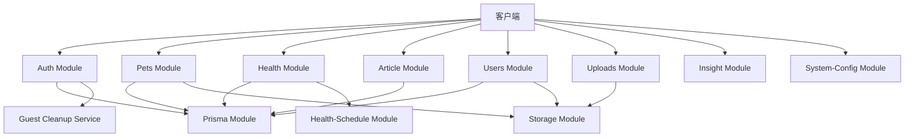
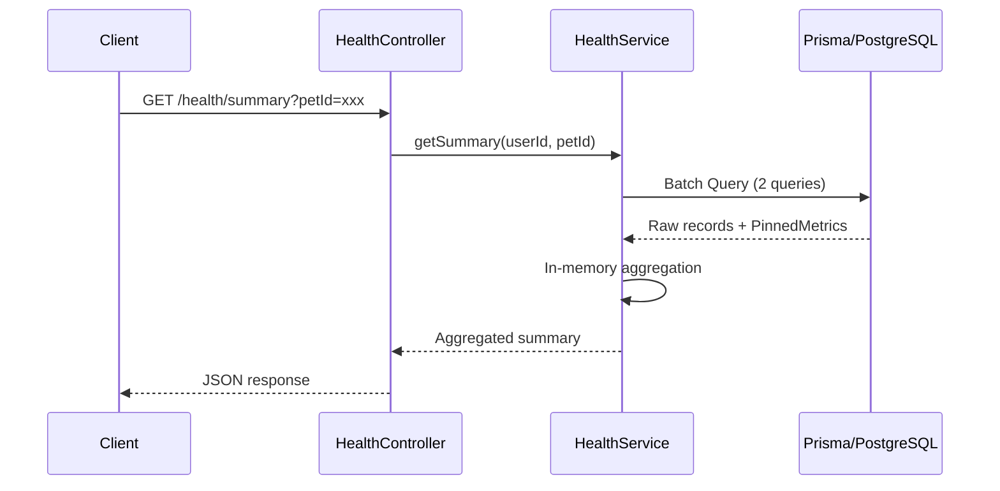
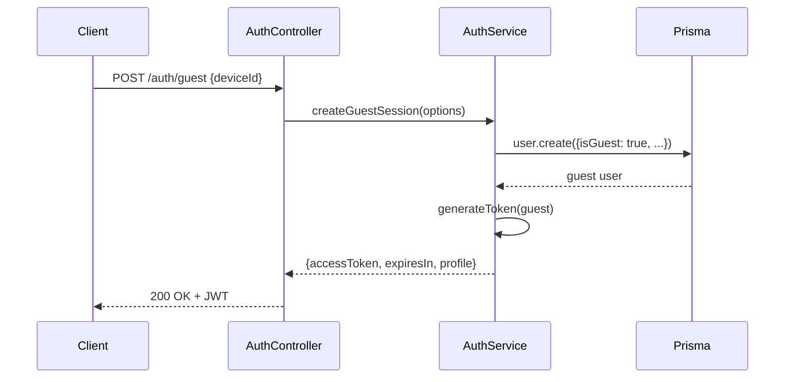
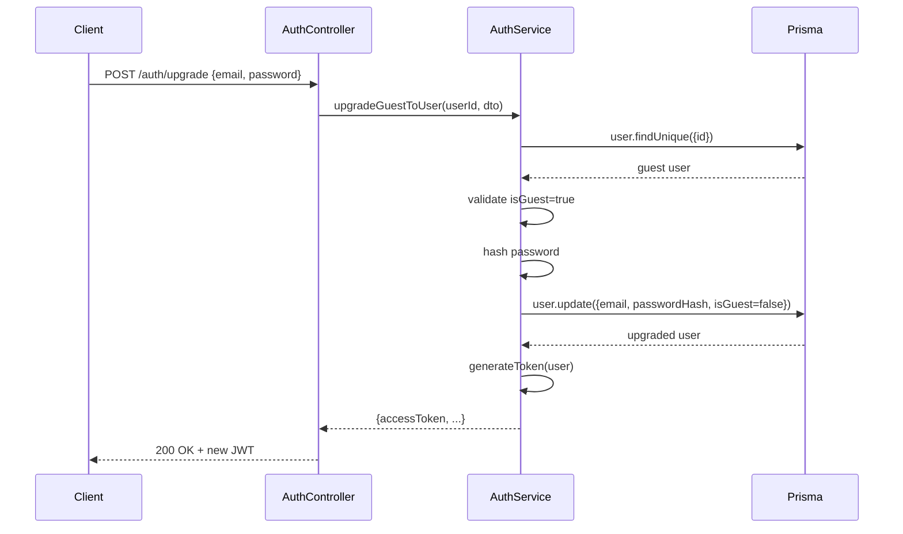
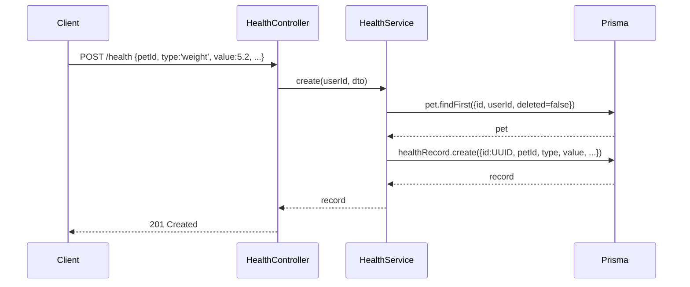
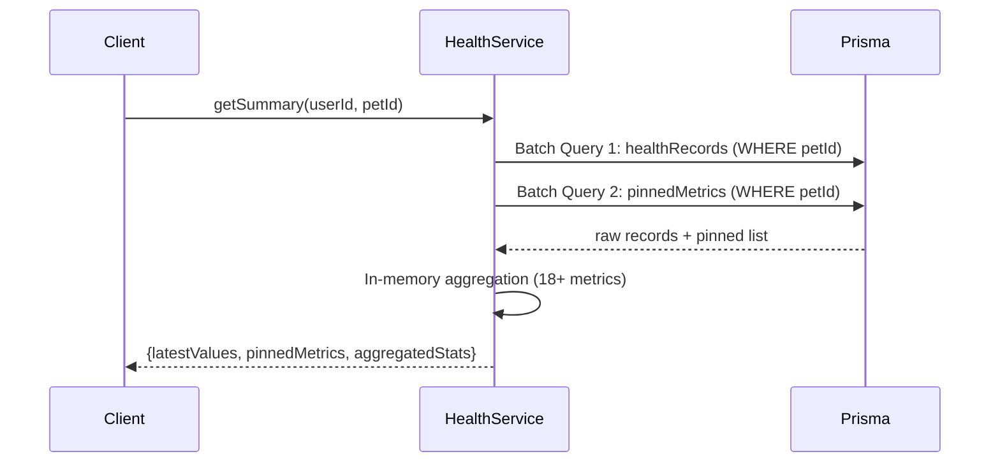
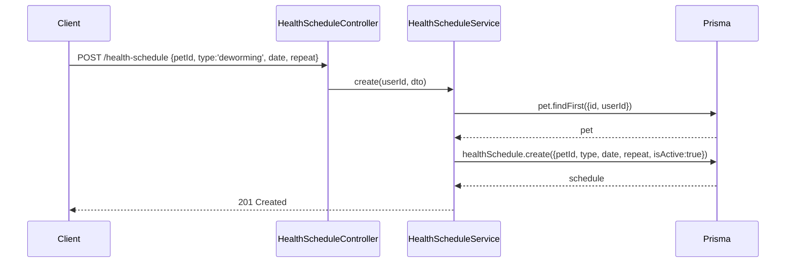
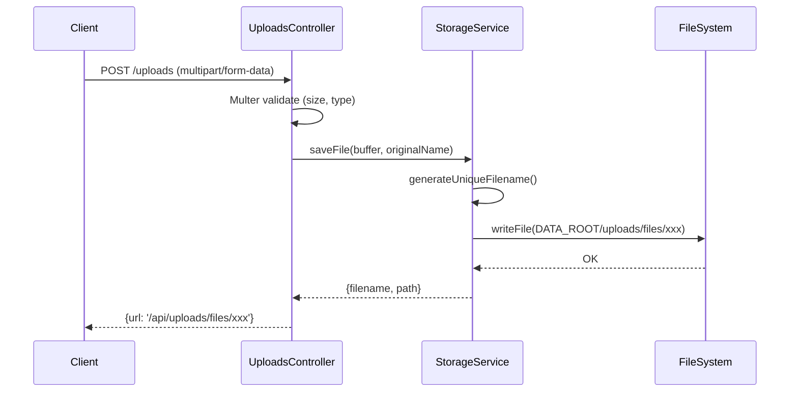
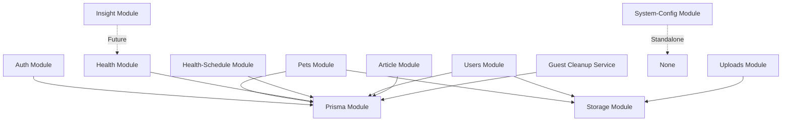
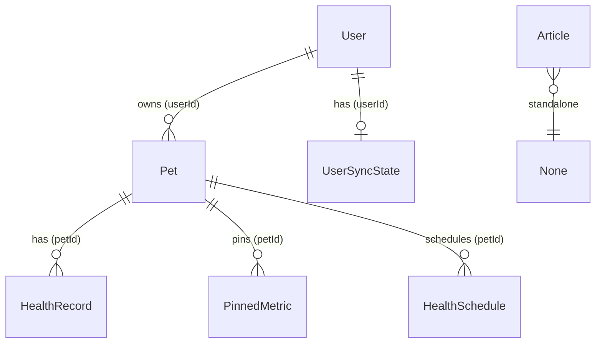

# iPet-BackEnd 业务域与边界分析

> **文档版本**: v1.0  
> **生成日期**: 2025-12-20  
> **维护负责**: Backend Team

---

## 一、整体架构概览

### 1.1 技术栈

- **框架**: NestJS 11.x (Node.js)
- **数据库**: PostgreSQL + Prisma ORM
- **认证**: JWT (jsonwebtoken)
- **缓存**: Cache Manager
- **限流**: @nestjs/throttler
- **文件上传**: Multer
- **其他**: bcrypt (密码加密), compression (响应压缩)

### 1.2 核心模块概览



---

## 二、业务域划分

iPet-BackEnd 系统按业务职责划分为以下 **5 个核心业务域**:

### 2.1 认证与授权域 (Authentication & Authorization)

**负责模块**: `auth`, `guest`

**业务边界**:
- ✅ **做什么**: 用户身份验证、游客账号创建、JWT令牌管理、账号升级
- ❌ **不做什么**: 用户资料管理、权限细粒度控制(当前仅基于token的用户级别鉴权)

---

### 2.2 宠物管理域 (Pet Management)

**负责模块**: `pets`

**业务边界**:
- ✅ **做什么**: 宠物档案的CRUD、宠物基本信息管理、宠物头像管理
- ❌ **不做什么**: 健康记录管理(属于Health域)、数据统计分析(属于Insight域)

---

### 2.3 健康追踪域 (Health Tracking)

**负责模块**: `health`, `health-schedule`, `insight`

**业务边界**:
- ✅ **做什么**: 
  - 健康记录的CRUD
  - 健康数据汇总与趋势分析
  - 指标固定(Pin/Unpin)
  - 健康日程管理(疫苗、驱虫等)
  - 健康洞察与建议生成
- ❌ **不做什么**: 
  - 宠物基础信息管理(属于Pets域)
  - 实际的AI算法实现(Insight当前为占位实现)

---

### 2.4 内容管理域 (Content Management)

**负责模块**: `article`, `system-config`

**业务边界**:
- ✅ **做什么**: 
  - 文章的CRUD(教育、食谱、科普)
  - 系统配置项管理(兜底数据、全局配置)
- ❌ **不做什么**: 
  - 用户生成内容(UGC)管理
  - 复杂的CMS功能(版本控制、审核流程等)

---

### 2.5 基础设施域 (Infrastructure)

**负责模块**: `prisma`, `storage`, `uploads`, `users`

**业务边界**:
- ✅ **做什么**: 
  - 数据库连接管理
  - 文件存储抽象
  - 文件上传处理
  - 用户账号信息管理
- ❌ **不做什么**: 
  - 分布式存储(当前为本地文件存储)
  - CDN集成

---

## 三、模块职责边界详解

### 3.1 Auth Module

#### 职责范围

| 功能 | 职责 | 不负责 |
|------|------|--------|
| **游客会话** | 创建临时游客账号、生成JWT | 游客数据清理(由GuestCleanupService负责) |
| **登录认证** | 邮箱密码验证、Token签发 | 密码重置、二次验证 |
| **账号升级** | 游客转正式用户 | 用户资料完善 |
| **Token刷新** | 旧Token换新Token(支持过期Token) | Token黑名单管理 |

#### 核心约束

- **Token有效期**: 30天
- **密码加盐轮次**: 12轮 bcrypt
- **限流策略**: 
  - 游客创建: 5次/小时
  - 登录: 3次/分钟
  - 刷新: 5次/分钟

#### API端点

```typescript
POST /auth/guest          // 创建游客会话
POST /auth/login          // 邮箱密码登录
POST /auth/upgrade        // 游客升级(需认证)
POST /auth/refresh        // Token刷新
POST /auth/logout         // 登出(客户端清除Token)
```

---

### 3.2 Pets Module

#### 职责范围

| 功能 | 职责 | 不负责 |
|------|------|--------|
| **宠物档案** | 创建、读取、更新、删除宠物信息 | 健康数据管理 |
| **头像管理** | 上传头像、删除旧头像 | 图片压缩、水印 |
| **数据隔离** | 确保用户只能访问自己的宠物 | 多用户共享宠物 |

#### 核心约束

- **宠物ID**: 由客户端生成UUID(服务端直接使用)
- **软删除**: `deleted=true` 标记,保留数据
- **默认固定指标**: 创建宠物时自动固定4个健康指标(weight, shoulder_height, meal, water)
- **性格数据**: JSON序列化存储

#### 数据模型依赖

```prisma
model Pet {
  id        String   @id // UUID from client
  userId    String
  user      User     @relation(...)
  
  // 基本信息
  name      String
  type      String?  // 宠物类型
  breed     String?  // 品种
  age       Int?
  weight    Float?
  gender    String?
  
  // 扩展信息
  personality  String? // JSON
  isSterilized Boolean
  
  // 关联关系
  healthRecords   HealthRecord[]
  pinnedMetrics   PinnedMetric[]
  healthSchedules HealthSchedule[]
}
```

---

### 3.3 Health Module

#### 职责范围

| 功能 | 职责 | 不负责 |
|------|------|--------|
| **记录管理** | 健康记录CRUD、批量查询 | 记录的AI分析 |
| **数据汇总** | 单宠物健康摘要、多指标聚合 | 跨宠物对比 |
| **指标固定** | Pin/Unpin健康指标 | 固定数量限制 |
| **时序数据** | 按时间范围聚合、分桶统计 | 实时流式数据 |

#### 核心约束

- **记录ID**: UUID from client
- **软删除**: `deleted=true`
- **性能优化**: 
  - Summary接口使用批量查询+内存聚合(P95 ~20ms)
  - Series接口服务端预聚合,避免客户端主线程阻塞
- **Schema自愈**: 自动检测并创建缺失的表/索引

#### 关键API

```typescript
POST   /health                // 创建健康记录
GET    /health                // 分页查询(支持petId, type过滤)
GET    /health/summary        // 获取宠物健康摘要(18+ metrics)
GET    /health/series         // 获取预聚合时序数据
PATCH  /health/:id            // 更新记录
DELETE /health/:id            // 删除记录
POST   /health/metrics/pin    // 固定/取消固定指标
```

#### 数据流



---

### 3.4 Health-Schedule Module

#### 职责范围

| 功能 | 职责 | 不负责 |
|------|------|--------|
| **日程管理** | 创建、查询、删除健康日程 | 自动提醒、推送通知 |
| **周期规则** | 存储重复规则(none, month, month_3等) | 规则的自动执行 |
| **权限校验** | 确保用户只能管理自己宠物的日程 | 跨用户日程共享 |

#### 核心约束

- **单宠物单类型**: 当前设计偏向"下次日程"(可创建多条,前端筛选最近)
- **激活状态**: `isActive=true` 筛选有效日程
- **时间存储**: `date` (DateTime) + `time` (String, HH:mm)

---

### 3.5 Users Module

#### 职责范围

| 功能 | 职责 | 不负责 |
|------|------|--------|
| **账号注册** | 创建正式用户账号 | 邮箱验证 |
| **资料管理** | 更新个人信息、头像、MBTI等 | 社交关系 |
| **实名认证** | 存储真实姓名、身份证(简化实现) | 实际验证逻辑 |
| **账号注销** | 级联删除用户及关联数据 | 数据归档、软删除 |

#### 核心约束

- **邮箱规范化**: `normalizeEmail()` 统一格式
- **密码加密**: bcrypt 12轮
- **游客兼容**: `isGuest` 字段区分游客与正式用户
- **级联删除**: 删除用户时自动删除 Pets → HealthRecords, HealthSchedules, PinnedMetrics

#### 数据模型关键字段

```prisma
model User {
  id           String   @id @default(cuid())
  email        String?  @unique
  passwordHash String?
  
  // Profile
  displayName  String?
  avatar       String?
  bio          String?
  mbti         String?
  tags         String? // JSON
  
  // Membership
  membershipLevel    String?
  membershipExpireAt DateTime?
  
  // Guest support
  isGuest        Boolean  @default(false)
  lastActiveAt   DateTime
  guestDeviceId  String?
}
```

---

### 3.6 Article Module

#### 职责范围

| 功能 | 职责 | 不负责 |
|------|------|--------|
| **内容管理** | 文章CRUD、分类筛选 | 富文本编辑器 |
| **统计** | 浏览量、点赞数记录 | 防刷机制 |
| **分类** | education, recipe, mythbust | 动态分类体系 |

#### 核心约束

- **内容格式**: HTML或Markdown(由前端决定)
- **分页**: 默认分页查询
- **索引优化**: `(category, createdAt DESC)` 联合索引

---

### 3.7 Insight Module

#### 职责范围

| 功能 | 职责 | 不负责 |
|------|------|--------|
| **趋势洞察** | 基于趋势方向返回简单建议 | 复杂AI分析 |
| **健康贴士** | 静态健康建议 | 个性化推荐 |

#### 当前实现

> ⚠️ **占位实现**: 当前为硬编码规则,未集成实际AI模型

```typescript
getTrendInsight(key: string, direction: string) {
  const insights = {
    up: '呈上升趋势',
    down: '呈下降趋势',
    stable: '保持稳定'
  };
  return { suggestion: insights[direction] || '暂无建议' };
}
```

---

### 3.8 Storage & Uploads Module

#### Storage Service

**职责**: 文件存储抽象层

- ✅ 保存文件到本地 `DATA_ROOT/uploads/`
- ✅ 删除文件
- ✅ 生成唯一文件名
- ❌ 不负责: 云存储集成、CDN

#### Uploads Controller

**职责**: 文件上传HTTP端点

- ✅ 处理 multipart/form-data
- ✅ 文件类型验证(images, videos)
- ✅ 大小限制(50MB)
- ❌ 不负责: 图片压缩、病毒扫描

#### 文件路径规则

```
${DATA_ROOT}/uploads/files/${uniqueFilename}
访问路径: /api/uploads/files/${uniqueFilename}
```

---

### 3.9 System-Config Module

#### 职责范围

| 功能 | 职责 | 不负责 |
|------|------|--------|
| **全局配置** | 返回前端所需的全局配置项 | 配置持久化(当前硬编码) |
| **兜底数据** | 提供默认的健康指标配置 | 动态配置管理 |

#### 当前实现

```typescript
getMetricOptions() {
  return {
    metricDefinitions: [...],      // 硬编码指标定义
    defaultPinnedMetrics: [...]    // 默认固定指标
  };
}
```

---

### 3.10 Guest Cleanup Service

#### 职责范围

- **自动清理**: 定期清理超过30天未活跃的游客账号
- **数据完整性**: 级联删除游客的宠物、健康记录等

#### 当前状态

> ⚠️ **未激活**: 代码已注入AppModule,但未配置定时任务

---

## 四、核心用例与业务流程

### 4.1 用户认证流程

#### 用例1: 游客快速体验



**状态变化**:
1. User表新增记录: `isGuest=true`, `lastActiveAt=now`
2. 客户端获得30天有效JWT

---

#### 用例2: 游客升级为正式用户



**状态变化**:
1. User记录更新: `isGuest=false`, `email=xxx`, `passwordHash=xxx`
2. 游客数据(宠物、健康记录)保留
3. 签发新JWT(payload包含email)

---

#### 用例3: Token刷新

**关键设计**: 允许**过期Token**刷新(ignoreExpiration)

```typescript
// auth.service.ts
const payload = verify(token, this.jwtSecret, { 
  ignoreExpiration: true  // 允许过期Token
});
const newToken = sign(newPayload, this.jwtSecret, { 
  expiresIn: 30 * 24 * 60 * 60 
});
```

---

### 4.2 宠物健康数据追踪流程

#### 用例4: 记录一次体重测量



**状态变化**:
1. HealthRecord表新增记录
2. `updatedAt` 自动更新
3. 数据可用于后续汇总

---

#### 用例5: 查看宠物健康摘要

**性能要求**: P95 < 20ms



**优化策略**:
- 批量查询替代N+1
- 内存聚合替代多次数据库聚合
- 索引优化: `idx_health_record_pet_date`

---

#### 用例6: 设置健康日程



**状态变化**:
1. HealthSchedule表新增记录
2. `isActive=true` 标记为活跃
3. 前端可按type查询最近日程

---

### 4.3 文件上传流程



---

## 五、依赖关系图

### 5.1 模块依赖



### 5.2 表依赖关系



**级联删除规则**:
- 删除 User → 删除 Pets → 删除 HealthRecords, PinnedMetrics, HealthSchedules
- 删除 Pet (Cascade) → 删除关联的 HealthRecords, PinnedMetrics, HealthSchedules

---

### 5.3 服务间调用

| 调用方 | 被调用方 | 目的 |
|--------|---------|------|
| PetsService | StorageService | 删除旧头像 |
| UsersService | StorageService | 删除用户/宠物头像 |
| UploadsController | StorageService | 保存上传文件 |
| 所有Service | PrismaService | 数据库操作 |

---

## 六、领域模型与关键约束

### 6.1 数据不变量

#### User

| 不变量 | 描述 | 校验位置 |
|--------|------|---------|
| **Email唯一性** | 正式用户邮箱不可重复 | Prisma unique约束 + Service层 |
| **游客无邮箱** | `isGuest=true` 时 `email=null` | AuthService |
| **密码哈希存储** | 明文密码永不落库 | bcrypt 12轮 |

#### Pet

| 不变量 | 描述 | 校验位置 |
|--------|------|---------|
| **ID由客户端生成** | 服务端直接使用UUID | DTO validation |
| **用户隔离** | 用户只能访问自己的宠物 | Controller层校验 `userId` |
| **软删除** | `deleted=true` 保留数据 | Service层 |

#### HealthRecord

| 不变量 | 描述 | 校验位置 |
|--------|------|---------|
| **必须关联宠物** | `petId` 外键约束 | Prisma schema |
| **用户间接隔离** | 通过 Pet.userId 校验 | Service层查宠物归属 |
| **软删除** | `deleted=true` | Service层 |

---

### 6.2 校验规则

#### CreatePetDto

```typescript
class CreatePetDto {
  @IsString() name: string;
  
  @IsOptional()
  @IsIn(['dog', 'cat', 'other'])
  type?: string;
  
  @IsOptional()
  @IsInt()
  @Min(0)
  age?: number;
  
  @IsOptional()
  @IsNumber()
  @Min(0)
  weight?: number;
  
  @IsOptional()
  @IsArray()
  personality?: string[];
}
```

#### CreateHealthRecordDto

```typescript
class CreateHealthRecordDto {
  @IsString() petId: string;
  @IsString() type: string;
  @IsNumber() value: number;
  @IsString() unit: string;
  @IsString() date: string; // ISO timestamp or YYYY-MM-DD
  
  @IsOptional()
  @IsString() notes?: string;
}
```

---

### 6.3 权限规则

#### 认证级别

1. **公开端点**: 
   - `POST /auth/guest`
   - `POST /auth/login`
   - `POST /auth/refresh`

2. **需认证**: 所有其他端点(通过全局 `JwtAuthGuard`)

#### 数据隔离规则

```typescript
// 模式1: 直接校验userId
const pet = await this.prisma.pet.findFirst({
  where: { id, userId, deleted: false }
});

// 模式2: 通过关联表间接校验
const record = await this.prisma.healthRecord.findFirst({
  where: { id },
  include: { pet: true }
});
if (record.pet.userId !== userId) {
  throw new NotFoundException();
}
```

---

### 6.4 性能约束

#### 关键性能指标

| 接口 | P95 目标 | 优化手段 |
|------|---------|---------|
| `GET /health/summary` | < 20ms | 批量查询 + 内存聚合 |
| `GET /health/series` | < 50ms | 服务端预聚合 + 分桶 |
| `GET /pets` | < 10ms | 索引优化 `idx_pet_user_active` |

#### 数据库索引

```sql
-- Prisma schema 已定义
idx_pet_user_active: (userId, deleted)
idx_health_record_pet_date: (petId, date DESC)
idx_article_category_created: (category, createdAt DESC)
idx_health_schedule_pet_active: (petId, isActive, date)
users_guest_last_active: (isGuest, lastActiveAt)
```

---

### 6.5 数据一致性保证

#### 事务使用场景

1. **用户注销**: 
```typescript
await this.prisma.$transaction(async (tx) => {
  await tx.pet.deleteMany({ where: { userId } });
  await tx.userSyncState.deleteMany({ where: { userId } });
  await tx.user.delete({ where: { id: userId } });
});
```

2. **游客升级**: 使用 `update` 的原子性保证邮箱唯一性

#### 幂等性设计

- **健康记录**: 客户端生成UUID作为ID,重复POST返回409 Conflict(Prisma P2002)
- **宠物创建**: 同上
- **Token刷新**: 无状态JWT,天然幂等

---

## 七、风险与改进建议

### 7.1 当前限制

| 限制 | 影响 | 建议改进 |
|------|------|---------|
| **本地文件存储** | 单机部署限制,无法水平扩展 | 集成OSS(阿里云/腾讯云) |
| **Guest清理未激活** | 数据库膨胀风险 | 启用定时任务(Cron) |
| **Insight为占位实现** | 无实际AI能力 | 集成第三方AI API或训练模型 |
| **无邮箱验证** | 虚假注册风险 | 添加验证码服务 |
| **Token无黑名单** | 登出后Token仍有效 | Redis黑名单或短期Token |
| **缺少审计日志** | 无操作溯源 | 增加AuditLog表 |

---

### 7.2 技术债

1. **HealthService**: Schema自愈逻辑应移至Migration
2. **PetsController**: 重复的 `userId` 校验代码可提取为Decorator
3. **SystemConfig**: 硬编码配置应持久化到数据库
4. **Article**: 缺少内容审核机制

---

### 7.3 扩展性建议

#### 水平扩展

- 文件存储 → 对象存储(OSS)
- 数据库 → 读写分离 + 连接池优化
- 缓存 → Redis集群
- 会话 → Stateless JWT(当前已实现)

#### 功能扩展

- 多宠物对比看板
- 健康报告导出(PDF)
- 宠物社交(分享、关注)
- 疫苗提醒推送(APNs/FCM)

---

## 八、总结

### 8.1 架构优势

✅ **清晰的模块边界**: 职责单一,低耦合  
✅ **成熟的技术栈**: NestJS + Prisma 开发效率高  
✅ **性能优化**: 批量查询、索引优化、服务端聚合  
✅ **游客友好**: 低门槛体验,平滑升级  

### 8.2 核心特性

1. **JWT Stateless认证**: 轻量级,易扩展
2. **软删除设计**: 数据可恢复
3. **客户端生成ID**: 离线操作友好,避免同步冲突
4. **级联删除**: 保证数据完整性

### 8.3 维护建议

- **文档同步**: Schema变更后及时更新本文档
- **性能监控**: 关注 P95 指标,及时优化慢查询
- **安全审计**: 定期检查依赖漏洞(`npm audit`)
- **单元测试**: 补充核心业务逻辑测试(当前缺失)

---

**文档维护**: 随着业务演进,请及时更新本文档以反映实际架构状态。
