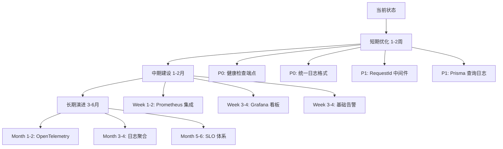

# iPet Backend 可观测性分析

## 一、可观测性目标

### 1.1 定位能力要求

**核心目标**: 线上问题 10 分钟内定位到模块/接口/SQL

这一目标要求系统具备：
- **快速定位能力**: 从问题发现到根因定位 ≤ 10 分钟
- **精准度要求**: 能准确定位到具体模块、接口、SQL 语句
- **完整链路追踪**: 请求从入口到出口的完整执行路径可追溯

### 1.2 当前现状

#### ✅ 已实现的能力

1. **基础日志记录**
   - 使用 NestJS Logger 记录关键事件（HealthService, GuestCleanupService, StorageService）
   - 部分控制器使用 `console.log` 记录请求参数

2. **性能意识**
   - 代码注释中记录性能优化成果（如 [getSummary](file:///Users/zhengjiyuan/Desktop/iPet/iPet-BackEnd/src-backend/health/health.service.ts#L96-L103): 180ms → 20ms）
   - 数据库查询已有索引优化（TD-008）

3. **错误处理**
   - 使用 try-catch 捕获异常
   - 通过 NestJS 内置异常抛出业务错误

#### ❌ 缺失的能力

1. **无请求追踪机制**
   - 缺少 traceId/requestId 生成与传递
   - 无法关联同一请求的多个日志条目
   - 跨服务调用无法追踪（如未来可能的微服务拆分）

2. **无运行时性能监控**
   - 缺少 HTTP 请求耗时统计
   - 无 P95/P99 等关键性能指标
   - 数据库查询耗时未记录

3. **无系统级监控**
   - 缺少错误率统计与看板
   - 无健康检查端点（/health, /metrics）
   - 磁盘空间、内存、CPU 等资源无监控

4. **无告警系统**
   - 问题发生时无主动通知
   - 依赖人工发现和日志排查

### 1.3 改进建议

#### 短期优化（1-2 周）
- ✅ 添加请求 ID 中间件
- ✅ 统一日志格式（结构化 JSON）
- ✅ 添加 Prisma 查询日志
- ✅ 实现基础健康检查端点

#### 中期建设（1-2 月）
- ✅ 集成 Prometheus + Grafana
- ✅ 实现请求耗时监控
- ✅ 添加错误率统计
- ✅ 配置基础告警规则

#### 长期演进（3-6 月）
- ✅ 引入分布式追踪（OpenTelemetry）
- ✅ 构建完整监控看板
- ✅ 实现日志聚合（ELK/Loki）
- ✅ 建立 SLO/SLA 体系

---

## 二、日志系统

### 2.1 结构化日志规范

#### 当前实现

**混合日志方式**:

1. **console.log**（不推荐）
   - 位置: [HealthController.findAll](file:///Users/zhengjiyuan/Desktop/iPet/iPet-BackEnd/src-backend/health/health.controller.ts#L14)
   - 使用场景: 请求参数记录
   ```typescript
   console.log('[HealthController] findAll called with:', { petId, page, limit, type, userId });
   ```

2. **NestJS Logger**（推荐）
   - 位置: [HealthService](file:///Users/zhengjiyuan/Desktop/iPet/iPet-BackEnd/src-backend/health/health.service.ts#L10), [GuestCleanupService](file:///Users/zhengjiyuan/Desktop/iPet/iPet-BackEnd/src-backend/guest/guest-cleanup.service.ts#L8), [StorageService](file:///Users/zhengjiyuan/Desktop/iPet/iPet-BackEnd/src-backend/storage/storage.service.ts)
   - 使用场景: 错误记录、警告信息
   ```typescript
   private readonly logger = new Logger(HealthService.name);
   this.logger.error('[HealthService] Failed to ensure health schema on startup', err?.stack);
   this.logger.warn('[HealthService] HealthRecord table missing. Creating automatically...');
   ```

#### 存在问题

| 问题 | 影响 | 位置 |
|------|------|------|
| **日志格式不统一** | 难以解析和检索 | 全代码库 |
| **缺少上下文信息** | 无法关联请求链路 | 所有日志 |
| **日志级别不规范** | info/warn/error 使用不一致 | 多处 |
| **时间戳不统一** | console.log 时间戳格式与 Logger 不同 | Controller 层 |
| **敏感信息可能泄露** | 请求参数直接记录，未脱敏 | HealthController |

#### 改进方案

**1. 统一日志格式（结构化 JSON）**

```typescript
// src-backend/common/logger/app-logger.service.ts
import { Injectable, LoggerService } from '@nestjs/common';

@Injectable()
export class AppLogger implements LoggerService {
  private context?: string;

  setContext(context: string) {
    this.context = context;
  }

  private formatLog(level: string, message: string, data?: any) {
    return JSON.stringify({
      timestamp: new Date().toISOString(),
      level,
      context: this.context,
      message,
      ...data,
      // traceId will be added by middleware
    });
  }

  log(message: string, data?: any) {
    console.log(this.formatLog('info', message, data));
  }

  error(message: string, trace?: string, data?: any) {
    console.error(this.formatLog('error', message, { trace, ...data }));
  }

  warn(message: string, data?: any) {
    console.warn(this.formatLog('warn', message, data));
  }
}
```

**2. 敏感信息脱敏**

```typescript
// 在记录请求参数前脱敏
const sanitizedParams = {
  petId: petId?.slice(0, 8) + '***',  // 部分遮蔽
  userId: '***',  // 完全隐藏
  page,
  limit,
  type
};
this.logger.log('Request received', sanitizedParams);
```

**3. 推荐日志级别使用规范**

- **error**: 系统错误、异常、需要立即处理的问题
- **warn**: 潜在问题、降级操作、表结构自动恢复
- **info**: 关键业务事件、性能优化记录、启动/关闭
- **debug**: 调试信息、详细执行流程（生产环境关闭）

### 2.2 TraceId 贯穿机制

#### 当前实现

**❌ 未实现任何追踪机制**

- 无 traceId/requestId 生成
- JWT payload 包含 uid，但未用于日志关联
- 多个日志条目无法关联到同一请求

#### 存在问题

**无法回答以下问题**:
- ❓ 用户 A 在 14:35:22 的请求经过了哪些模块？
- ❓ 某个错误日志对应的是哪个 API 请求？
- ❓ 一个耗时 500ms 的请求，时间都消耗在哪里？

#### 改进方案

**1. RequestId 中间件**

```typescript
// src-backend/common/middleware/request-id.middleware.ts
import { Injectable, NestMiddleware } from '@nestjs/common';
import { Request, Response, NextFunction } from 'express';
import { v4 as uuidv4 } from 'uuid';

@Injectable()
export class RequestIdMiddleware implements NestMiddleware {
  use(req: Request, res: Response, next: NextFunction) {
    const requestId = req.headers['x-request-id'] || uuidv4();
    req['requestId'] = requestId;
    res.setHeader('X-Request-Id', requestId);
    next();
  }
}
```

**2. 日志拦截器（自动注入 requestId）**

```typescript
// src-backend/common/interceptors/logging.interceptor.ts
import { Injectable, NestInterceptor, ExecutionContext, CallHandler } from '@nestjs/common';
import { Observable } from 'rxjs';
import { tap } from 'rxjs/operators';

@Injectable()
export class LoggingInterceptor implements NestInterceptor {
  intercept(context: ExecutionContext, next: CallHandler): Observable<any> {
    const request = context.switchToHttp().getRequest();
    const requestId = request.requestId;
    const method = request.method;
    const url = request.url;
    const startTime = Date.now();

    return next.handle().pipe(
      tap(() => {
        const duration = Date.now() - startTime;
        console.log(JSON.stringify({
          requestId,
          method,
          url,
          duration,
          timestamp: new Date().toISOString(),
        }));
      }),
    );
  }
}
```

**3. 在 main.ts 中注册**

```typescript
// src-backend/main.ts
import { RequestIdMiddleware } from './common/middleware/request-id.middleware';

async function bootstrap() {
  const app = await NestFactory.create(AppModule);
  
  // 全局拦截器
  app.useGlobalInterceptors(new LoggingInterceptor());
  
  await app.listen(3000);
}
```

**4. 在 AppModule 中配置中间件**

```typescript
// src-backend/app.module.ts
export class AppModule implements NestModule {
  configure(consumer: MiddlewareConsumer) {
    consumer
      .apply(RequestIdMiddleware)
      .forRoutes('*');
  }
}
```

### 2.3 关键事件埋点

#### 当前埋点清单

| 模块 | 事件 | 位置 | 日志级别 |
|------|------|------|----------|
| **GuestCleanupService** | 清理过期游客账号 | [runOnce](file:///Users/zhengjiyuan/Desktop/iPet/iPet-BackEnd/src-backend/guest/guest-cleanup.service.ts#L20-L21) | warn |
| **GuestCleanupService** | 删除单个账号失败 | [runOnce](file:///Users/zhengjiyuan/Desktop/iPet/iPet-BackEnd/src-backend/guest/guest-cleanup.service.ts#L29) | error |
| **GuestCleanupService** | 清理任务整体失败 | [runOnce](file:///Users/zhengjiyuan/Desktop/iPet/iPet-BackEnd/src-backend/guest/guest-cleanup.service.ts#L32) | error |
| **HealthService** | 表结构同步失败 | [onModuleInit](file:///Users/zhengjiyuan/Desktop/iPet/iPet-BackEnd/src-backend/health/health.service.ts#L23) | error |
| **HealthService** | 表缺失自动创建 | [syncSchema](file:///Users/zhengjiyuan/Desktop/iPet/iPet-BackEnd/src-backend/health/health.service.ts#L595) | warn |
| **HealthService** | 索引创建完成 | [ensureHealthIndexes](file:///Users/zhengjiyuan/Desktop/iPet/iPet-BackEnd/src-backend/health/health.service.ts#L734) | log |
| **StorageService** | 文件删除失败 | [deleteFile](file:///Users/zhengjiyuan/Desktop/iPet/iPet-BackEnd/src-backend/storage/storage.service.ts) | error |
| **StorageService** | 文件不存在 | [deleteFile](file:///Users/zhengjiyuan/Desktop/iPet/iPet-BackEnd/src-backend/storage/storage.service.ts) | warn |
| **HealthController** | 请求参数（console.log）| [findAll](file:///Users/zhengjiyuan/Desktop/iPet/iPet-BackEnd/src-backend/health/health.controller.ts#L14) | - |

#### 缺失埋点

**关键业务路径未覆盖**:

| 缺失事件 | 重要性 | 建议位置 |
|---------|--------|---------|
| **用户注册/登录** | 🔴 高 | AuthService |
| **JWT Token 生成/刷新** | 🔴 高 | AuthService.generateToken |
| **上传文件** | 🟡 中 | UploadsService |
| **创建宠物** | 🟡 中 | PetsService |
| **健康记录 CRUD** | 🟡 中 | HealthService.create/update/remove |
| **数据库连接失败** | 🔴 高 | PrismaService.onModuleInit |
| **定时任务执行** | 🟡 中 | GuestCleanupService（已有部分） |
| **限流触发** | 🟢 低 | ThrottlerGuard |

#### 改进方案

**1. 关键操作埋点示例**

```typescript
// AuthService - 登录埋点
async login(dto: LoginDto, ip: string) {
  const startTime = Date.now();
  try {
    const user = await this.validateUser(dto.account, dto.password);
    const token = this.generateToken(user);
    
    this.logger.log('User login successful', {
      userId: user.id,
      ip,
      duration: Date.now() - startTime,
    });
    
    return token;
  } catch (error) {
    this.logger.error('User login failed', error.stack, {
      account: dto.account,
      ip,
      duration: Date.now() - startTime,
    });
    throw error;
  }
}
```

**2. 数据库操作埋点（Prisma Middleware）**

```typescript
// src-backend/prisma/prisma.service.ts
constructor(private readonly configService: ConfigService) {
  // ... existing code ...

  // Query logging middleware
  this.$use(async (params, next) => {
    const before = Date.now();
    const result = await next(params);
    const after = Date.now();
    
    const duration = after - before;
    
    // 记录慢查询（>100ms）
    if (duration > 100) {
      console.log(JSON.stringify({
        type: 'slow_query',
        model: params.model,
        action: params.action,
        duration,
        timestamp: new Date().toISOString(),
      }));
    }
    
    return result;
  });
}
```

---

## 三、监控指标

### 3.1 请求耗时监控

#### 当前实现

**❌ 无运行时监控**

代码中有性能优化的注释记录：
- [getSummary 优化](file:///Users/zhengjiyuan/Desktop/iPet/iPet-BackEnd/src-backend/health/health.service.ts#L96-L103): 从 180ms 降至 20ms（89% 提升）
- [getMetricSeries 优化](file:///Users/zhengjiyuan/Desktop/iPet/iPet-BackEnd/src-backend/health/health.service.ts#L261-L275): 服务端聚合，客户端处理从 100-200ms 降至 <10ms

但这些都是**离线分析结果**，不是**运行时监控数据**。

#### 存在问题

- ❌ 无法实时查看 API 请求耗时
- ❌ 不知道哪些接口是慢接口
- ❌ 无 P95/P99 等百分位数指标
- ❌ 无法对比不同时间段的性能变化

#### 改进方案

**1. HTTP 请求拦截器（收集耗时）**

```typescript
// src-backend/common/interceptors/performance.interceptor.ts
import { Injectable, NestInterceptor, ExecutionContext, CallHandler } from '@nestjs/common';
import { Observable } from 'rxjs';
import { tap } from 'rxjs/operators';
import { PrometheusService } from '../metrics/prometheus.service';

@Injectable()
export class PerformanceInterceptor implements NestInterceptor {
  constructor(private readonly metricsService: PrometheusService) {}

  intercept(context: ExecutionContext, next: CallHandler): Observable<any> {
    const request = context.switchToHttp().getRequest();
    const { method, url } = request;
    const startTime = Date.now();

    return next.handle().pipe(
      tap({
        next: () => {
          const duration = Date.now() - startTime;
          this.metricsService.recordHttpRequest(method, url, 200, duration);
        },
        error: (error) => {
          const duration = Date.now() - startTime;
          const statusCode = error.status || 500;
          this.metricsService.recordHttpRequest(method, url, statusCode, duration);
        },
      }),
    );
  }
}
```

**2. Prometheus 指标服务**

```typescript
// src-backend/common/metrics/prometheus.service.ts
import { Injectable } from '@nestjs/common';
import { Counter, Histogram, Registry } from 'prom-client';

@Injectable()
export class PrometheusService {
  private readonly registry: Registry;
  private readonly httpRequestDuration: Histogram;
  private readonly httpRequestTotal: Counter;

  constructor() {
    this.registry = new Registry();

    // HTTP 请求耗时直方图（用于计算 P95/P99）
    this.httpRequestDuration = new Histogram({
      name: 'http_request_duration_ms',
      help: 'Duration of HTTP requests in ms',
      labelNames: ['method', 'route', 'status_code'],
      buckets: [10, 50, 100, 200, 500, 1000, 2000, 5000],
    });

    // HTTP 请求总数计数器
    this.httpRequestTotal = new Counter({
      name: 'http_request_total',
      help: 'Total number of HTTP requests',
      labelNames: ['method', 'route', 'status_code'],
    });

    this.registry.registerMetric(this.httpRequestDuration);
    this.registry.registerMetric(this.httpRequestTotal);
  }

  recordHttpRequest(method: string, route: string, statusCode: number, duration: number) {
    this.httpRequestDuration.observe({ method, route, status_code: statusCode }, duration);
    this.httpRequestTotal.inc({ method, route, status_code: statusCode });
  }

  getMetrics(): string {
    return this.registry.metrics();
  }
}
```

**3. /metrics 端点**

```typescript
// src-backend/app.controller.ts
@Controller()
export class AppController {
  constructor(
    private readonly appService: AppService,
    private readonly metricsService: PrometheusService,
  ) {}

  @Get('metrics')
  async getMetrics() {
    return this.metricsService.getMetrics();
  }
}
```

### 3.2 数据库耗时监控

#### 当前实现

**部分支持，未启用**

- Prisma 支持查询日志和中间件
- [PrismaService](file:///Users/zhengjiyuan/Desktop/iPet/iPet-BackEnd/src-backend/prisma/prisma.service.ts) 已有 middleware 用于 ID 生成，但未用于性能监控

已有数据库索引优化：
- `idx_pet_user_active`: 用户的活跃宠物查询
- `idx_health_record_pet_date`: 健康记录日期范围查询
- `idx_article_category_created`: 文章分类查询
- `idx_health_schedule_pet_active`: 活跃健康计划查询

#### 改进方案

**1. Prisma 查询日志**

```typescript
// src-backend/prisma/prisma.service.ts
constructor(private readonly configService: ConfigService) {
  const dbUrl = configService.get<string>('databaseUrl');

  super({
    datasources: { db: { url: dbUrl } },
    log: [
      { emit: 'event', level: 'query' },
      { emit: 'event', level: 'error' },
      { emit: 'event', level: 'warn' },
    ],
  });

  // 监听查询事件
  this.$on('query', (e) => {
    if (e.duration > 100) {  // 慢查询阈值 100ms
      console.log(JSON.stringify({
        type: 'slow_query',
        query: e.query,
        params: e.params,
        duration: e.duration,
        timestamp: new Date().toISOString(),
      }));
    }
  });
}
```

**2. 数据库性能指标收集**

```typescript
// Prisma middleware for metrics
this.$use(async (params, next) => {
  const before = Date.now();
  const result = await next(params);
  const duration = Date.now() - before;

  // 记录到 Prometheus
  metricsService.recordDatabaseQuery(
    params.model,
    params.action,
    duration
  );

  return result;
});
```

### 3.3 错误率统计

#### 当前实现

**❌ 无全局错误统计**

- 使用 try-catch 捕获错误
- 通过 NestJS 异常抛出业务错误（NotFoundException, BadRequestException 等）
- 无全局 ExceptionFilter 统计错误

#### 改进方案

**全局异常过滤器**

```typescript
// src-backend/common/filters/global-exception.filter.ts
import { ExceptionFilter, Catch, ArgumentsHost, HttpException, HttpStatus } from '@nestjs/common';
import { PrometheusService } from '../metrics/prometheus.service';

@Catch()
export class GlobalExceptionFilter implements ExceptionFilter {
  constructor(private readonly metricsService: PrometheusService) {}

  catch(exception: unknown, host: ArgumentsHost) {
    const ctx = host.switchToHttp();
    const response = ctx.getResponse();
    const request = ctx.getRequest();

    const status =
      exception instanceof HttpException
        ? exception.getStatus()
        : HttpStatus.INTERNAL_SERVER_ERROR;

    const message =
      exception instanceof HttpException
        ? exception.message
        : 'Internal server error';

    // 记录错误到 Prometheus
    this.metricsService.recordError(
      request.method,
      request.url,
      status,
      exception['name'] || 'UnknownError'
    );

    // 记录错误日志
    console.error(JSON.stringify({
      type: 'error',
      requestId: request.requestId,
      method: request.method,
      url: request.url,
      status,
      message,
      stack: exception['stack'],
      timestamp: new Date().toISOString(),
    }));

    response.status(status).json({
      statusCode: status,
      message,
      timestamp: new Date().toISOString(),
      path: request.url,
    });
  }
}
```

### 3.4 队列堆积监控

#### 当前实现

**❌ 无消息队列**

- 未使用消息队列（如 Bull, RabbitMQ, Kafka）
- [GuestCleanupService](file:///Users/zhengjiyuan/Desktop/iPet/iPet-BackEnd/src-backend/guest/guest-cleanup.service.ts) 使用 `setInterval` 定时执行（6 小时）
- 无异步任务队列

#### 建议

如果未来需要异步任务处理：
1. **引入 Bull + Redis**: 用于延迟任务、重试机制
2. **监控队列深度**: 通过 Redis LLEN 命令
3. **监控消费延迟**: 记录任务入队时间与执行时间差

当前场景下，定时任务监控即可：

```typescript
// GuestCleanupService 添加指标
private async runOnce() {
  const startTime = Date.now();
  // ... existing logic ...
  const duration = Date.now() - startTime;
  
  this.logger.log('Guest cleanup completed', {
    deletedCount: expiredGuests.length,
    duration,
  });
}
```

### 3.5 磁盘空间监控

#### 当前实现

**❌ 无磁盘空间监控**

数据存储位置：
- 数据根目录: `IPET_DATA_DIR` (默认 `../iPetData`)
- 数据库: `iPetData/db/ipet.db`
- 上传文件: `iPetData/uploads/`
- 同步数据: `iPetData/sync/`

上传文件限制：
- Body limit: 20MB（配置在 [configuration.ts](file:///Users/zhengjiyuan/Desktop/iPet/iPet-BackEnd/src-backend/config/configuration.ts#L32)）
- 无单个文件大小限制
- 无总存储容量监控

#### 改进方案

**1. 磁盘空间检查服务**

```typescript
// src-backend/common/monitoring/disk-monitor.service.ts
import { Injectable, Logger } from '@nestjs/common';
import { Cron } from '@nestjs/schedule';
import * as fs from 'fs';
import * as path from 'path';

@Injectable()
export class DiskMonitorService {
  private readonly logger = new Logger(DiskMonitorService.name);

  @Cron('0 */6 * * *')  // 每 6 小时检查一次
  async checkDiskSpace() {
    const dataDir = process.env.IPET_DATA_DIR || '../iPetData';
    const stats = await this.getDiskUsage(dataDir);

    const usagePercent = (stats.used / stats.total) * 100;

    if (usagePercent > 90) {
      this.logger.error('Disk usage critical', { usagePercent, ...stats });
    } else if (usagePercent > 75) {
      this.logger.warn('Disk usage high', { usagePercent, ...stats });
    }
  }

  private async getDiskUsage(dirPath: string) {
    const stats = fs.statfsSync(dirPath);
    return {
      total: stats.blocks * stats.bsize,
      free: stats.bfree * stats.bsize,
      used: (stats.blocks - stats.bfree) * stats.bsize,
    };
  }
}
```

**2. 上传文件总量监控**

```typescript
@Cron('0 0 * * *')  // 每天午夜统计
async checkUploadsSize() {
  const uploadsDir = path.join(dataDir, 'uploads');
  const totalSize = await this.getDirectorySize(uploadsDir);
  const totalSizeGB = totalSize / (1024 ** 3);

  this.logger.log('Uploads directory size', { totalSizeGB });

  if (totalSizeGB > 50) {  // 超过 50GB 告警
    this.logger.warn('Uploads directory size exceeds threshold', { totalSizeGB });
  }
}
```

---

## 四、告警策略与阈值

### 4.1 告警配置

#### 当前实现

**❌ 无告警系统**

当前限流配置（[app.module.ts](file:///Users/zhengjiyuan/Desktop/iPet/iPet-BackEnd/src-backend/app.module.ts)）：
- 全局限流: 100 req/60s
- 登录接口: 3 req/60s（[AuthController](file:///Users/zhengjiyuan/Desktop/iPet/iPet-BackEnd/src-backend/auth/auth.controller.ts)）
- 注册接口: 3 req/60s
- 游客登录: 5 req/3600s

无健康检查端点：
- 缺少 `/health` 端点
- 缺少 `/metrics` 端点（Prometheus 格式）

### 4.2 建议阈值

基于系统特性，建议以下告警规则：

| 指标 | 级别 | 阈值 | 持续时间 | 说明 |
|------|------|------|----------|------|
| **API P95 延迟** | 🟡 warning | > 500ms | 5分钟 | 影响用户体验 |
| **API P95 延迟** | 🔴 critical | > 1000ms | 5分钟 | 严重影响用户体验 |
| **错误率** | 🟡 warning | > 1% | 5分钟 | 出现异常 |
| **错误率** | 🔴 critical | > 5% | 5分钟 | 系统严重异常 |
| **数据库慢查询** | 🟡 warning | > 100ms | 单次 | 需要优化 |
| **数据库慢查询** | 🔴 critical | > 1000ms | 单次 | 严重性能问题 |
| **磁盘使用率** | 🟡 warning | > 75% | - | 需要清理或扩容 |
| **磁盘使用率** | 🔴 critical | > 90% | - | 紧急扩容 |
| **内存使用率** | 🟡 warning | > 80% | 10分钟 | 可能内存泄漏 |
| **内存使用率** | 🔴 critical | > 95% | 5分钟 | 即将 OOM |
| **定时任务失败** | 🔴 critical | 失败 | 单次 | 影响数据一致性 |
| **JWT 签名错误** | 🔴 critical | > 10 次/分钟 | 1分钟 | 可能受到攻击 |

### 4.3 告警渠道

**推荐方案**:

1. **Prometheus AlertManager**
   - 统一告警规则管理
   - 支持告警聚合、抑制、静默

2. **通知渠道**
   - 🔴 Critical: 短信 + 电话 + 钉钉/飞书
   - 🟡 Warning: 邮件 + 钉钉/飞书
   - 🟢 Info: 仅邮件

3. **值班制度**
   - 设置值班轮换
   - 告警升级机制（5分钟未处理升级至上级）

**AlertManager 配置示例**:

```yaml
# alertmanager.yml
route:
  group_by: ['alertname', 'severity']
  group_wait: 10s
  group_interval: 10s
  repeat_interval: 1h
  receiver: 'default'
  routes:
    - match:
        severity: critical
      receiver: 'critical-alerts'
    - match:
        severity: warning
      receiver: 'warning-alerts'

receivers:
  - name: 'default'
    webhook_configs:
      - url: 'http://your-webhook-service/alerts'
  
  - name: 'critical-alerts'
    webhook_configs:
      - url: 'http://your-webhook-service/critical'
    # email_configs, pagerduty_configs, etc.
  
  - name: 'warning-alerts'
    webhook_configs:
      - url: 'http://your-webhook-service/warning'
```

---

## 五、看板设计

### 5.1 最小可用看板

#### Dashboard 1: API 性能监控

**核心指标**:
- QPS（Queries Per Second）
- P50/P95/P99 延迟
- 错误率（按状态码分类）
- Top 10 慢接口

**Grafana 示例查询（PromQL）**:

```promql
# QPS
sum(rate(http_request_total[5m])) by (route)

# P95 延迟
histogram_quantile(0.95, sum(rate(http_request_duration_ms_bucket[5m])) by (le, route))

# 错误率
sum(rate(http_request_total{status_code=~"5.."}[5m])) / sum(rate(http_request_total[5m]))
```

#### Dashboard 2: 数据库性能

**核心指标**:
- SQL 查询 QPS
- 慢查询数量（>100ms）
- 连接池使用率
- Top 10 慢查询

#### Dashboard 3: 系统资源

**核心指标**:
- CPU 使用率
- 内存使用率
- 磁盘使用率
- 网络 I/O

#### Dashboard 4: 业务指标

**核心指标**:
- 日活跃用户（DAU）
- 新增用户数
- 宠物总数
- 健康记录新增量
- 游客清理数量

### 5.2 关键指标

| 指标名称 | 类型 | 采集频率 | 保留时长 | 说明 |
|---------|------|---------|---------|------|
| `http_request_total` | Counter | 实时 | 30天 | HTTP 请求总数 |
| `http_request_duration_ms` | Histogram | 实时 | 30天 | HTTP 请求耗时 |
| `db_query_duration_ms` | Histogram | 实时 | 30天 | 数据库查询耗时 |
| `db_slow_query_total` | Counter | 实时 | 30天 | 慢查询计数 |
| `error_total` | Counter | 实时 | 90天 | 错误总数 |
| `guest_cleanup_deleted_total` | Counter | 6小时 | 90天 | 清理的游客账号数 |
| `disk_usage_bytes` | Gauge | 6小时 | 180天 | 磁盘使用量 |
| `memory_usage_bytes` | Gauge | 1分钟 | 7天 | 内存使用量 |

### 5.3 可视化方案

**技术栈**:
- **Prometheus**: 指标采集与存储
- **Grafana**: 可视化看板
- **AlertManager**: 告警管理

**部署架构**:

```
┌─────────────────┐
│  iPet Backend   │
│  (NestJS)       │
│  :3000          │
│                 │
│  /metrics       │ ◄─┐
└─────────────────┘   │
                      │ scrape
                      │
┌─────────────────┐   │
│  Prometheus     │───┘
│  :9090          │
│                 │
│  - 指标存储      │───┐
│  - PromQL查询   │   │
└─────────────────┘   │
                      │
┌─────────────────┐   │ query
│  Grafana        │───┘
│  :3001          │
│                 │
│  - 可视化看板    │
└─────────────────┘
                      
┌─────────────────┐
│  AlertManager   │
│  :9093          │
│                 │
│  - 告警路由      │
│  - 通知发送      │
└─────────────────┘
```

---

## 六、实施建议

### 6.1 短期优化（1-2周）

#### 优先级 P0（立即执行）

1. **添加健康检查端点**
   ```typescript
   @Get('health')
   getHealth() {
     return { status: 'ok', timestamp: Date.now() };
   }
   ```

2. **统一日志格式**
   - 将所有 `console.log` 替换为 `Logger`
   - 添加结构化日志格式

3. **添加 RequestId 中间件**
   - 实现请求追踪基础能力
   - 为后续分布式追踪做准备

#### 优先级 P1（本周内）

4. **启用 Prisma 查询日志**
   - 识别慢查询
   - 优化数据库性能

5. **添加请求耗时日志**
   - 在 LoggingInterceptor 中记录每个请求耗时
   - 初步建立性能基线

### 6.2 中期建设（1-2月）

#### 第 1 阶段：指标收集（Week 1-2）

1. **集成 Prometheus**
   - 安装 `prom-client`
   - 实现 PrometheusService
   - 添加 `/metrics` 端点

2. **实现核心指标**
   - HTTP 请求耗时
   - 数据库查询耗时
   - 错误率统计

#### 第 2 阶段：可视化（Week 3-4）

3. **部署 Grafana**
   - 配置 Prometheus 数据源
   - 创建 API 性能看板
   - 创建数据库性能看板

4. **配置基础告警**
   - 部署 AlertManager
   - 配置 P95 延迟告警
   - 配置错误率告警

### 6.3 长期演进（3-6月）

#### 第 1 阶段：分布式追踪（Month 1-2）

1. **引入 OpenTelemetry**
   - 自动采集请求链路
   - 集成 Jaeger 或 Zipkin
   - 可视化请求调用链

#### 第 2 阶段：日志聚合（Month 3-4）

2. **部署 ELK/Loki Stack**
   - Elasticsearch/Loki: 日志存储
   - Logstash/Promtail: 日志收集
   - Kibana/Grafana: 日志查询

#### 第 3 阶段：SLO/SLA 体系（Month 5-6）

3. **建立服务等级目标**
   - 定义核心接口 SLO（如 P95 < 500ms, 可用性 99.9%）
   - 设置错误预算（Error Budget）
   - 基于 SLO 触发告警和优化

---

## 七、技术选型建议

### 7.1 日志聚合

#### 方案对比

| 方案 | 优势 | 劣势 | 适用场景 |
|------|------|------|---------|
| **ELK Stack** | 功能强大、生态成熟 | 资源消耗大、运维复杂 | 大规模、复杂查询 |
| **Loki + Grafana** | 轻量、与 Grafana 集成好 | 查询能力弱于 ES | 中小规模、追求简洁 |
| **CloudWatch Logs** | 免运维、与 AWS 集成 | 成本高、厂商锁定 | AWS 环境 |

**推荐**: Loki + Grafana（中小规模团队首选）

### 7.2 链路追踪

#### 方案对比

| 方案 | 优势 | 劣势 | 适用场景 |
|------|------|------|---------|
| **Jaeger** | 开源标准、功能完整 | 存储依赖 Cassandra/ES | 中大规模 |
| **Zipkin** | 轻量、易部署 | 功能相对简单 | 小规模 |
| **OpenTelemetry** | 标准化、厂商中立 | 需要配套后端（Jaeger/Zipkin） | 所有场景（推荐） |
| **AWS X-Ray** | 免运维 | 厂商锁定 | AWS 环境 |

**推荐**: OpenTelemetry + Jaeger

### 7.3 指标收集

#### 方案对比

| 方案 | 优势 | 劣势 | 适用场景 |
|------|------|------|---------|
| **Prometheus + Grafana** | 行业标准、生态丰富 | 长期存储需额外方案 | 所有场景（首选） |
| **InfluxDB + Grafana** | 时序数据库专用 | 社区小于 Prometheus | 时序数据为主 |
| **Datadog** | SaaS、免运维 | 成本高 | 预算充足团队 |

**推荐**: Prometheus + Grafana

### 7.4 告警系统

#### 方案对比

| 方案 | 优势 | 劣势 | 适用场景 |
|------|------|------|---------|
| **AlertManager** | Prometheus 原生、免费 | 功能相对基础 | Prometheus 用户 |
| **PagerDuty** | 功能强大、值班管理完善 | 收费 | 大团队 |
| **自建 Webhook** | 灵活、可定制 | 需要开发和维护 | 特殊需求 |

**推荐**: AlertManager（初期） → PagerDuty（成熟期）

---

## 八、总结

### 8.1 当前可观测性成熟度

**分数**: 🔴 **2/10** (初级阶段)

| 维度 | 评分 | 说明 |
|------|------|------|
| 日志系统 | 3/10 | 有基础日志，但格式不统一，缺少 traceId |
| 链路追踪 | 0/10 | 完全缺失 |
| 指标监控 | 1/10 | 仅有代码注释中的性能记录 |
| 告警系统 | 0/10 | 完全缺失 |
| 可视化 | 0/10 | 无监控看板 |

### 8.2 风险评估

**当前风险**:
- 🔴 **高风险**: 生产问题定位时间无法保证（可能 > 1 小时）
- 🔴 **高风险**: 性能退化无法及时发现
- 🟡 **中风险**: 数据库慢查询无法识别
- 🟡 **中风险**: 系统资源耗尽无法预警

### 8.3 建议优先级



### 8.4 成功标准

**3 个月后应达到**:
- ✅ P95 请求延迟可查询
- ✅ 错误率实时监控
- ✅ 慢查询自动告警
- ✅ 核心接口有可视化看板
- ✅ 关键告警通知到人

**6 个月后应达到**:
- ✅ 完整的分布式追踪能力
- ✅ 日志聚合与全文检索
- ✅ SLO 定义与错误预算追踪
- ✅ 自动化性能回归检测
- ✅ **实现目标**: 线上问题 10 分钟内定位到模块/接口/SQL ✨
