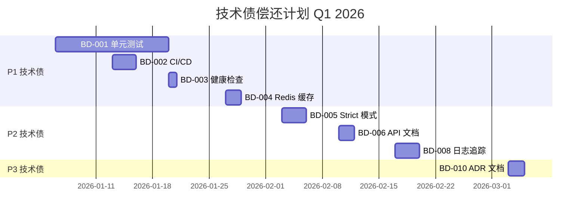

# iPet-BackEnd 工程化与质量保障

> **文档版本**: v1.0  
> **更新时间**: 2025-12-20  
> **负责人**: 技术团队  
> **文档目标**: 规范后端工程实践、保障代码质量、提升团队协作效率

---

## 一、工程化目标

### 1.1 核心原则

| 原则 | 说明 | 实施现状 |
|------|------|---------|
| **一致性** | 代码风格统一，降低协作成本 | ✅ 已落地 (ESLint + Prettier) |
| **安全性** | 构建、发布流程可追溯、可回滚 | ⚠️ 部分完成 (手动部署) |
| **可测试性** | 所有核心逻辑可自动化测试 | ❌ 缺失 |
| **可观测性** | 问题可快速定位、性能可量化 | ⚠️ 基础监控缺失 |

### 1.2 工程化成熟度评估

| 维度 | 评分 | 说明 |
|------|------|------|
| **项目结构** | ⭐⭐⭐⭐⭐ | NestJS 标准模块化架构，职责清晰 |
| **编码规范** | ⭐⭐⭐⭐ | TypeScript + ESLint + Prettier，规范完善 |
| **测试体系** | ⭐ | 无单元测试、集成测试、E2E 测试 |
| **CI/CD** | ⭐⭐ | 手动部署脚本，无自动化流水线 |
| **质量门禁** | ⭐⭐ | 本地 Lint，无 CI 检查 |
| **文档管理** | ⭐⭐⭐ | README 完善，ADR 缺失 |

---

## 二、项目结构与编码规范

### 2.1 项目架构

```
iPet-BackEnd/
├── src-backend/              # 业务代码 (NestJS sourceRoot)
│   ├── app.module.ts         # 根模块
│   ├── main.ts               # 应用入口
│   ├── auth/                 # 认证模块
│   ├── users/                # 用户模块
│   ├── pets/                 # 宠物模块
│   ├── health/               # 健康记录模块
│   ├── health-schedule/      # 健康日程模块
│   ├── article/              # 文章模块
│   ├── insight/              # 健康洞察模块
│   ├── uploads/              # 文件上传模块
│   ├── storage/              # 存储服务
│   ├── prisma/               # Prisma 服务
│   ├── config/               # 配置模块
│   ├── common/               # 公共模块 (guards, interceptors, pipes)
│   ├── utils/                # 工具函数
│   └── system-config/        # 系统配置
├── prisma/                   # 数据库 Schema 与迁移
│   ├── schema.prisma         # Prisma Schema 定义
│   ├── migrations/           # 数据库迁移历史
│   └── seed.ts               # 数据种子
├── dist/                     # 构建产物
├── node_modules/             # 依赖包
├── scripts/                  # 脚本目录 (当前为空)
├── .env                      # 环境变量 (本地开发)
├── .env.example              # 环境变量模板
├── package.json              # 项目配置
├── tsconfig.json             # TypeScript 配置
├── eslint.config.mjs         # ESLint 配置
├── .prettierrc               # Prettier 配置
├── nest-cli.json             # NestJS CLI 配置
├── pack_deploy.sh            # 部署打包脚本
├── verify_fix.sh             # API 验证脚本
└── README.md                 # 项目文档
```

### 2.2 模块组织原则

#### ✅ 当前实践

**模块化设计**
- 每个业务域独立模块 (15个模块)
- 清晰的职责边界 (controller/service/module)
- 依赖注入驱动 (NestJS IoC 容器)

**分层架构**
```
Controller 层 (路由与参数校验)
    ↓
Service 层 (业务逻辑)
    ↓
Prisma 层 (数据访问)
    ↓
PostgreSQL (数据存储)
```

**共享模块**
- `common/`: 全局守卫、拦截器、管道
- `utils/`: 纯函数工具
- `config/`: 配置管理 (ConfigModule)
- `prisma/`: 数据库客户端单例

#### 📋 改进建议

**缺少明确的接口定义层**
```typescript
// 建议补充
src-backend/
├── dto/                      # 数据传输对象
│   ├── auth.dto.ts
│   ├── user.dto.ts
│   └── pet.dto.ts
├── entities/                 # 领域实体
│   ├── user.entity.ts
│   └── pet.entity.ts
└── interfaces/               # 接口定义
    ├── auth.interface.ts
    └── repository.interface.ts
```

---

## 三、Lint/Format 约定

### 3.1 TypeScript 配置

**配置文件**: [`tsconfig.json`](file:///Users/zhengjiyuan/Desktop/iPet/iPet-BackEnd/tsconfig.json)

**关键配置**:
```json
{
  "compilerOptions": {
    "target": "ES2022",
    "module": "nodenext",
    "moduleResolution": "nodenext",
    "strict": false,                    // ⚠️ 未启用严格模式
    "strictNullChecks": true,
    "noImplicitAny": false,             // ⚠️ 允许隐式 any
    "experimentalDecorators": true,     // NestJS 必需
    "emitDecoratorMetadata": true,      // NestJS 必需
    "skipLibCheck": true
  }
}
```

**现状评估**:
- ✅ 支持最新 ES 特性 (ES2022)
- ✅ 使用最新模块解析策略 (nodenext)
- ⚠️ 类型检查不够严格 (建议启用 `strict: true`)

### 3.2 ESLint 配置

**配置文件**: [`eslint.config.mjs`](file:///Users/zhengjiyuan/Desktop/iPet/iPet-BackEnd/eslint.config.mjs)

**规则集**:
```javascript
export default tseslint.config(
  eslint.configs.recommended,            // JS 基础规则
  ...tseslint.configs.recommendedTypeChecked, // TS 类型检查
  eslintPluginPrettierRecommended,       // Prettier 集成
  {
    rules: {
      '@typescript-eslint/no-explicit-any': 'off',      // ⚠️ 允许 any
      '@typescript-eslint/no-floating-promises': 'warn', // ⚠️ 异步警告
      '@typescript-eslint/no-unsafe-argument': 'warn',   // ⚠️ 不安全参数
      'prettier/prettier': ['error', { endOfLine: 'auto' }]
    }
  }
);
```

**现状评估**:
- ✅ 集成 Prettier，避免格式冲突
- ✅ 启用 TypeScript 类型检查
- ⚠️ 关键规则降级为 `warn` 或 `off`，建议逐步收紧

### 3.3 Prettier 配置

**配置文件**: [`.prettierrc`](file:///Users/zhengjiyuan/Desktop/iPet/iPet-BackEnd/.prettierrc)

```json
{
  "singleQuote": true,
  "trailingComma": "all"
}
```

**现状评估**:
- ✅ 配置简洁，与 ESLint 集成良好
- ✅ 使用单引号 + 尾随逗号 (现代 JS 最佳实践)

### 3.4 代码质量自动化

#### 当前状态

| 工具 | 触发时机 | 状态 |
|------|---------|------|
| ESLint | 手动执行 `npm run lint` | ✅ 已配置 |
| Prettier | 手动执行 `npm run format` | ✅ 已配置 |
| Type Check | 构建时自动执行 | ✅ 已内置 |
| Git Hooks | - | ❌ 未配置 |
| CI Lint | - | ❌ 未配置 |

#### 📋 改进建议

**1. 添加 Git Hooks (Husky + lint-staged)**
```bash
npm install -D husky lint-staged

# .husky/pre-commit
npx lint-staged

# package.json
{
  "lint-staged": {
    "*.ts": [
      "eslint --fix",
      "prettier --write"
    ]
  }
}
```

**2. 本地质量门禁**
- 使用 `npm run lint` 与 `npm run build` 进行本地质量校验

---

## 四、测试策略

### 4.1 当前测试现状

#### ❌ 测试体系缺失

**package.json 分析**:
- 无测试相关依赖 (Jest/Vitest/Mocha)
- 无测试脚本 (`npm test` 未定义)
- 无测试覆盖率配置

**代码库分析**:
- 无 `*.spec.ts` 或 `*.test.ts` 文件
- 无 `__tests__/` 目录
- 无 E2E 测试

**现有验证方式**:
- ✅ 手动验证脚本: [`verify_fix.sh`](file:///Users/zhengjiyuan/Desktop/iPet/iPet-BackEnd/verify_fix.sh)
  ```bash
  # 注册 → 登录 → 创建宠物 (手动 curl 测试)
  ```

### 4.2 建议测试策略

#### 🎯 测试金字塔

```
         /\
        /  \      E2E (5%)
       /____\     - 关键业务流程 (注册/登录/宠物管理)
      /      \    
     /        \   Integration (15%)
    /__________\  - API 路由 + 数据库交互
   /            \ 
  /              \ Unit (80%)
 /________________\ - Service 层业务逻辑
                    - Utils 工具函数
```

#### 📋 推荐测试框架

**单元测试 + 集成测试**: Jest (NestJS 官方推荐)
```bash
npm install -D @nestjs/testing jest @types/jest ts-jest
```

**E2E 测试**: Supertest
```bash
npm install -D supertest @types/supertest
```

**测试配置**:
```json
// package.json
{
  "scripts": {
    "test": "jest",
    "test:watch": "jest --watch",
    "test:cov": "jest --coverage",
    "test:e2e": "jest --config ./test/jest-e2e.json"
  },
  "jest": {
    "moduleFileExtensions": ["js", "json", "ts"],
    "rootDir": "src-backend",
    "testRegex": ".*\\.spec\\.ts$",
    "transform": {
      "^.+\\.(t|j)s$": "ts-jest"
    },
    "collectCoverageFrom": [
      "**/*.(t|j)s",
      "!**/*.module.ts"
    ],
    "coverageDirectory": "../coverage",
    "testEnvironment": "node"
  }
}
```

### 4.3 测试数据构造策略

#### 推荐方案: Factory Pattern + Test Fixtures

**1. 数据工厂 (test/factories/)**
```typescript
// test/factories/user.factory.ts
import { faker } from '@faker-js/faker';

export const createMockUser = (overrides = {}) => ({
  id: faker.string.uuid(),
  email: faker.internet.email(),
  isGuest: false,
  displayName: faker.person.fullName(),
  ...overrides,
});
```

**2. Prisma Mock (jest-mock-extended)**
```typescript
import { mockDeep, mockReset, DeepMockProxy } from 'jest-mock-extended';
import { PrismaClient } from '@prisma/client';

export const prismaMock = mockDeep<PrismaClient>();

beforeEach(() => {
  mockReset(prismaMock);
});
```

**3. 测试示例**
```typescript
// src-backend/users/users.service.spec.ts
describe('UsersService', () => {
  let service: UsersService;
  let prisma: DeepMockProxy<PrismaClient>;

  beforeEach(() => {
    prisma = prismaMock;
    service = new UsersService(prisma);
  });

  it('should find user by id', async () => {
    const mockUser = createMockUser({ id: 'test-123' });
    prisma.user.findUnique.mockResolvedValue(mockUser);

    const result = await service.findById('test-123');
    expect(result).toEqual(mockUser);
  });
});
```

### 4.4 契约测试 (API Contract Testing)

#### 推荐方案: Pact.js (消费者驱动契约)

**场景**: 前后端并行开发，确保 API 契约一致性

```typescript
// test/contracts/auth.pact.spec.ts
import { Pact } from '@pact-foundation/pact';

describe('Auth API Contract', () => {
  const provider = new Pact({
    consumer: 'iPet-Frontend',
    provider: 'iPet-Backend',
  });

  it('POST /api/auth/login 返回 accessToken', async () => {
    await provider.addInteraction({
      state: 'user exists',
      uponReceiving: 'a login request',
      withRequest: {
        method: 'POST',
        path: '/api/auth/login',
        body: {
          email: 'test@example.com',
          password: 'Password123!',
        },
      },
      willRespondWith: {
        status: 200,
        body: {
          accessToken: Matchers.string(),
          user: {
            id: Matchers.uuid(),
            email: 'test@example.com',
          },
        },
      },
    });

    // 验证契约
    const response = await axios.post('/api/auth/login', {...});
    expect(response.data).toHaveProperty('accessToken');
  });
});
```

### 4.5 测试覆盖率目标

| 阶段 | 覆盖率目标 | 优先测试模块 |
|------|-----------|-------------|
| **Phase 1** | 30% | `auth`, `users`, `utils` |
| **Phase 2** | 50% | `pets`, `health`, `health-schedule` |
| **Phase 3** | 70% | 所有业务模块 |

**质量门禁**:
```json
// package.json
{
  "jest": {
    "coverageThreshold": {
      "global": {
        "branches": 50,
        "functions": 60,
        "lines": 70,
        "statements": 70
      }
    }
  }
}
```

---

## 五、CI/CD 流程

### 5.1 当前部署现状

#### 手动部署流程

**打包脚本**: [`pack_deploy.sh`](file:///Users/zhengjiyuan/Desktop/iPet/iPet-BackEnd/pack_deploy.sh)
```bash
#!/bin/bash
# 1. 清理旧文件
# 2. 复制 shared 与 iPet-BackEnd
# 3. 排除 node_modules, dist, .git
# 4. 打包为 deploy.zip
# 5. 手动上传到服务器
```

**服务器部署步骤** (手动执行):
```bash
1. 上传 deploy.zip
2. 解压
3. cd iPet-BackEnd
4. npm install
5. npm run build
6. npm run start:prod
```

#### ❌ 当前缺失

- 无 CI/CD 流水线
- 无自动化测试执行
- 无自动化部署
- 无灰度发布机制
- 无自动回滚

### 5.2 部署流程建议

#### 方案一: 手动部署流程
- 依赖人工执行构建与发布步骤
      - name: Upload coverage
        uses: codecov/codecov-action@v3

  # 3️⃣ 数据库迁移检查
  migration:
    runs-on: ubuntu-latest
    needs: test
    services:
      postgres:
        image: postgres:15
        env:
          POSTGRES_PASSWORD: test
    steps:
      - uses: actions/checkout@v3
      - run: npm ci
      - run: npx prisma migrate deploy
      - run: npx prisma generate

  # 4️⃣ 构建 Docker 镜像
  build:
    runs-on: ubuntu-latest
    needs: migration
    if: github.ref == 'refs/heads/main'
    steps:
      - uses: actions/checkout@v3
      - uses: docker/setup-buildx-action@v2
      - uses: docker/login-action@v2
        with:
          registry: ${{ secrets.DOCKER_REGISTRY }}
          username: ${{ secrets.DOCKER_USERNAME }}
          password: ${{ secrets.DOCKER_PASSWORD }}
      - uses: docker/build-push-action@v4
        with:
          context: .
          push: true
          tags: |
            ${{ secrets.DOCKER_REGISTRY }}/ipet-backend:${{ github.sha }}
            ${{ secrets.DOCKER_REGISTRY }}/ipet-backend:latest

  # 5️⃣ 部署到生产环境
  deploy:
    runs-on: ubuntu-latest
    needs: build
    if: github.ref == 'refs/heads/main'
    steps:
      - name: Deploy to Server
        uses: appleboy/ssh-action@master
        with:
          host: ${{ secrets.SERVER_HOST }}
          username: ${{ secrets.SERVER_USER }}
          key: ${{ secrets.SSH_PRIVATE_KEY }}
          script: |
            docker pull ${{ secrets.DOCKER_REGISTRY }}/ipet-backend:latest
            docker stop ipet-backend || true
            docker rm ipet-backend || true
            docker run -d \
              --name ipet-backend \
              -p 3000:3000 \
              --env-file /opt/ipet/.env \
              ${{ secrets.DOCKER_REGISTRY }}/ipet-backend:latest
```

#### 方案二: GitLab CI/CD

```yaml
# .gitlab-ci.yml
stages:
  - test
  - build
  - deploy

variables:
  POSTGRES_DB: ipet_test
  POSTGRES_USER: postgres
  POSTGRES_PASSWORD: test

test:
  stage: test
  image: node:18
  services:
    - postgres:15
  script:
    - npm ci
    - npm run lint
    - npm run test:cov
  coverage: '/Lines\s*:\s*(\d+\.\d+)%/'

build:
  stage: build
  image: docker:latest
  services:
    - docker:dind
  only:
    - main
  script:
    - docker build -t ipet-backend:$CI_COMMIT_SHA .
    - docker push ipet-backend:$CI_COMMIT_SHA

deploy:
  stage: deploy
  only:
    - main
  script:
    - ssh deploy@server 'cd /opt/ipet && docker-compose up -d'
```

### 5.3 数据库迁移策略

#### Prisma Migrate 工作流

**开发环境**:
```bash
# 1. 修改 schema.prisma
# 2. 创建迁移
npx prisma migrate dev --name add_user_avatar

# 3. 生成 Prisma Client
npx prisma generate
```

**生产环境**:
```bash
# CI/CD 自动执行
npx prisma migrate deploy  # 只应用迁移，不创建新迁移
```

#### 迁移安全规范

**危险操作检查清单**:
- [ ] 是否删除字段? → 先标记为 optional，观察一周后再删
- [ ] 是否重命名字段? → 使用数据迁移脚本
- [ ] 是否修改枚举值? → 确保向后兼容
- [ ] 是否添加 NOT NULL 约束? → 先添加默认值

**回滚策略**:
```bash
# 查看迁移历史
npx prisma migrate status

# 回滚到指定迁移 (需手动执行 SQL)
# Prisma 不支持自动回滚，需要:
# 1. 编写回滚 SQL
# 2. 在数据库执行
# 3. 同步 schema.prisma
```

### 5.4 发布与回滚

#### 蓝绿部署 (推荐)

```yaml
# docker-compose.yml
services:
  backend-blue:
    image: ipet-backend:${BLUE_VERSION}
    ports:
      - "3001:3000"
  
  backend-green:
    image: ipet-backend:${GREEN_VERSION}
    ports:
      - "3002:3000"
  
  nginx:
    image: nginx:alpine
    ports:
      - "80:80"
    volumes:
      - ./nginx.conf:/etc/nginx/nginx.conf
```

**发布流程**:
```bash
# 1. 部署到 Green 环境
GREEN_VERSION=v1.2.0 docker-compose up -d backend-green

# 2. 健康检查
curl http://localhost:3002/health

# 3. 切换流量 (修改 nginx.conf)
upstream backend {
  server backend-green:3000;  # 切换到 green
}

# 4. 重载 Nginx
docker exec nginx nginx -s reload

# 5. 观察监控指标 (5-10分钟)

# 6. 如果正常，停止 Blue 环境
docker-compose stop backend-blue
```

**回滚流程**:
```bash
# 1. 切换 Nginx 到 Blue
upstream backend {
  server backend-blue:3000;
}

# 2. 重载
docker exec nginx nginx -s reload

# 3. 回滚时间: < 30 秒
```

### 5.5 健康检查与监控

#### 添加健康检查端点

```typescript
// src-backend/health/health.controller.ts
import { Controller, Get } from '@nestjs/common';
import { HealthCheck, HealthCheckService, PrismaHealthIndicator } from '@nestjs/terminus';

@Controller('health')
export class HealthController {
  constructor(
    private health: HealthCheckService,
    private db: PrismaHealthIndicator,
  ) {}

  @Get()
  @HealthCheck()
  check() {
    return this.health.check([
      () => this.db.pingCheck('database'),
    ]);
  }
}
```

**响应示例**:
```json
{
  "status": "ok",
  "info": {
    "database": {
      "status": "up"
    }
  },
  "error": {},
  "details": {
    "database": {
      "status": "up"
    }
  }
}
```

---

## 六、ADR (架构决策记录)

### 6.1 ADR 管理现状

#### ❌ 当前缺失

- 无 ADR 文档
- 架构决策散落在代码注释、文档中
- 决策背景、权衡过程未记录

### 6.2 ADR 模板与流程

#### 推荐目录结构

```
iPet-BackEnd/
└── docs/
    └── adr/
        ├── 0001-use-nestjs-framework.md
        ├── 0002-choose-prisma-orm.md
        ├── 0003-jwt-authentication.md
        └── template.md
```

#### ADR 模板

```markdown
# ADR-XXXX: [决策标题]

**状态**: 提议 | 接受 | 废弃 | 替代  
**日期**: YYYY-MM-DD  
**决策者**: [姓名列表]  
**相关问题**: #123

---

## 背景与问题

[描述需要做出决策的技术或业务背景]

---

## 决策驱动因素

- **非功能性需求**: 性能 / 可扩展性 / 安全性 / ...
- **约束条件**: 技术栈限制 / 团队技能 / 时间预算 / ...
- **优先级**: P0 / P1 / P2

---

## 候选方案

### 方案 A: [方案名称]

**描述**: [方案详情]

**优点**:
- ✅ ...
- ✅ ...

**缺点**:
- ❌ ...
- ❌ ...

**成本**: 开发时间 / 维护成本 / 学习曲线

---

### 方案 B: ...

---

## 决策结果

**选择**: 方案 A

**理由**:
1. ...
2. ...

**权衡**:
- 接受了 [某个缺点]，因为 [原因]

---

## 影响

**正面影响**:
- ...

**负面影响**:
- ...

**迁移成本**:
- ...

---

## 验证

**成功指标**:
- [ ] 指标1
- [ ] 指标2

**后续行动**:
- [ ] 任务1
- [ ] 任务2

---

## 相关参考

- [外部文档链接]
- [相关 ADR]
```

### 6.3 现有架构决策补录

#### ADR-0001: 使用 NestJS 框架

**背景**: 需要选择后端框架

**候选方案**:
- Express.js (轻量级)
- Koa.js (现代化)
- NestJS (企业级)

**决策**: NestJS

**理由**:
- ✅ TypeScript 优先支持
- ✅ 依赖注入 + 模块化架构
- ✅ 内置守卫、拦截器、管道
- ✅ 与 Prisma 深度集成
- ✅ 活跃社区 + 完善文档

**权衡**:
- ❌ 学习曲线较陡 → 团队已掌握
- ❌ 包体积较大 → 性能影响可接受

---

#### ADR-0002: 使用 Prisma ORM

**背景**: 需要类型安全的 ORM

**候选方案**:
- TypeORM (NestJS 官方推荐)
- Sequelize (成熟稳定)
- Prisma (现代化)

**决策**: Prisma

**理由**:
- ✅ 自动生成类型定义
- ✅ 声明式 Schema
- ✅ 迁移管理完善
- ✅ 查询性能优秀

**权衡**:
- ❌ 不支持 MongoDB → 项目使用 PostgreSQL，无影响

---

#### ADR-0003: JWT 认证 + 游客模式

**背景**: 需要支持匿名用户与注册用户

**决策**: JWT + `isGuest` 标志位

**理由**:
- ✅ 无状态认证，易扩展
- ✅ 统一用户模型 (User 表)
- ✅ 无缝升级流程 (游客 → 正式用户)

**权衡**:
- ❌ 游客数据需定期清理 → 实现了定时任务

---

## 七、技术债清单管理

### 7.1 当前技术债

参考 [docs/frontend/产品迭代与技术债管理层.md](file:///Users/zhengjiyuan/Desktop/iPet/docs/frontend/产品迭代与技术债管理层.md) ，后端相关技术债整理：

#### 🟠 P1 - 重要技术债

| ID | 技术债项 | 影响面 | 改造方案 | 预估工时 | 状态 |
|----|---------|--------|---------|---------|------|
| **BD-001** | **缺少单元测试** | 代码质量保障 | 引入 Jest，覆盖率目标 30% → 50% → 70% | 2 周 | 📋 待处理 |
| **BD-002** | **缺少 CI/CD** | 发布效率与安全 | GitHub Actions 流水线 | 3 天 | 📋 待处理 |
| **BD-003** | **缺少健康检查端点** | 运维监控 | @nestjs/terminus 集成 | 1 天 | 📋 待处理 |
| **BD-004** | **CacheModule 未使用** | 性能优化 | 接入 Redis，缓存 articles/config | 2 天 | 📋 待处理 |

#### 🟡 P2 - 正常技术债

| ID | 技术债项 | 影响面 | 改造方案 | 预估工时 | 状态 |
|----|---------|--------|---------|---------|------|
| **BD-005** | **TypeScript strict 模式未启用** | 类型安全 | 启用 `strict: true`，修复类型错误 | 3 天 | 📋 待处理 |
| **BD-006** | **缺少 API 文档** | 协作效率 | Swagger/OpenAPI 集成 | 2 天 | 📋 待处理 |
| **BD-007** | **文件存储使用本地文件系统** | 多实例部署 | 迁移至 OSS/S3 | 5 天 | 📋 待处理 |
| **BD-008** | **缺少日志追踪** | 问题排查 | traceId + 结构化日志 (Winston) | 3 天 | 📋 待处理 |

#### 🟢 P3 - 较低技术债

| ID | 技术债项 | 影响面 | 改造方案 | 预估工时 | 状态 |
|----|---------|--------|---------|---------|------|
| **BD-009** | **乐观锁未启用** | 并发冲突 | 在 Pet/HealthRecord 更新时校验 `version` | 2 天 | 📋 待处理 |
| **BD-010** | **缺少 ADR 文档** | 决策可追溯性 | 补录历史决策，建立 ADR 流程 | 2 天 | 📋 待处理 |
| **BD-011** | **缺少性能监控** | 问题发现滞后 | Prometheus + Grafana | 5 天 | 📋 待处理 |

### 7.2 技术债偿还计划

**每周迭代分配**:
```
总开发时间 = 100%
├─ 新功能开发: 60%
├─ Bug 修复: 20%
└─ 技术债偿还: 20%
```

**Q1 2026 技术债偿还路线图**:



---

## 八、质量保障流程

### 8.1 代码评审 (Code Review)

#### 评审清单

**功能性**:
- [ ] 是否符合需求？
- [ ] 边界条件是否处理？
- [ ] 错误情况是否覆盖？

**可读性**:
- [ ] 命名是否清晰？
- [ ] 逻辑是否易懂？
- [ ] 是否需要注释？

**可维护性**:
- [ ] 是否符合 SOLID 原则？
- [ ] 代码重复度如何？
- [ ] 是否过度设计？

**性能**:
- [ ] 是否有 N+1 查询？
- [ ] 循环是否高效？
- [ ] 缓存是否合理？

**安全性**:
- [ ] 输入是否校验？
- [ ] SQL 注入风险？
- [ ] 敏感信息是否保护？

**测试**:
- [ ] 是否有单元测试？
- [ ] 测试覆盖率是否达标？
- [ ] 测试是否有意义？

### 8.2 发布检查清单

**代码质量**:
- [ ] Lint 通过 (无 error)
- [ ] Type Check 通过
- [ ] 单元测试覆盖率 ≥ 70%
- [ ] Code Review 通过

**功能验证**:
- [ ] 手动测试核心流程
- [ ] 性能测试 (P95 延迟无退化)
- [ ] 兼容性测试 (PostgreSQL 版本)

**安全检查**:
- [ ] 依赖包漏洞扫描 (`npm audit`)
- [ ] 敏感信息检查 (无硬编码密钥)
- [ ] API 权限校验

**运维准备**:
- [ ] 数据库迁移脚本已验证
- [ ] 环境变量已配置
- [ ] 回滚方案已准备
- [ ] 监控告警已配置

**文档更新**:
- [ ] CHANGELOG 已更新
- [ ] API 文档已同步
- [ ] README 已更新

---

## 九、工具链推荐

### 9.1 开发工具

| 工具 | 用途 | 状态 |
|------|------|------|
| **NestJS CLI** | 项目脚手架、代码生成 | ✅ 已使用 |
| **Prisma Studio** | 数据库 GUI 管理 | 📋 推荐使用 |
| **Postman/Insomnia** | API 测试 | 📋 推荐使用 |
| **Docker Desktop** | 本地容器化开发 | 📋 推荐使用 |

### 9.2 质量工具

| 工具 | 用途 | 状态 |
|------|------|------|
| **ESLint** | 代码规范检查 | ✅ 已配置 |
| **Prettier** | 代码格式化 | ✅ 已配置 |
| **Jest** | 单元测试 | ❌ 待引入 |
| **Supertest** | E2E 测试 | ❌ 待引入 |
| **Husky** | Git Hooks | ❌ 待引入 |
| **lint-staged** | 提交前检查 | ❌ 待引入 |
| **Codecov** | 测试覆盖率报告 | ❌ 待引入 |

### 9.3 运维工具

| 工具 | 用途 | 状态 |
|------|------|------|
| **PM2** | 进程管理 | 📋 推荐使用 |
| **Nginx** | 反向代理 | 📋 推荐使用 |
| **Docker** | 容器化部署 | 📋 推荐使用 |
| **Prometheus** | 性能监控 | ❌ 待引入 |
| **Grafana** | 监控可视化 | ❌ 待引入 |
| **Sentry** | 错误追踪 | ❌ 待引入 |
| **Winston** | 结构化日志 | ❌ 待引入 |

---

## 十、最佳实践与规范

### 10.1 NestJS 最佳实践

**1. 模块组织**
```typescript
// ✅ 推荐: 每个功能独立模块
@Module({
  imports: [PrismaModule],  // 依赖模块
  controllers: [PetsController],
  providers: [PetsService],
  exports: [PetsService],  // 供其他模块使用
})
export class PetsModule {}

// ❌ 避免: 所有逻辑都在 AppModule
```

**2. DTO 与 Entity 分离**
```typescript
// ✅ 推荐: 使用 DTO 校验输入
export class CreatePetDto {
  @IsString()
  @MinLength(1)
  name: string;

  @IsEnum(['dog', 'cat', 'bird'])
  type: string;
}

// ❌ 避免: 直接使用 Prisma 生成的类型作为输入
```

**3. 异常处理**
```typescript
// ✅ 推荐: 使用 NestJS 内置异常
throw new NotFoundException(`Pet with ID ${id} not found`);

// ❌ 避免: 抛出普通 Error
throw new Error('Not found');
```

### 10.2 Prisma 最佳实践

**1. 索引优化**
```prisma
// ✅ 推荐: 为常用查询添加索引
model HealthRecord {
  // ...
  @@index([petId, date(sort: Desc)])  // 时间范围查询
  @@index([petId, type])              // 类型过滤
}
```

**2. 关系定义**
```prisma
// ✅ 推荐: 明确级联删除策略
model Pet {
  id String @id @default(uuid())
  healthRecords HealthRecord[]
}

model HealthRecord {
  id String @id @default(uuid())
  petId String
  pet Pet @relation(fields: [petId], references: [id], onDelete: Cascade)
}
```

**3. 事务使用**
```typescript
// ✅ 推荐: 多表操作使用事务
await prisma.$transaction([
  prisma.user.delete({ where: { id } }),
  prisma.pet.deleteMany({ where: { userId: id } }),
]);

// ❌ 避免: 分别调用，可能部分失败
await prisma.user.delete({ where: { id } });
await prisma.pet.deleteMany({ where: { userId: id } });
```

### 10.3 TypeScript 最佳实践

**1. 避免 any**
```typescript
// ✅ 推荐: 定义明确类型
interface CreatePetPayload {
  name: string;
  type: 'dog' | 'cat' | 'bird';
}

// ❌ 避免
function createPet(data: any) { ... }
```

**2. 使用类型保护**
```typescript
// ✅ 推荐
if (user.isGuest) {
  // TypeScript 知道这里 user.email 可能为 null
  if (!user.email) return;
}

// ❌ 避免: 强制类型转换
const email = user.email!;  // 危险!
```

---

## 十一、改进路线图

### Phase 1: 基础设施加固 (1-2周)

**目标**: 建立质量门禁

- [ ] 引入 Jest，编写第一个单元测试
- [ ] 配置 GitHub Actions (Lint + Build)
- [ ] 添加 Husky + lint-staged
- [ ] 添加健康检查端点

**验收标准**:
- ✅ 每次提交自动执行 Lint
- ✅ PR 必须通过 CI 检查
- ✅ `/health` 端点返回数据库状态

---

### Phase 2: 测试体系建设 (2-4周)

**目标**: 核心模块测试覆盖率 ≥ 30%

- [ ] `auth.service` 单元测试
- [ ] `users.service` 单元测试
- [ ] `pets.service` 单元测试
- [ ] E2E 测试 (登录/注册/宠物 CRUD)

**验收标准**:
- ✅ Codecov 显示覆盖率 ≥ 30%
- ✅ CI 拒绝覆盖率下降的 PR

---

### Phase 3: CI/CD 自动化 (1周)

**目标**: 一键部署到生产环境

- [ ] Docker 镜像构建流水线
- [ ] 自动部署到测试环境
- [ ] 蓝绿部署脚本
- [ ] 自动回滚机制

**验收标准**:
- ✅ 合并到 `main` 自动部署
- ✅ 回滚时间 < 5 分钟

---

### Phase 4: 监控与可观测性 (1-2周)

**目标**: 问题可快速定位

- [ ] 接入 Winston 结构化日志
- [ ] 接入 Sentry 错误追踪
- [ ] Prometheus + Grafana 监控
- [ ] traceId 全链路追踪

**验收标准**:
- ✅ 所有错误自动上报 Sentry
- ✅ Grafana 显示 QPS、延迟、错误率

---

### Phase 5: 性能与稳定性优化 (持续)

**目标**: 支持更大规模

- [ ] Redis 缓存接入
- [ ] 数据归档策略 (HealthRecord 冷热分离)
- [ ] 文件存储迁移至 OSS
- [ ] 异步任务队列 (BullMQ)

**验收标准**:
- ✅ 文章列表 P95 延迟 < 50ms
- ✅ 支持 10 万+ 用户

---

## 十二、总结与建议

### 12.1 工程化成熟度总结

**优势**:
- ✅ 模块化架构清晰 (NestJS 最佳实践)
- ✅ 类型安全保障 (TypeScript + Prisma)
- ✅ 代码规范完善 (ESLint + Prettier)

**不足**:
- ❌ 缺少自动化测试 (高风险)
- ❌ 缺少 CI/CD 流水线 (效率低)
- ❌ 缺少监控与日志 (问题排查困难)

### 12.2 优先级建议

**P0 (立即行动)**:
1. **建立测试体系** (BD-001)
   - 引入 Jest
   - 核心模块单元测试覆盖率 ≥ 30%
2. **配置 CI/CD** (BD-002)
   - GitHub Actions 自动化流水线
   - 质量门禁 (Lint + Build)

**P1 (近期规划)**:
3. **健康检查端点** (BD-003)
4. **Redis 缓存** (BD-004)
5. **TypeScript strict 模式** (BD-005)

**P2 (中期优化)**:
6. **API 文档** (BD-006)
7. **日志追踪** (BD-008)
8. **监控体系** (BD-011)

### 12.3 关键指标

**质量指标**:
- 测试覆盖率: 当前 0% → 目标 70%
- Lint 错误: 当前 0 → 保持 0
- Type 错误: 当前 0 → 保持 0

**效率指标**:
- 部署时间: 当前 30 分钟 → 目标 5 分钟
- 回滚时间: 当前 60 分钟 → 目标 5 分钟
- CI 执行时间: 目标 < 10 分钟

**稳定性指标**:
- 可用性: 目标 99.9%
- P95 延迟: 目标 < 200ms
- 错误率: 目标 < 0.1%

---

## 附录

### A. 参考资源

**官方文档**:
- [NestJS 文档](https://docs.nestjs.com/)
- [Prisma 文档](https://www.prisma.io/docs)
- [TypeScript 手册](https://www.typescriptlang.org/docs/)

**最佳实践**:
- [NestJS Best Practices](https://github.com/nestjs/nest/blob/master/CONTRIBUTING.md)
- [ADR 模板](https://github.com/joelparkerhenderson/architecture-decision-record)
- [12-Factor App](https://12factor.net/)

### B. 相关文档

- [后端架构总结](file:///Users/zhengjiyuan/Desktop/iPet/iPet-BackEnd/后端架构总结.md)
- [数据设计](file:///Users/zhengjiyuan/Desktop/iPet/docs/backend/数据设计.md)
- [接口契约](file:///Users/zhengjiyuan/Desktop/iPet/docs/backend/接口契约.md)
- [前端技术债管理](file:///Users/zhengjiyuan/Desktop/iPet/docs/frontend/产品迭代与技术债管理层.md)

---

**文档维护**: 本文档由技术团队维护，每季度更新技术债清单和工程化进展。

**反馈渠道**: 如有任何疑问或建议，请联系 Tech Lead 或在团队会议上提出。

---

**版本历史**:

| 版本 | 日期 | 修改内容 | 修改人 |
|------|------|---------|--------|
| v1.0 | 2025-12-20 | 初始版本，建立工程化与质量保障体系 | Antigravity Agent |
