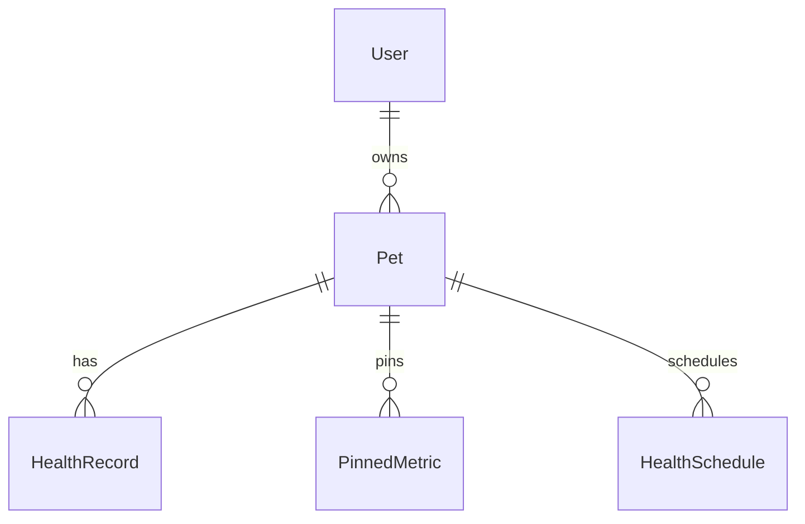

# iPet-Backend 接口契约文档

> **文档说明**:本文档详细描述了 iPet-Backend 的 API 接口契约,是前后端协作与回归测试的"唯一真相"。  
> **框架**: NestJS + Prisma + PostgreSQL  
> **全局前缀**: `/api`

---

## 一、REST 路由清单

### 1.1 认证模块 (`/api/auth`)

| 方法   | 路径           | 认证要求 | 限流策略         | 功能说明       |
| ------ | -------------- | -------- | ---------------- | -------------- |
| POST   | `/auth/guest`  | 否       | 5次/小时         | 创建游客会话   |
| POST   | `/auth/login`  | 否       | 3次/分钟         | 用户登录       |
| POST   | `/auth/upgrade`| 是       | 3次/分钟         | 游客升级为正式用户 |
| POST   | `/auth/logout` | 否       | 无               | 用户登出       |
| POST   | `/auth/refresh`| 否       | 5次/分钟         | 刷新访问令牌   |

**请求示例** (`POST /auth/login`):
```json
{
  "email": "user@example.com",
  "password": "YourSecurePassword123"
}
```

**响应示例**:
```json
{
  "accessToken": "eyJhbGciOiJIUzI1NiIsInR5cCI6IkpXVCJ9...",
  "refreshToken": "eyJhbGciOiJIUzI1NiIsInR5cCI6IkpXVCJ9...",
  "expiresIn": 2592000,
  "user": {
    "id": "clx1234567890",
    "email": "user@example.com",
    "nickname": "小王",
    "isGuest": false
  }
}
```

---

### 1.2 用户模块 (`/api/users`)

| 方法   | 路径               | 认证要求 | 限流策略 | 功能说明           |
| ------ | ------------------ | -------- | -------- | ------------------ |
| POST   | `/users/register`  | 否       | 3次/分钟 | 用户注册           |
| GET    | `/users/me`        | 是       | 无       | 获取当前用户信息   |
| POST   | `/users/verify`    | 是       | 无       | 实名认证           |
| POST   | `/users/settings`  | 是       | 无       | 更新用户设置       |
| PUT    | `/users/profile`   | 是       | 无       | 更新用户档案       |
| DELETE | `/users/account`   | 是       | 无       | 删除用户账户       |

**请求示例** (`POST /users/register`):
```json
{
  "email": "newuser@example.com",
  "password": "SecurePass456",
  "nickname": "新用户"
}
```

---

### 1.3 宠物模块 (`/api/pets`)

| 方法   | 路径          | 认证要求 | 功能说明       |
| ------ | ------------- | -------- | -------------- |
| POST   | `/pets`       | 是       | 创建宠物档案   |
| GET    | `/pets`       | 是       | 获取用户宠物列表 |
| GET    | `/pets/:id`   | 是       | 获取单个宠物详情 |
| PATCH  | `/pets/:id`   | 是       | 更新宠物信息   |
| DELETE | `/pets/:id`   | 是       | 删除宠物(软删除) |

**查询参数** (`GET /pets`):
- `page` (number, optional): 页码(从1开始)，默认 `1`
- `limit` (number, optional): 每页数量，默认 `50`，最大 `200`

**请求示例** (`POST /pets`):
```json
{
  "name": "旺财",
  "type": "dog",
  "breed": "金毛",
  "gender": "male",
  "birthDate": "2022-05-15",
  "weight": 25.5,
  "avatar": "https://example.com/avatar.jpg"
}
```

---

### 1.4 健康记录模块 (`/api/health`)

| 方法   | 路径                    | 认证要求 | 功能说明             |
| ------ | ----------------------- | -------- | -------------------- |
| POST   | `/health`               | 是       | 创建健康记录         |
| GET    | `/health`               | 是       | 获取健康记录列表     |
| GET    | `/health/summary`       | 是       | 获取健康数据摘要     |
| GET    | `/health/series`        | 是       | 获取指标时序数据     |
| GET    | `/health/:id`           | 是       | 获取单条健康记录     |
| PATCH  | `/health/:id`           | 是       | 更新健康记录         |
| DELETE | `/health/:id`           | 是       | 删除健康记录(软删除) |
| POST   | `/health/metrics/pin`   | 是       | 置顶/取消置顶指标    |

**查询参数** (`GET /health`):
- `petId` (string, optional): 宠物ID
- `page` (number, optional): 页码(从1开始)，默认 `1`
- `limit` (number, optional): 每页数量，默认 `50`，最大 `200`
- `type` (string, optional): 记录类型(weight, meal, water等)

> 说明：`GET /health` 服务端会始终应用分页（即使未传 `page/limit`），避免大数据量全量拉取导致性能/内存不可控。  
> 性能建议：尽量传 `petId`（并在需要时传 `type`），以命中 HealthRecord 覆盖索引查询形态（`petId + type + deleted + date DESC`）。

**响应示例**:
```json
[
  {
    "id": "rec_abc123",
    "petId": "pet_xyz789",
    "type": "weight",
    "value": 25.5,
    "unit": "kg",
    "date": "2024-12-20T00:00:00.000Z",
    "notes": "体重稳定",
    "source": "manual",
    "updatedAt": 1734652800000,
    "deleted": false
  }
]
```

---

### 1.5 健康计划模块 (`/api/health-schedules`)

| 方法   | 路径                      | 认证要求 | 功能说明         |
| ------ | ------------------------- | -------- | ---------------- |
| POST   | `/health-schedules`       | 是       | 创建健康计划     |
| GET    | `/health-schedules/:petId`| 是       | 获取宠物健康计划 |
| DELETE | `/health-schedules/:id`   | 是       | 删除健康计划     |

**查询参数** (`GET /health-schedules/:petId`):
- `type` (string, optional): 计划类型（metric key）
- `page` (number, optional): 页码(从1开始)，默认 `1`
- `limit` (number, optional): 每页数量，默认 `50`，最大 `200`

---

### 1.6 文章模块 (`/api/articles`)

| 方法 | 路径            | 认证要求 | 功能说明       |
| ---- | --------------- | -------- | -------------- |
| GET  | `/articles`     | 否       | 获取文章列表   |
| GET  | `/articles/:id` | 否       | 获取文章详情   |
| POST | `/articles`     | 否       | 创建文章(CMS)  |

**查询参数** (`GET /articles`):
- `category` (string, optional): 文章分类
- `page` (number, optional): 页码(从1开始)，默认 `1`
- `limit` (number, optional): 每页数量，默认 `20`，最大 `100`

> 说明：文章列表默认不返回 `content`（正文），需通过 `GET /articles/:id` 获取详情，避免列表场景传输过大。

---

### 1.7 洞察模块 (`/api/insights`)

| 方法 | 路径                 | 认证要求 | 功能说明           |
| ---- | -------------------- | -------- | ------------------ |
| GET  | `/insights/trend`    | 是       | 获取趋势洞察       |
| GET  | `/insights/:key`     | 是       | 获取特定指标洞察   |

**查询参数** (`GET /insights/trend`):
- `key` (string, required): 指标类型
- `direction` (string, required): 趋势方向(up/down)

---

### 1.8 系统配置模块 (`/api/config`)

| 方法 | 路径              | 认证要求 | 功能说明         |
| ---- | ----------------- | -------- | ---------------- |
| GET  | `/config/metrics` | 否       | 获取指标配置     |

---

### 1.9 上传模块 (`/api/uploads`)

| 方法 | 路径                       | 认证要求 | 功能说明                                     |
| ---- | -------------------------- | -------- | -------------------------------------------- |
| POST | `/uploads/:type`           | 否       | 标准文件上传（`multipart/form-data`）        |
| POST | `/uploads/:type/base64`    | 否       | Base64 上传（用于微信小程序 uploadFile 限制） |

**标准上传**  
格式：`multipart/form-data`  
字段名：`file`  
类型参数：`type` (avatar, photo, etc.)

**Base64 上传**（用于微信小程序在未配置 uploadFile 域名时的降级方案）  
格式：`application/json`，内容示例：
```json
{
  "data": "data:image/png;base64,iVBORw0KGgoAAAANSUhEUgAAAAUA",
  "fileName": "avatar.png",
  "mimeType": "image/png"
}
```
`data` 支持纯 Base64 字符串或 data URL（含 `data:<mime>;base64,` 前缀）。

**响应示例**（两种接口一致）：
```json
{
  "url": "http://localhost:3000/api/uploads/avatar/1234567890.jpg",
  "path": "avatar/1234567890.jpg"
}
```

---

### 1.10 管理后台模块 (`/api/admin`)

> 详细文档请参见：[管理后台 API 文档](./管理后台API.md)

| 方法   | 路径                        | 认证要求   | 功能说明       |
| ------ | --------------------------- | ---------- | -------------- |
| POST   | `/admin/login`              | 否         | 管理员登录     |
| GET    | `/admin/users`              | 管理员     | 用户列表       |
| GET    | `/admin/users/:id`          | 管理员     | 用户详情       |
| PATCH  | `/admin/users/:id/ban`      | 管理员     | 封禁用户       |
| PATCH  | `/admin/users/:id/unban`    | 管理员     | 解封用户       |
| DELETE | `/admin/users/:id`          | 管理员     | 删除用户       |
| GET    | `/admin/articles`           | 管理员     | 文章列表       |
| POST   | `/admin/articles`           | 管理员     | 创建文章       |
| PATCH  | `/admin/articles/:id`       | 管理员     | 更新文章       |
| DELETE | `/admin/articles/:id`       | 管理员     | 删除文章       |
| GET    | `/admin/stats/dashboard`    | 管理员     | 仪表盘统计     |
| GET    | `/admin/stats/users/trend`  | 管理员     | 用户趋势       |
| GET    | `/admin/stats/records/trend`| 管理员     | 记录趋势       |
| GET    | `/admin/system/info`        | 管理员     | 系统信息       |
| GET    | `/admin/system/storage`     | 管理员     | 存储统计       |

---

## 二、请求/响应结构规范

### 2.1 分页规范

**请求参数**:
- `page` (number): 页码,从 **1** 开始
- `limit` (number): 每页数量,默认值由业务层决定

**实现方式**:
```typescript
const skip = (page - 1) * limit;
const take = limit;
```

**响应格式**(当前为数组,非标准分页响应):
```json
[
  { "id": "1", "name": "item1" },
  { "id": "2", "name": "item2" }
]
```

> **改进建议**: 未来应统一分页响应格式,包含 `total`, `page`, `limit`, `data` 字段。

---

### 2.2 排序规范

**默认排序**:
- 健康记录: 按 `date` 降序
- 文章: 按 `createdAt` 降序

**实现示例**:
```typescript
orderBy: { date: 'desc' }
```

---

### 2.3 过滤规范

**软删除过滤**:
- 所有查询默认过滤 `deleted: false`
- 物理删除不在API层暴露

**权限过滤**:
- 自动过滤当前用户无权访问的资源
- 通过 `pet.userId` 或 `userId` 字段关联

---

### 2.4 时间格式规范

**日期字段**:
- 使用 **ISO 8601** 格式: `2024-12-20T00:00:00.000Z`
- 存储为字符串(HealthRecord.date)或 TIMESTAMP(其他表)

**时间戳字段**:
- `updatedAt` 返回毫秒级 Unix 时间戳(JavaScript `Date.getTime()`)

---

### 2.5 空值约定

**数据库字段**:
- 可空字段使用 `null`
- 前端接收后转换为 `undefined`(根据业务需求)

**响应处理**:
```typescript
metadata: (record.metadata || undefined) as Record<string, any> | undefined
```

---

## 三、错误码体系

### 3.1 HTTP 状态码规范

| 状态码 | 含义                   | 使用场景                     |
| ------ | ---------------------- | ---------------------------- |
| 200    | OK                     | 成功响应                     |
| 201    | Created                | 资源创建成功                 |
| 400    | Bad Request            | 参数错误、验证失败           |
| 401    | Unauthorized           | 未认证或令牌无效             |
| 403    | Forbidden              | 无权限访问                   |
| 404    | Not Found              | 资源不存在                   |
| 429    | Too Many Requests      | 超过限流阈值                 |
| 500    | Internal Server Error  | 服务器内部错误               |

---

### 3.2 NestJS 异常映射

| NestJS 异常               | HTTP 状态码 | 业务含义         |
| ------------------------- | ----------- | ---------------- |
| `BadRequestException`     | 400         | 参数错误         |
| `UnauthorizedException`   | 401         | 认证失败         |
| `NotFoundException`       | 404         | 资源未找到       |
| `InternalServerErrorException` | 500    | 服务器错误       |

**错误响应示例**:
```json
{
  "statusCode": 404,
  "message": "Pet with ID pet_123 not found",
  "error": "Not Found"
}
```

---

### 3.3 业务错误码(当前未实现)

**状态**: 当前系统未实现自定义业务错误码,仅依赖 HTTP 状态码 + `message` 字段。

**改进建议**: 未来应引入业务错误码体系:
```json
{
  "code": "PET_NOT_FOUND",
  "message": "宠物不存在",
  "statusCode": 404,
  "details": { "petId": "pet_123" }
}
```

---

## 四、认证与授权

### 4.1 JWT 令牌机制

**令牌类型**:
- `accessToken`: 访问令牌,有效期 **30天**
- `refreshToken`: 刷新令牌,与 `accessToken` 相同(滚动更新)

**Payload 结构**:
```typescript
{
  uid: string;          // 用户ID
  email?: string;       // 邮箱(可选)
  isGuest: boolean;     // 是否为游客
}
```

**认证流程**:
1. 客户端在 `Authorization` 头中携带令牌: `Bearer <token>`
2. `JwtAuthGuard` 验证令牌并提取 payload
3. 将用户信息注入 `req.user`

---

### 4.2 开放端点

以下端点**无需认证**:
- `POST /users/register`
- `POST /auth/login`
- `POST /auth/guest`
- `POST /auth/refresh`
- `POST /auth/logout`
- `GET /articles/*`

---

### 4.3 游客会话策略

**滑动保留机制**:
- 游客在访问受保护端点时,`lastActiveAt` 自动更新(节流6小时)
- 长期未活跃游客会被定期清理

**实现逻辑**:
```typescript
if (payload?.uid && payload?.isGuest) {
  const cutoff = new Date(Date.now() - 6 * 60 * 60 * 1000);
  await prisma.user.updateMany({
    where: { id: payload.uid, isGuest: true, lastActiveAt: { lt: cutoff } },
    data: { lastActiveAt: new Date() }
  });
}
```

---

### 4.4 权限验证规则

**资源所有权验证**:
- 所有宠物相关操作验证 `pet.userId === req.user.uid`
- 健康记录通过 `pet` 关联间接验证

**验证示例**:
```typescript
const pet = await prisma.pet.findFirst({
  where: { id: petId, userId, deleted: false }
});
if (!pet) throw new NotFoundException('Pet not found');
```

---

## 五、版本策略

### 5.1 当前版本状态

**API 版本**: 无显式版本号(隐式 v1)  
**全局前缀**: `/api`

---

### 5.2 未来版本规划

**版本路径建议**:
- `/api/v1/...` - 当前版本
- `/api/v2/...` - 未来版本

**兼容性原则**:
1. **向后兼容**: 新版本应尽量保持旧版本接口可用
2. **废弃策略**:
   - 标记废弃字段(响应中保留,但文档标注 `@deprecated`)
   - 提前至少 **3个月** 通知客户端
   - 提供迁移指南

**破坏性变更处理**:
- 引入新路径(如 `/api/v2/pets`)
- 同时维护旧版本至少 **6个月**
- 返回响应头 `X-API-Version: 2.0`

---

### 5.3 灰度发布

**策略**(待实现):
- 通过请求头 `X-Feature-Flag` 或查询参数 `beta=true` 启用新功能
- 内部测试账号优先体验新版本

---

## 六、幂等性与一致性要求

### 6.1 幂等性接口识别

**幂等操作**:
- `GET /health` - 查询操作本身幂等
- `PUT /users/profile` - 使用完整资源替换,幂等
- `DELETE /pets/:id` - 软删除,重复删除不产生副作用

**非幂等操作**:
- `POST /health` - 创建新记录,每次生成新 UUID
- `POST /pets` - 创建新宠物

---

### 6.2 幂等性保证机制(建议实现)

**客户端幂等键**:
```http
POST /api/health
Idempotency-Key: client-generated-uuid-12345
```

**服务端实现**:
1. 检查 `Idempotency-Key` 是否已存在
2. 若存在,返回缓存的响应(200 OK)
3. 若不存在,执行操作并缓存响应(1小时)

**状态**: 当前未实现,建议在高并发场景引入。

---

### 6.3 数据一致性保证

**事务边界**:
- Prisma 自动管理数据库事务
- 跨表操作使用 `prisma.$transaction`

**并发控制**:
- 使用 `version` 字段实现乐观锁(HealthRecord 已实现)
- 避免 Lost Update 问题

**示例**:
```typescript
await prisma.healthRecord.update({
  where: { id, version: currentVersion },
  data: { value: newValue, version: currentVersion + 1 }
});
```

---

### 6.4 软删除一致性

**规则**:
- 所有删除操作为软删除(`deleted: true`)
- 查询自动过滤 `deleted: false`
- 外键级联删除通过 Prisma 管理

**级联策略**:
```prisma
model Pet {
  healthRecords HealthRecord[] @relation(onDelete: Cascade)
}
```

---

## 七、限流与反重放

### 7.1 限流策略

**配置** (基于 `@nestjs/throttler`):
- 默认全局限流:未明确配置(需确认)
- 端点级限流:
  - `POST /auth/guest`: 5次/小时
  - `POST /auth/login`: 3次/分钟
  - `POST /auth/upgrade`: 3次/分钟
  - `POST /users/register`: 3次/分钟
  - `POST /auth/refresh`: 5次/分钟

**限流响应**:
```json
{
  "statusCode": 429,
  "message": "Too Many Requests",
  "error": "ThrottlerException"
}
```

---

### 7.2 反重放攻击(未实现)

**建议方案**:
1. **时间戳验证**: 请求头携带 `X-Timestamp`,服务端校验时间差
2. **Nonce 机制**: 一次性令牌,防止请求重放
3. **签名验证**: 敏感操作使用 HMAC 签名

---

## 八、CORS 与安全配置

### 8.1 CORS 策略

**配置** (`main.ts`):
```typescript
app.enableCors({
  origin: origins,              // 从环境变量读取
  credentials: true,
  allowedHeaders: ['Content-Type', 'Authorization', 'If-None-Match'],
  methods: ['GET', 'POST', 'PUT', 'PATCH', 'DELETE', 'OPTIONS'],
  exposedHeaders: ['ETag']
});
```

---

### 8.2 安全头

**当前配置**:
- `Content-Type` 验证(通过 `ValidationPipe`)
- `Authorization` Bearer 令牌认证

**建议增强**:
- Helmet 中间件(CSP, HSTS等)
- Rate Limiting 全局默认值

---

## 九、性能优化与缓存

### 9.1 数据库索引

**关键索引**(已实现):
```sql
-- 健康记录覆盖索引
CREATE INDEX idx_health_record_covering 
ON "HealthRecord"(petId, type, deleted, date DESC) 
WHERE deleted = false;

-- 宠物用户查询索引
CREATE INDEX idx_pet_user_active 
ON "Pet"(userId, deleted) 
WHERE deleted = false;
```

---

### 9.2 查询优化

**批量查询替代 N+1**:
- `getSummary` 使用单次查询获取所有指标数据
- 内存聚合替代多次数据库查询

**字段投影**:
```typescript
select: { id: true, type: true, value: true, date: true }
// 减少 40-50% 数据传输
```

---

### 9.3 服务端聚合

**时序数据聚合** (`GET /health/series`):
- 服务端按 day/week/month 分桶
- 避免客户端主线程阻塞(100-200ms → <10ms)
- 常用桶（day/week/month）可通过 `HealthMetricBucket` 物化桶表加速，降低冷缓存/频繁失效时的峰值扫描与聚合压力

---

## 十、维护与扩展建议

### 10.1 待完善项

1. **统一响应格式**: 引入 `{ code, data, message }` 结构
2. **业务错误码**: 定义错误码枚举,替代纯文本消息
3. **幂等键支持**: 高并发场景必备
4. **API 文档生成**: 集成 Swagger/OpenAPI
5. **请求日志**: 记录 `traceId` 用于链路追踪

---

### 10.2 文档维护流程

**更新触发条件**:
- 新增/修改接口
- 变更错误码或响应格式
- 调整认证/限流策略

**维护责任**:
- 后端开发者修改接口时同步更新文档
- Code Review 必须包含文档审查

---

## 十一、附录

### 11.1 数据库 Schema 参考

**核心表**:
- `User`: 用户表(包含游客)
- `Pet`: 宠物表
- `HealthRecord`: 健康记录表
- `PinnedMetric`: 置顶指标表
- `HealthMetricBucket`: 健康时序物化桶表（day/week/month）
- `HealthSchedule`: 健康计划表
- `Article`: 文章表

**关系**:


---

### 11.2 关键配置项

**环境变量**:
- `JWT_SECRET`: JWT 签名密钥
- `DATABASE_URL`: PostgreSQL 连接字符串
- `CLIENT_ORIGIN`: CORS 允许的客户端源
- `PORT`: 服务端口(默认3000)
- `BODY_LIMIT`: 请求体大小限制(默认20MB)

---

### 11.3 联系与反馈

如发现文档与实际实现不一致,请立即反馈并修正。

**最后更新**: 2025-12-20  
**文档版本**: v1.0.0
