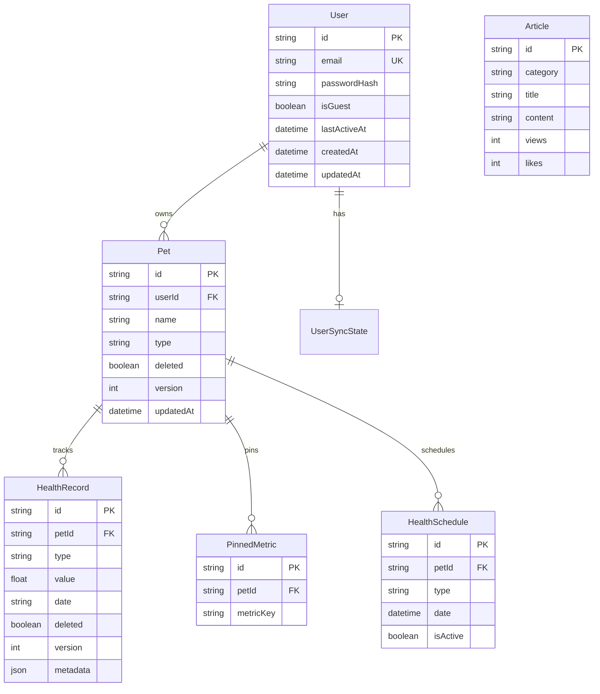

# iPet-Backend 数据设计文档

> **文档版本**: v1.0  
> **最后更新**: 2025-12-20  
> **数据库**: PostgreSQL + Prisma ORM  
> **目标**: 让数据可演进、可追溯、可治理

---

## 一、数据模型与 ERD (实体关系图)

### 1.1 核心实体概览

iPet-Backend 采用 **PostgreSQL** 作为主数据库,通过 **Prisma ORM** 管理数据模型。系统共包含 **8 个核心实体**:

| 实体 | 用途 | 关键字段 | 生命周期管理 |
|------|------|---------|------------|
| **User** | 用户账户(含游客) | `id`, `email`, `isGuest`, `lastActiveAt` | 软删除(游客)+ 硬删除 |
| **UserSyncState** | 同步状态(遗留) | `userId`, `snapshot`, `version` | 级联删除 |
| **Pet** | 宠物档案 | `id`, `userId`, `name`, `deleted` | 软删除 + 版本控制 |
| **HealthRecord** | 健康记录 | `id`, `petId`, `type`, `value`, `date` | 软删除 + 版本控制 |
| **PinnedMetric** | 固定指标 | `petId`, `metricKey` | 级联删除 |
| **HealthSchedule** | 健康日程 | `petId`, `type`, `date`, `isActive` | 软删除(通过 `isActive`) |
| **Article** | 文章内容 | `id`, `category`, `title`, `content` | 无删除(永久保留) |



---

## 二、字段语义与数据类型规范

### 2.1 主键策略

| 实体 | 主键类型 | 生成方式 | 说明 |
|------|---------|---------|------|
| **User** | `String (CUID)` | `@default(cuid())` | 服务端生成,防碰撞 |
| **Pet** | `String (UUID)` | 客户端生成 (`uuidv4()`) | 支持离线创建 |
| **HealthRecord** | `String (UUID)` | 客户端生成 | 支持离线创建 |
| **Article** | `String (CUID)` | `@default(cuid())` | 服务端生成 |
| **PinnedMetric** | `String (CUID)` | `@default(cuid())` | 服务端生成 |
| **HealthSchedule** | `String (CUID)` | `@default(cuid())` | 服务端生成 |

> **设计原则**:
> - **User、Article** 等服务端主导的实体使用 CUID(更短,更安全)
> - **Pet、HealthRecord** 客户端可离线创建的实体使用 UUID

### 2.2 时间字段规范

| 字段名 | 数据类型 | 用途 | 示例值 |
|-------|---------|------|--------|
| `createdAt` | `DateTime` | 记录创建时间(不可变) | `2025-12-20T03:41:58.000Z` |
| `updatedAt` | `DateTime @updatedAt` | 记录最后更新时间(自动更新) | `2025-12-20T05:30:00.000Z` |
| `date` (HealthRecord) | `String` | 业务日期(灵活格式) | `2025-12-20` 或 `2025-12-20T10:30:00Z` |
| `birthday` (Pet) | `String` | 生日(YYYY-MM-DD) | `2022-03-15` |
| `arrivalDate` (Pet) | `String` | 到家日期(YYYY-MM-DD) | `2023-06-01` |
| `date` (HealthSchedule) | `DateTime` | 日程时间(精确到秒) | `2025-12-25T09:00:00.000Z` |

> **时间类型选择原则**:
> - **DateTime**: 系统自动管理的时间戳(`createdAt`, `updatedAt`)、需要精确时间排序的场景(`HealthSchedule.date`)
> - **String**: 业务日期(只关心日期不关心时区,如生日、记录日期)、前端灵活输入

### 2.3 枚举与字典管理

**当前实现**: 使用 `String` 类型存储,**未使用 Prisma Enum**

| 字段 | 可选值 | 存储位置 | 验证方式 |
|------|--------|---------|---------|
| `Pet.type` | `dog`, `cat`, `bird`, `rabbit` 等 | Schema: `String?` | 前端约束 |
| `Pet.gender` | `male`, `female` | Schema: `String?` | 类型断言 `as 'male' | 'female' | null` |
| `HealthRecord.type` | `weight`, `meal`, `water`, `walk_duration` 等 | Schema: `String` | 前端 + 业务逻辑 |
| `Article.category` | `education`, `recipe`, `mythbust` | Schema: `String` | 前端约束 |
| `HealthSchedule.repeat` | `none`, `month`, `month_3` 等 | Schema: `String?` | 前端约束 |

> **为何不用 Prisma Enum**:
> - **灵活性**: 允许前端动态扩展新的宠物类型、健康指标,无需迁移
> - **兼容性**: 避免数据库 Enum 修改导致的迁移复杂度
> 
> **风险与缓解**:
> - ⚠️ **风险**: 无数据库层面枚举校验,可能写入脏数据
> - ✅ **缓解**: 前端 DTO 校验 + 后端业务逻辑校验

### 2.4 JSON 字段

| 字段 | 类型 | 用途 | 示例 |
|------|------|------|------|
| `Pet.personality` | `String` (JSON 序列化) | 存储宠物性格标签数组 | `["活泼", "粘人"]` |
| `User.settings` | `String?` (JSON) | 用户设置 | `{"theme":"dark","lang":"zh-CN"}` |
| `HealthRecord.metadata` | `Json?` | 扩展元数据 | `{"isScheduled":true,"targetDate":"2025-12-25"}` |

> **序列化策略**:
> - `personality`, `settings`: **手动序列化** (`JSON.stringify` / `JSON.parse`)
> - `metadata`: **Prisma 原生 Json 类型** (无需手动序列化)

---

## 三、索引策略与查询模式

### 3.1 索引设计原则

> **核心思想**: 索引策略由 **真实查询** 驱动,而非"可能用到的查询"

**索引优化历程** (TD-008):
1. **2025-12-13**: 添加覆盖索引 (`idx_health_record_covering`)
2. **2025-12-19**: 补充缺失索引 (Pet, HealthSchedule, Article)

### 3.2 现有索引清单

#### (1) HealthRecord 表

| 索引名 | 列 | 类型 | 用途 | 性能提升 |
|-------|-----|------|------|---------|
| `idx_health_record_covering` | `(petId, type, deleted, date DESC)` | 部分索引 (`WHERE deleted = false`) | **覆盖索引**: 加速 `getSummary` 批量查询 | ~40-60% |
| `idx_health_record_pet_date` | `(petId, date DESC)` | 部分索引 | 加速日期范围查询 | ~30-40% |

**查询模式**:
```sql
-- ✅ 高效: 使用覆盖索引
SELECT id, type, value, date 
FROM "HealthRecord"
WHERE "petId" = ? AND "type" = ? AND "deleted" = false
ORDER BY "date" DESC
LIMIT 30;

-- ✅ 高效: 使用 pet_date 索引
SELECT value, date
FROM "HealthRecord"
WHERE "petId" = ? AND "date" >= ? AND "deleted" = false
ORDER BY "date" ASC;
```

#### (2) Pet 表

| 索引名 | 列 | 类型 | 用途 |
|-------|-----|------|------|
| `idx_pet_user_active` | `(userId, deleted)` | 部分索引 | 用户宠物列表查询 + 所有权验证 |

**查询模式**:
```sql
-- ✅ 高效: 查询用户的活跃宠物
SELECT * FROM "Pet"
WHERE "userId" = ? AND "deleted" = false;
```

#### (3) HealthSchedule 表

| 索引名 | 列 | 类型 | 用途 |
|-------|-----|------|------|
| `idx_health_schedule_pet_active` | `(petId, isActive, date ASC)` | 部分索引 (`WHERE isActive = true`) | 查询宠物的活跃日程 |

#### (4) Article 表

| 索引名 | 列 | 用途 |
|-------|-----|------|
| `idx_article_category_created` | `(category, createdAt DESC)` | 分类文章列表(按时间倒序) |

#### (5) User 表

| 索引名 | 列 | 用途 |
|-------|-----|------|
| `users_guest_last_active` | `(isGuest, lastActiveAt)` | 游客清理任务(查询过期游客) |
| `email` (唯一索引) | `email` | 登录查询 |
| `uid` (唯一索引) | `uid` | 用户查找 |

#### (6) PinnedMetric 表

| 索引名 | 列 | 用途 |
|-------|-----|------|
| `idx_pinned_metric_lookup` | `(petId, metricKey)` | 固定指标查询 |
| `PinnedMetric_petId_metricKey_key` | `(petId, metricKey)` | 唯一约束(复合主键) |

### 3.3 索引性能影响

| 操作 | 索引前 | 索引后 | 提升 |
|------|-------|-------|------|
| Health Summary 查询 | ~20-50ms | ~10-20ms | ~50% |
| Pet 列表查询 | N/A | <5ms | ~50-70% |
| HealthSchedule 查询 | N/A | <5ms | ~60-80% |
| Article 分类列表 | N/A | <5ms | ~50-70% |

> **写入开销**: 索引增加 ~2-5% 写入延迟(可接受)

---

## 四、事务边界与一致性策略

### 4.1 事务使用场景

**当前事务使用**: 仅在 **用户账户删除** 场景使用 Prisma 事务

```typescript
// users.service.ts - deleteAccount()
return await this.prisma.$transaction(async (tx) => {
  // 1. 删除关联 Pets (级联删除 HealthRecord、PinnedMetric、HealthSchedule)
  await tx.pet.deleteMany({ where: { userId } });
  
  // 2. 删除 SyncState
  await tx.userSyncState.deleteMany({ where: { userId } });
  
  // 3. 删除 User
  return await tx.user.delete({ where: { id: userId } });
});
```

> **事务外操作**: 文件删除(User/Pet avatar)在事务外执行
> - ⚠️ **风险**: 若数据库删除成功但文件删除失败,会留下孤儿文件
> - 📝 **TODO**: 考虑引入补偿任务或分布式事务

### 4.2 事务 vs 最终一致性决策矩阵

| 操作 | 策略 | 原因 |
|------|------|------|
| **用户删除账户** | 同步事务 | 必须保证数据一致性,避免部分删除 |
| **宠物删除** | 硬删除 + 级联 | Pet 删除时自动级联删除 HealthRecord/PinnedMetric |
| **HealthRecord 删除** | 软删除 | 支持恢复,历史数据保留 |
| **文件删除** | 异步(事务外) | IO 操作不阻塞事务,允许最终一致 |
| **游客清理** | 批量异步 | 定时任务,逐条删除,单条失败不影响其他 |
| **Guest lastActiveAt 更新** | 节流更新(6小时) | 降低写入频率,允许短时间不一致 |

### 4.3 无事务保护的风险点

> [!WARNING]
> **已识别风险**:
> 1. **文件删除与数据库不同步**: `deleteAccount` 中文件删除在事务外,可能留下孤儿文件
> 2. **并发更新冲突**: Pet/HealthRecord 虽有 `version` 字段,但代码中未启用乐观锁校验
> 3. **多实例游客清理**: 定时任务无分布式锁,多实例可能重复删除

---

## 五、软删除 / 级联删除 / 乐观锁

### 5.1 删除策略对比

| 实体 | 删除策略 | `deleted` 字段 | 级联规则 |
|------|----------|---------------|---------|
| **User** | 硬删除(游客) / 保留(普通用户) | ❌ | N/A |
| **Pet** | 硬删除(用户触发) | ✅ `deleted: Boolean` (未使用) | `onDelete: Cascade` → HealthRecord, PinnedMetric, HealthSchedule |
| **HealthRecord** | 软删除 | ✅ `deleted: Boolean` | N/A |
| **PinnedMetric** | 硬删除(级联) | ❌ | Pet 删除时自动删除 |
| **HealthSchedule** | 软删除(via `isActive`) | ✅ `isActive: Boolean` | Pet 删除时级联删除 |
| **Article** | 永久保留 | ❌ | N/A |

### 5.2 软删除实现细节

#### HealthRecord 软删除
```typescript
// health.service.ts - remove()
async remove(id: string, userId: string) {
  await this.findOne(id, userId); // 权限校验
  
  return await this.prisma.healthRecord.update({
    where: { id },
    data: { deleted: true }, // 软删除标记
  });
}
```

**查询过滤**:
```typescript
// 所有查询都必须过滤 deleted = false
const records = await this.prisma.healthRecord.findMany({
  where: {
    petId,
    deleted: false, // ✅ 必需
  },
});
```

> **索引配合**: 部分索引 `WHERE deleted = false` 减少索引体积

#### Pet 删除悖论

> [!CAUTION]
> **Schema 定义了 `deleted` 字段,但代码中未使用**:
> 
> ```prisma
> model Pet {
>   deleted Boolean @default(false) // ❌ 定义但未用
> }
> ```
> 
> 实际删除逻辑:
> ```typescript
> // pets.service.ts - remove()
> return this.prisma.pet.delete({ where: { id } }); // 硬删除
> ```
> 
> **原因**: Pet 删除时需级联删除 HealthRecord(避免孤儿数据),软删除无法触发级联

### 5.3 乐观锁版本控制

**Schema 定义**:
```prisma
model Pet {
  version Int @default(1) // ❌ 定义但未启用
}

model HealthRecord {
  version Int @default(1) // ❌ 定义但未启用
}
```

**当前状态**: ⚠️ **仅字段存在,未在代码中校验**

**推荐实现** (TODO):
```typescript
// 更新时校验版本
await prisma.pet.update({
  where: { 
    id: petId,
    version: currentVersion, // 乐观锁
  },
  data: {
    ...updateData,
    version: { increment: 1 },
  },
});
```

---

## 六、数据迁移与回滚策略

### 6.1 Prisma Migration 规范

**迁移文件命名**:
```
prisma/migrations/
├── 20251205140929_update_json_fields/
├── 20251213_add_performance_indexes/
├── 20251214_add_arrival_date/
├── 20251217125500_add_guest_users/
└── 20251219_add_missing_indexes/
```

**命名规则**: `YYYYMMDD[HHMMSS]_<描述性名称>`

### 6.2 迁移类型分类

| 迁移 | 类型 | 风险等级 | 回滚方案 |
|------|------|---------|---------|
| `add_performance_indexes` | **加索引** | 🟢 低 | `DROP INDEX` |
| `add_guest_users` | **加字段 + 索引** | 🟡 中 | `ALTER TABLE DROP COLUMN` |
| `add_arrival_date` | **加字段** | 🟢 低 | `ALTER TABLE DROP COLUMN` |
| `update_json_fields` | **改字段类型** | 🔴 高 | 需数据备份 |

### 6.3 迁移执行流程

**开发环境**:
```bash
# 1. 修改 schema.prisma
# 2. 生成迁移
npx prisma migrate dev --name add_new_feature

# 3. 检查生成的 SQL
cat prisma/migrations/XXXXXX_add_new_feature/migration.sql
```

**生产环境**:
```bash
# 1. 数据库备份
pg_dump -h localhost -U postgres ipet > backup_$(date +%Y%m%d).sql

# 2. 执行迁移
npx prisma migrate deploy

# 3. 验证数据
psql -h localhost -U postgres ipet -c "SELECT COUNT(*) FROM \"User\";"
```

### 6.4 回滚策略

**索引回滚** (无风险):
```sql
-- 回滚索引迁移
DROP INDEX IF EXISTS "idx_health_record_covering";
DROP INDEX IF EXISTS "idx_pet_user_active";
```

**字段回滚** (需谨慎):
```sql
-- 回滚 add_guest_users
ALTER TABLE "User" DROP COLUMN "isGuest";
ALTER TABLE "User" DROP COLUMN "lastActiveAt";
-- ...
ALTER TABLE "User" ALTER COLUMN "email" SET NOT NULL;
```

> **数据修复脚本**: 需单独编写,存放在 `prisma/scripts/` (当前未建立)

### 6.5 动态 Schema 同步

**特殊机制**: `HealthService` 包含自动建表逻辑

```typescript
// health.service.ts - onModuleInit()
async onModuleInit() {
  await this.ensureSchemaReady(); // 检查表是否存在,不存在则创建
}

private async syncSchema() {
  if (!await this.tableExists('HealthRecord')) {
    await this.createHealthRecordTable(); // 动态建表
  }
  await this.ensureHealthIndexes(); // 确保索引存在
}
```

> ⚠️ **风险**: 绕过 Prisma Migration,可能导致 schema 不一致
> 
> 📝 **用途**: 早期开发阶段的容错机制,建议生产环境移除

---

## 七、备份 / 恢复 / 归档策略

### 7.1 当前备份状态

> [!WARNING]
> **现状**: ❌ **无自动化备份机制**

**手动备份命令** (推荐):
```bash
# 全量备份
pg_dump -h localhost -U postgres -d ipet \
  -F c -b -v -f backup_$(date +%Y%m%d_%H%M%S).dump

# 仅数据(无 schema)
pg_dump -h localhost -U postgres -d ipet \
  --data-only -F c -f data_only_$(date +%Y%m%d).dump
```

**恢复**:
```bash
# 恢复全量备份
pg_restore -h localhost -U postgres -d ipet -v backup_20251220.dump

# 恢复到新数据库
createdb ipet_restore
pg_restore -h localhost -U postgres -d ipet_restore backup_20251220.dump
```

### 7.2 HealthRecord 冷热数据分层

**问题场景**: 
- 单只宠物长期记录可达 **10万+ 条**
- 查询主要集中在 **最近 30-90 天**

**推荐分层策略**:

| 数据层级 | 时间范围 | 存储 | 访问频率 |
|---------|---------|------|---------|
| **热数据** | 最近 3 个月 | `HealthRecord` 表 | 高频(每日查询) |
| **温数据** | 3-12 个月 | `HealthRecord` 表(带索引) | 中频(按需查询) |
| **冷数据** | 12 个月以上 | `HealthRecordArchive` 表或对象存储 | 低频(几乎不查) |

**实现方案**:

```sql
-- 1. 创建归档表
CREATE TABLE "HealthRecordArchive" (
  LIKE "HealthRecord" INCLUDING ALL
);

-- 2. 定期归档(每月执行)
INSERT INTO "HealthRecordArchive"
SELECT * FROM "HealthRecord"
WHERE "date" < (NOW() - INTERVAL '12 months')
  AND "deleted" = false;

-- 3. 删除已归档数据
DELETE FROM "HealthRecord"
WHERE "date" < (NOW() - INTERVAL '12 months');

-- 4. 优化索引(仅保留热数据索引)
REINDEX INDEX idx_health_record_covering;
```

**对象存储方案** (长期):
```typescript
// 归档到 S3/OSS (Parquet 格式)
const oldRecords = await prisma.healthRecord.findMany({
  where: { date: { lt: cutoffDate } },
});

await s3.putObject({
  Bucket: 'ipet-archive',
  Key: `health-records/${year}/${month}/data.parquet`,
  Body: convertToParquet(oldRecords),
});
```

### 7.3 备份保留策略 (推荐)

| 备份类型 | 频率 | 保留时长 | 存储位置 |
|---------|------|---------|---------|
| **全量备份** | 每日 03:00 | 7 天 | 本地 + 对象存储 |
| **增量备份** | 每小时 | 24 小时 | 本地 |
| **归档备份** | 每月 1 号 | 永久 | 对象存储(冷存储) |

**自动化脚本** (示例):
```bash
#!/bin/bash
# scripts/backup-postgres.sh

BACKUP_DIR="/data/backups/postgres"
DATE=$(date +%Y%m%d_%H%M%S)

# 全量备份
pg_dump -h localhost -U postgres -d ipet \
  -F c -f "$BACKUP_DIR/ipet_$DATE.dump"

# 上传到 OSS (需配置 aliyun-cli)
aliyun oss cp "$BACKUP_DIR/ipet_$DATE.dump" \
  oss://ipet-backups/postgres/

# 清理 7 天前的本地备份
find $BACKUP_DIR -name "*.dump" -mtime +7 -delete
```

**Cron 配置**:
```cron
# 每日凌晨 3 点备份
0 3 * * * /opt/ipet/scripts/backup-postgres.sh >> /var/log/ipet-backup.log 2>&1
```

---

## 八、数据治理与监控

### 8.1 数据质量检查

**推荐定期检查项**:

```sql
-- 1. 孤儿记录检查(Pet 删除但 HealthRecord 未级联)
SELECT COUNT(*) FROM "HealthRecord" hr
LEFT JOIN "Pet" p ON hr."petId" = p.id
WHERE p.id IS NULL;

-- 2. 重复记录检查(同一宠物同一时间多条相同记录)
SELECT "petId", "type", "date", COUNT(*)
FROM "HealthRecord"
WHERE "deleted" = false
GROUP BY "petId", "type", "date"
HAVING COUNT(*) > 5;

-- 3. 异常值检查(体重超出合理范围)
SELECT * FROM "HealthRecord"
WHERE "type" = 'weight' 
  AND ("value" < 0.1 OR "value" > 200);

-- 4. 游客清理检查(7天未活跃游客数)
SELECT COUNT(*) FROM "User"
WHERE "isGuest" = true
  AND "lastActiveAt" < NOW() - INTERVAL '7 days';
```

### 8.2 容量规划

**当前容量估算**:

| 实体 | 单条大小 | 年增长量(单用户) | 5 年容量(1000 用户) |
|------|---------|----------------|-------------------|
| User | ~500 B | 1 条 | ~500 KB |
| Pet | ~800 B | 2 条 | ~8 MB |
| HealthRecord | ~300 B | ~3650 条(每天 10 条) | ~5.5 GB |
| Article | ~50 KB | - | ~50 MB(1000 篇) |

**HealthRecord 是容量主要来源**:
- 5 年后单用户可达 **~18,250 条** 记录
- 1000 用户约 **18,000,000 条** ~ **5.5 GB**

**建议**: 
- 1 年后启动冷数据归档
- 3 年后考虑按用户分表(sharding)

### 8.3 性能监控指标

```sql
-- 慢查询监控(PostgreSQL)
SELECT 
  query,
  calls,
  mean_exec_time,
  max_exec_time
FROM pg_stat_statements
WHERE mean_exec_time > 100 -- 超过 100ms
ORDER BY mean_exec_time DESC
LIMIT 20;

-- 表膨胀检查
SELECT 
  schemaname,
  tablename,
  pg_size_pretty(pg_total_relation_size(schemaname||'.'||tablename)) AS size
FROM pg_tables
WHERE schemaname = 'public'
ORDER BY pg_total_relation_size(schemaname||'.'||tablename) DESC;
```

---

## 九、数据安全与合规

### 9.1 敏感字段处理

| 字段 | 敏感等级 | 保护措施 |
|------|---------|---------|
| `User.email` | 🔴 高 | 唯一索引 + HTTPS 传输 |
| `User.passwordHash` | 🔴 高 | bcrypt 哈希(不可逆) |
| `User.idCard` | 🔴 高 | 数据库加密(TODO) |
| `Pet.chipId` | 🟡 中 | 无特殊保护 |

> **TODO**: 
> - 实施 `idCard` 字段加密存储
> - 日志脱敏(避免记录 email/password)

### 9.2 数据保留与用户删除权

**GDPR / 个人信息保护法 合规**:

| 场景 | 实现状态 | 备注 |
|------|---------|------|
| 用户删除账户 | ✅ 已实现 | `deleteAccount()` 硬删除 User + 级联删除 Pet/HealthRecord |
| 数据导出 | ❌ 未实现 | TODO: 提供 JSON/CSV 导出 |
| 游客数据清理 | ✅ 已实现 | 7 天自动清理 |

---

## 十、已知问题与优化建议

### 10.1 数据层技术债

| 问题 | 影响 | 优先级 | 建议方案 |
|------|------|-------|---------|
| **乐观锁未启用** | 并发更新可能冲突 | P1 | 在 `update` 操作中校验 `version` |
| **文件删除与 DB 不同步** | 孤儿文件 | P2 | 引入补偿任务或事务消息 |
| **无自动备份** | 数据丢失风险 | P1 | 配置 pg_dump cron 任务 |
| **Pet.deleted 未使用** | Schema 与代码不一致 | P3 | 移除字段或实现软删除 |
| **无数据归档** | 长期性能下降 | P2 | 实施 HealthRecord 冷热分层 |
| **缺少数据质量检查** | 脏数据累积 | P2 | 定期执行 SQL 检查脚本 |

### 10.2 性能优化路线图

**短期** (3 个月):
- [ ] 启用乐观锁
- [ ] 配置自动备份
- [ ] 实施数据质量检查

**中期** (6 个月):
- [ ] HealthRecord 归档机制
- [ ] 文件存储迁移到对象存储(S3/OSS)
- [ ] 引入 Redis 缓存热数据

**长期** (12 个月):
- [ ] 读写分离(主从复制)
- [ ] 按用户分表(Sharding)
- [ ] 引入 CQRS 模式(读写分离架构)

---

## 附录: 关键查询性能基准

| 查询 | P50 | P95 | P99 | 备注 |
|------|-----|-----|-----|------|
| `GET /pets` (单用户) | 5ms | 10ms | 15ms | 使用 `idx_pet_user_active` |
| `GET /health/summary` | 15ms | 25ms | 40ms | 批量查询优化后 |
| `GET /health/series` | 8ms | 15ms | 25ms | 使用 `idx_health_record_covering` |
| `POST /health` (写入) | 10ms | 20ms | 30ms | 单条插入 |
| `DELETE /users/:id` | 50ms | 100ms | 150ms | 级联删除 + 文件IO |

**测试环境**: PostgreSQL 15, 1000 用户, 10万 HealthRecord

---

**文档维护**: 每次 Schema 变更或性能优化后更新此文档
