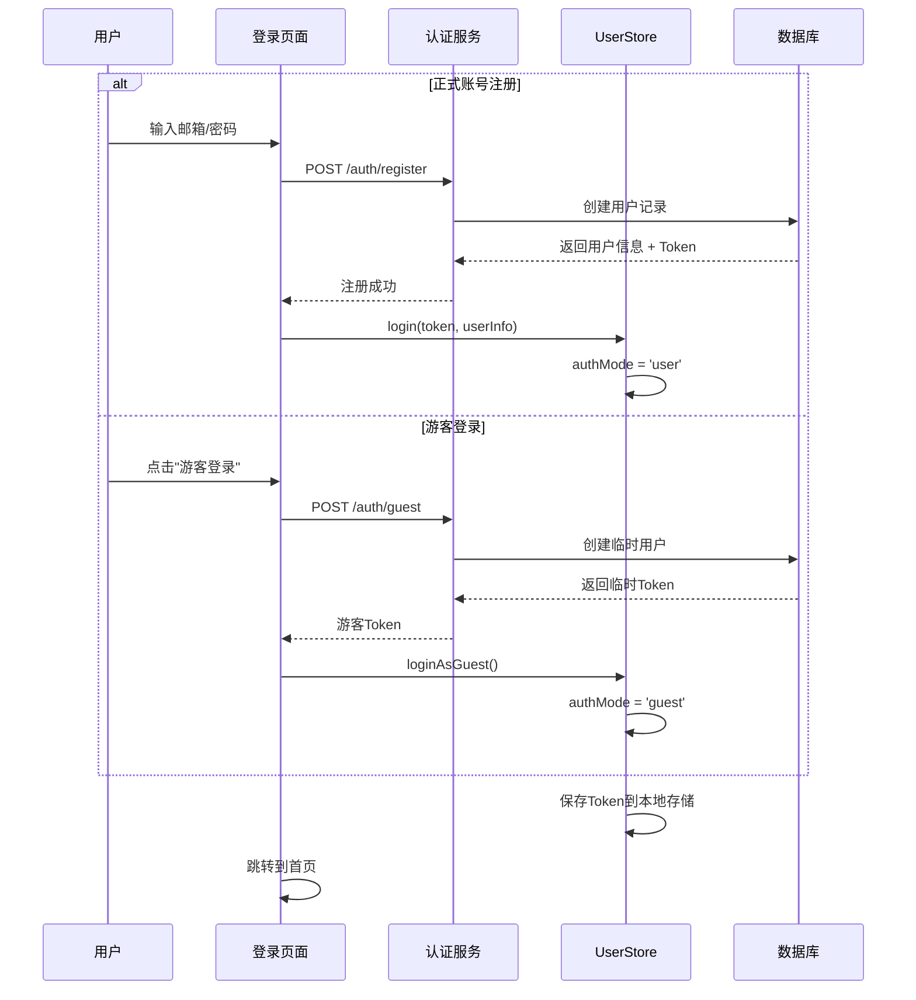
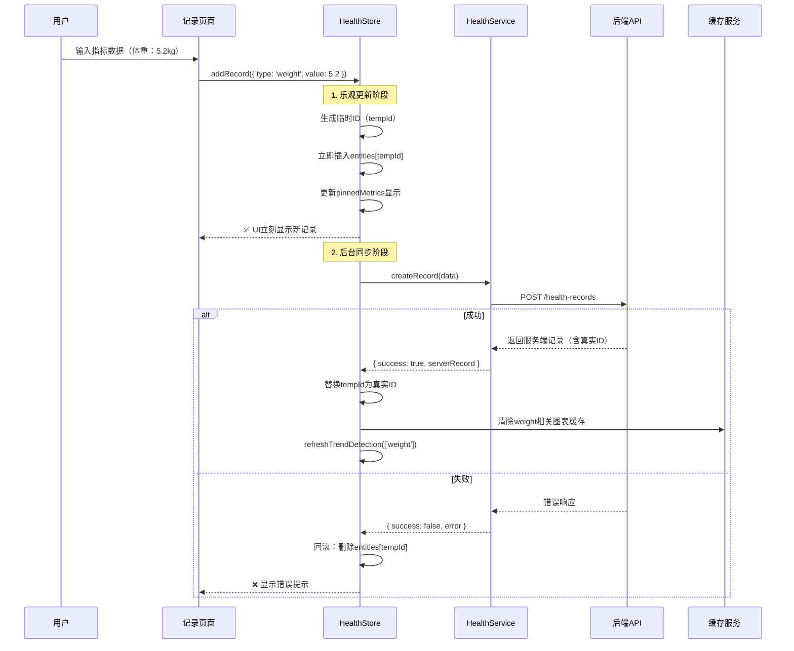
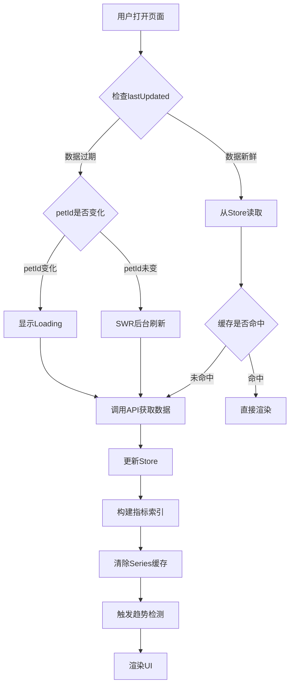
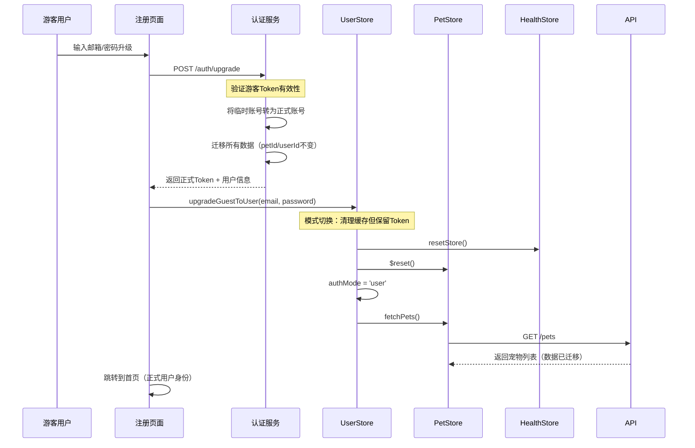
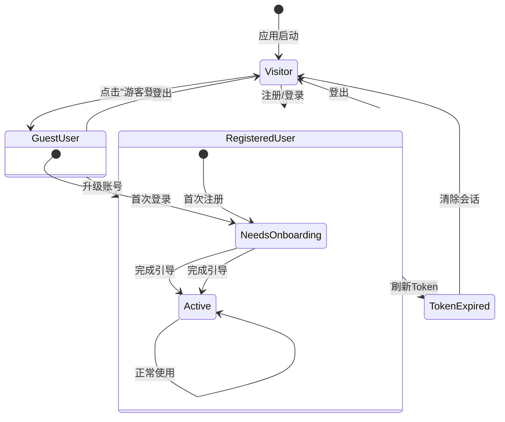
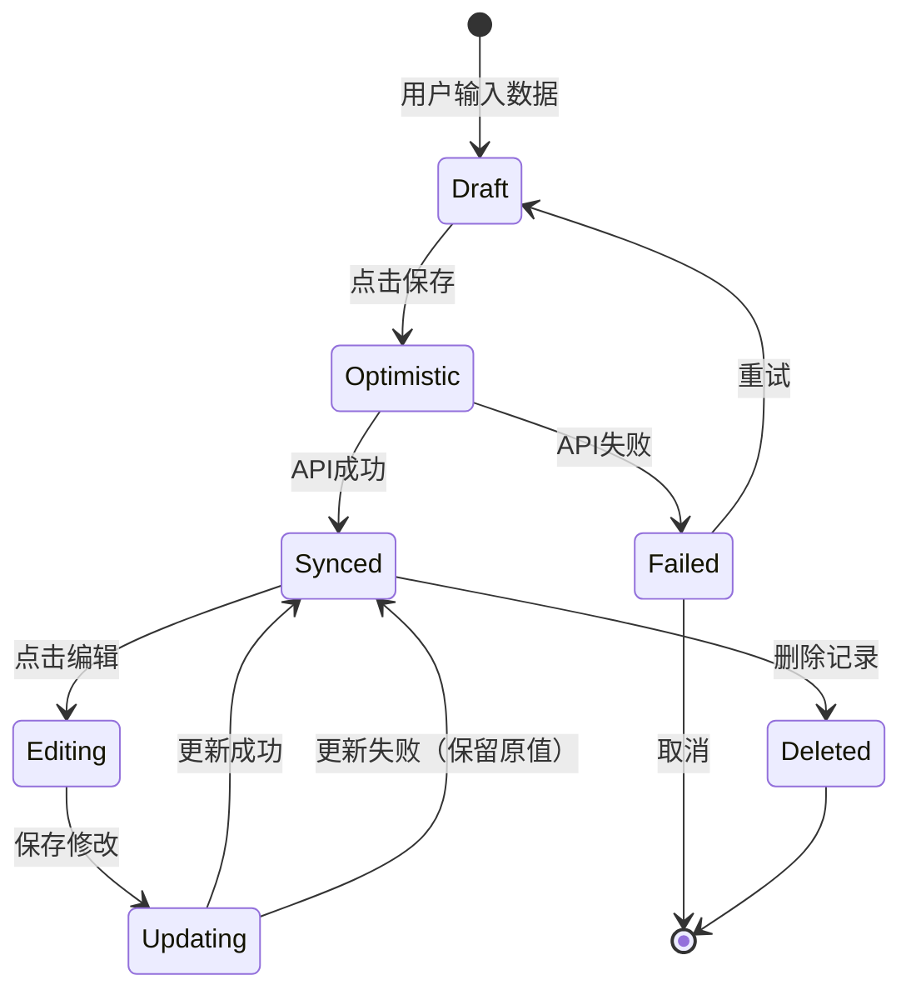
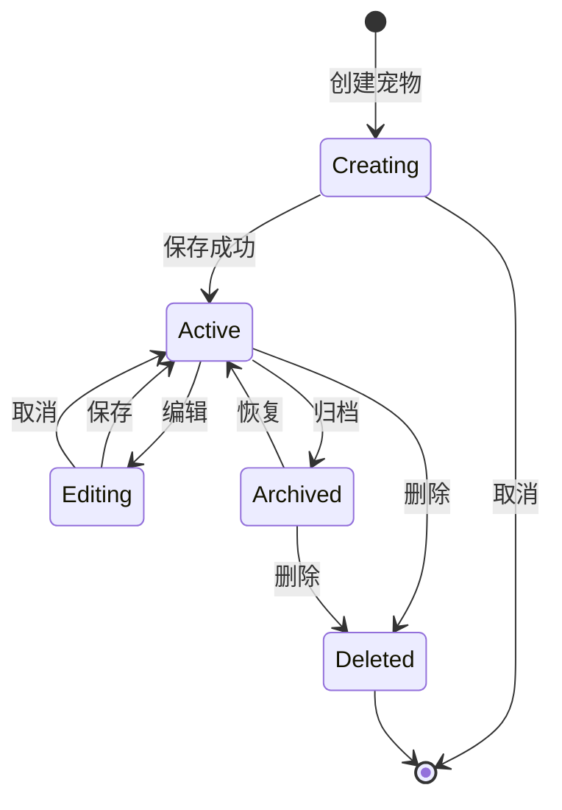
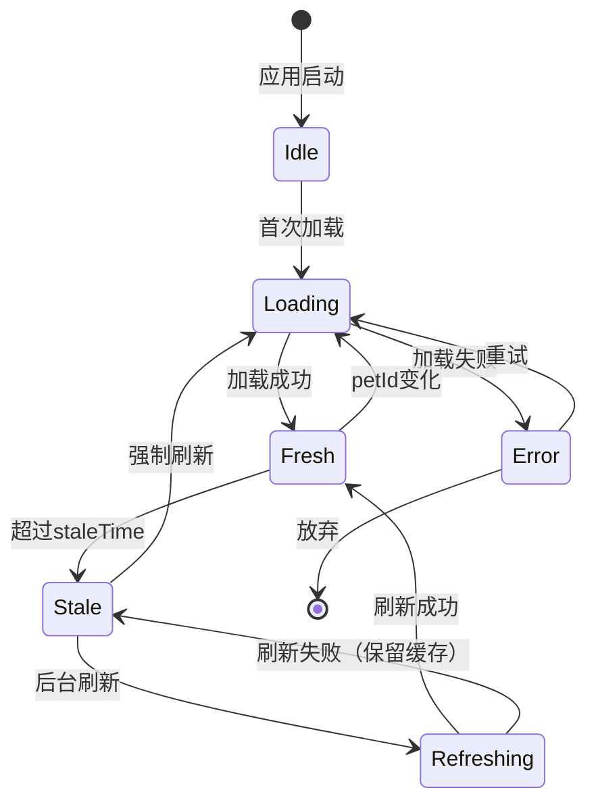
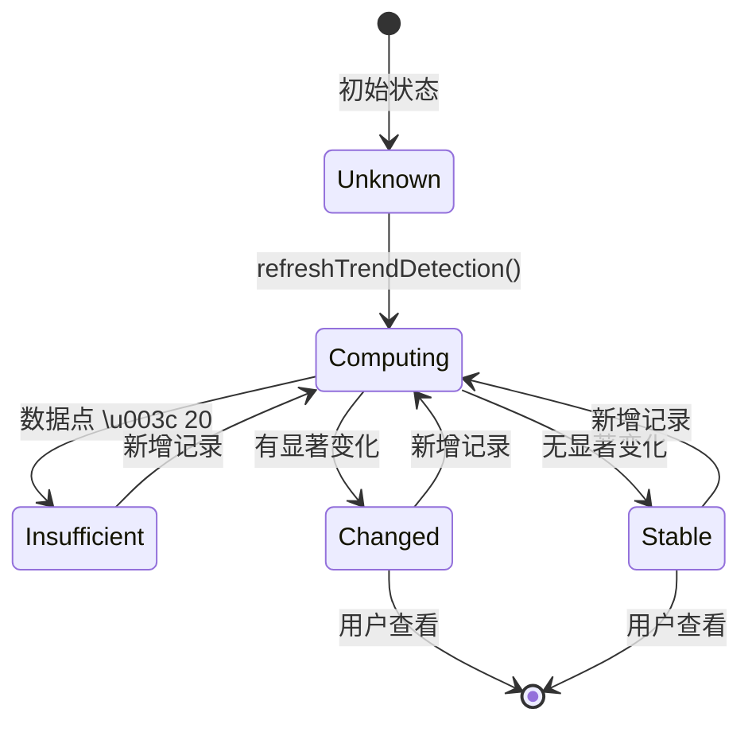
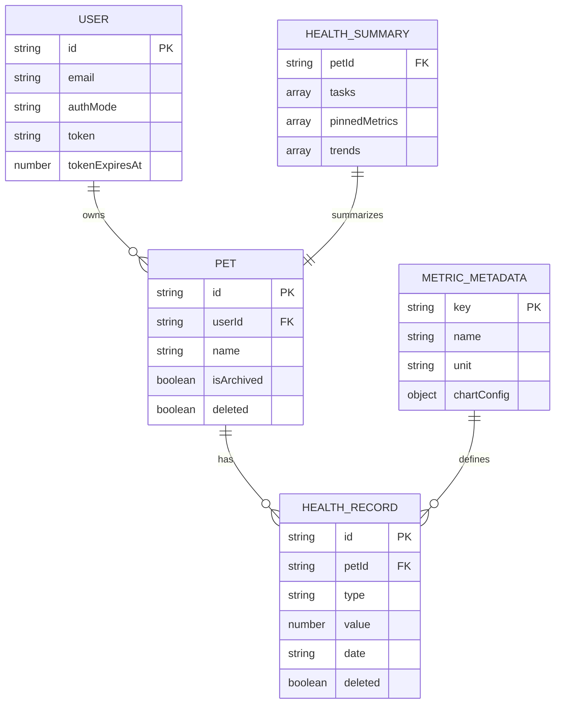

# iPet 产品与业务层文档

## 1. 业务边界与目标

### 1.1 系统定位

**iPet** 是一款面向宠物主人的**健康数据管理与分析系统**，致力于帮助宠物主人科学记录、追踪和分析宠物的健康状况。

### 1.2 核心功能（系统做什么）

#### 1.2.1 健康数据记录
- ✅ 支持30+种健康指标记录（体重、体温、饮食、运动等）
- ✅ 多维度数据采集（数值型、时间型、布尔型）
- ✅ 离线优先的数据同步机制
- ✅ 乐观更新（Optimistic UI）提升用户体验

#### 1.2.2 宠物档案管理
- ✅ 多宠物档案支持
- ✅ 宠物基础信息维护（品种、年龄、性别等）
- ✅ 宠物档案归档与恢复
- ✅ 宠物切换与选择

#### 1.2.3 数据可视化与分析
- ✅ 趋势图表展示（体重曲线、运动轨迹等）
- ✅ 显著性变化检测（自动识别异常波动）
- ✅ 健康摘要与日报
- ✅ 智能提醒与任务推送

#### 1.2.4 账号体系
- ✅ 正式账号（邮箱注册）
- ✅ 游客模式（快速体验，数据临时保留）
- ✅ 游客账号升级为正式账号
- ✅ Token过期自动检测与刷新

#### 1.2.5 内容服务
- ✅ 健康知识文章库（30+篇指标相关文章）
- ✅ Markdown 格式内容渲染
- ✅ 指标关联推荐

### 1.3 系统边界（系统不做什么）

#### 1.3.1 医疗诊断
- ❌ 不提供疾病诊断功能
- ❌ 不替代专业兽医咨询
- ❌ 不承诺医疗准确性

#### 1.3.2 第三方集成
- ❌ 不集成智能硬件（智能称、智能项圈）
- ❌ 不接入第三方健康平台
- ❌ 不提供社交分享功能（当前版本）

#### 1.3.3 商业化功能
- ❌ 不涉及电商/宠物用品销售
- ❌ 不提供付费会员服务（当前版本）
- ❌ 不包含广告系统

#### 1.3.4 多租户隔离
- ❌ 不支持多用户共享同一宠物档案（企业/家庭租户）
- ❌ 用户数据完全隔离（基于 `userId`）

### 1.4 核心指标（北极星指标）

#### 1.4.1 用户参与度
- **DAU（日活跃用户）**：衡量用户粘性
- **记录频次**：平均每用户每周记录次数
- **连续记录天数**：用户持续使用天数

#### 1.4.2 数据质量
- **指标覆盖度**：用户记录的指标种类数
- **数据完整性**：关键指标（体重、饮食、运动）的记录完整率

#### 1.4.3 用户留存
- **次日留存率**：新用户次日回访率
- **7日留存率**：新用户7天后的留存率
- **游客转化率**：游客账号升级为正式账号的比例

#### 1.4.4 系统健康
- **API成功率**：接口调用成功率（目标 \u003e 99%）
- **数据同步时效**：离线数据同步延迟（目标 \u003c 5秒）
- **缓存命中率**：本地缓存命中率（目标 \u003e 80%）

---

## 2. 业务域模型

### 2.1 核心概念

#### 2.1.1 用户（User）
- **属性**：
  - `id`: 用户唯一标识
  - `username`: 用户名
  - `email`: 邮箱
  - `displayName`: 显示名称
  - `avatar`: 头像URL
  - `authMode`: 认证模式（`'none' | 'guest' | 'user'`）
  - `token`: JWT令牌
  - `tokenExpiresAt`: 令牌过期时间
  - `needsOnboarding`: 是否需要引导流程

- **生命周期**：
  1. 访客 → 登录/注册 → 认证用户
  2. 游客模式 → 升级 → 正式用户
  3. 正式用户 → 登出 → 访客

#### 2.1.2 宠物（Pet）
- **属性**：
  - `id`: 宠物唯一标识
  - `name`: 宠物名称
  - `species`: 物种（猫/狗等）
  - `breed`: 品种
  - `birthdate`: 出生日期
  - `gender`: 性别
  - `avatar`: 头像
  - `isArchived`: 是否归档
  - `deleted`: 是否删除（软删除）

- **状态**：
  - **活跃**：正常显示和使用
  - **归档**：不再活跃，但数据保留
  - **已删除**：标记删除（软删除，不物理删除）

#### 2.1.3 健康记录（HealthRecord）
- **属性**：
  - `id`: 记录唯一标识
  - `petId`: 所属宠物ID
  - `type`: 指标类型（`weight`、`body_temp`、`meal` 等）
  - `value`: 指标数值
  - `date`: 记录日期（ISO 8601）
  - `note`: 备注
  - `deleted`: 是否删除
  - `tempId`: 临时ID（乐观更新使用）

- **分类**：
  - **生理指标**：体重、体温、心率、BMI等
  - **行为指标**：运动距离、步数、睡眠时长等
  - **饮食指标**：进食量、饮水量、营养成分等
  - **护理指标**：洗澡、驱虫、疫苗等

#### 2.1.4 指标元数据（MetricMetadata）
- **属性**：
  - `key`: 指标键（如 `weight`）
  - `name`: 中文名称
  - `unit`: 单位
  - `icon`: 图标
  - `category`: 分类
  - `chartConfig`: 图表配置
  - `normalRange`: 正常范围

#### 2.1.5 健康摘要（HealthSummary）
- **组成**：
  - `tasks`: 待办任务列表（疫苗提醒、体检提醒等）
  - `pinnedMetrics`: 置顶指标（最近更新的关键指标）
  - `trends`: 趋势分析（有显著变化的指标）
  - `dailySummaries`: 每日汇总数据

### 2.2 术语表

| 术语 | 英文 | 定义 | 示例 |
|------|------|------|------|
| 指标 | Metric | 可量化的健康数据维度 | 体重、体温、心率 |
| 记录 | Record | 某一时间点的指标数值 | 2024-01-15 体重 5.2kg |
| 趋势 | Trend | 指标随时间的变化模式 | 体重上升趋势 |
| 显著性变化 | Significant Change | 统计学意义上的异常波动 | 体重7天内下降10% |
| 乐观更新 | Optimistic Update | UI立即响应，后台异步同步 | 添加记录时先显示，后保存 |
| 游客模式 | Guest Mode | 无需注册即可体验的临时账号 | 数据保留30天 |
| 归档 | Archive | 宠物不再活跃，数据保留 | 宠物去世/送养 |
| 软删除 | Soft Delete | 逻辑删除，数据标记为删除但不物理删除 | `deleted: true` |
| 缓存失效 | Cache Invalidation | 数据变更后清除相关缓存 | 添加体重记录后清除体重图表缓存 |

### 2.3 关键流程

#### 2.3.1 用户注册与登录流程



#### 2.3.2 健康记录添加流程（乐观更新）



#### 2.3.3 数据同步与缓存流程



#### 2.3.4 游客账号升级流程



---

## 3. 权限与角色

### 3.1 角色定义

#### 3.1.1 访客（Visitor）
- **权限特征**：
  - ❌ 无需登录
  - ✅ 可浏览公开文章
  - ✅ 可访问帮助页面
  - ❌ 无法记录数据
  - ❌ 无法创建宠物档案

#### 3.1.2 游客用户（Guest User）
- **权限特征**：
  - ✅ 创建临时账号（无需邮箱）
  - ✅ 创建宠物档案
  - ✅ 记录健康数据
  - ✅ 查看图表和趋势
  - ⚠️ 数据临时保存（默认30天后清理）
  - ⚠️ 无法使用部分高级功能（待定义）

#### 3.1.3 正式用户（Registered User）
- **权限特征**：
  - ✅ 邮箱注册，永久保存数据
  - ✅ 所有游客功能
  - ✅ 数据云端永久保存
  - ✅ 多设备同步
  - ✅ 导出数据（未来）
  - ✅ 高级分析功能（未来）

### 3.2 权限矩阵

| 功能模块 | 访客 | 游客用户 | 正式用户 |
|---------|------|---------|---------|
| **账号管理** |
| 注册/登录 | ✅ | - | - |
| 游客登录 | ✅ | - | - |
| 账号升级 | - | ✅ | - |
| 修改个人资料 | ❌ | ✅ | ✅ |
| **宠物档案** |
| 创建宠物 | ❌ | ✅ | ✅ |
| 编辑宠物 | ❌ | ✅ | ✅ |
| 归档宠物 | ❌ | ✅ | ✅ |
| 删除宠物 | ❌ | ✅ | ✅ |
| **健康记录** |
| 添加记录 | ❌ | ✅ | ✅ |
| 编辑记录 | ❌ | ✅ | ✅ |
| 删除记录 | ❌ | ✅ | ✅ |
| 查看历史 | ❌ | ✅ | ✅ |
| **数据分析** |
| 查看图表 | ❌ | ✅ | ✅ |
| 趋势检测 | ❌ | ✅ | ✅ |
| 健康摘要 | ❌ | ✅ | ✅ |
| **内容服务** |
| 浏览文章 | ✅ | ✅ | ✅ |
| 帮助文档 | ✅ | ✅ | ✅ |

### 3.3 数据隔离规则

#### 3.3.1 用户级隔离
- **隔离键**：`userId`
- **隔离范围**：
  - 所有宠物档案
  - 所有健康记录
  - 用户配置和偏好设置
  - 缓存数据

- **实现机制**：
  ```typescript
  // 所有API请求自动携带用户标识
  headers: {
    'Authorization': `Bearer ${token}`,  // JWT中包含userId
  }
  
  // 后端强制过滤
  const pets = await db.pets.find({ userId: req.user.id })
  ```

#### 3.3.2 宠物级隔离
- **隔离键**：`petId`
- **隔离范围**：
  - 健康记录按petId分组
  - 图表数据按petId过滤
  - 趋势分析独立计算

- **实现机制**：
  ```typescript
  // Store中的recordsByPetId computed
  const recordsByPetId = computed(() => {
    const map: Record<string, HealthRecord[]> = {}
    ids.value.forEach(id => {
      const record = entities.value[id]
      const pId = String(record.petId)
      if (!map[pId]) map[pId] = []
      map[pId].push(record)
    })
    return map
  })
  ```

#### 3.3.3 租户隔离（未实现）
- **说明**：当前版本不支持多租户（企业/家庭共享）
- **未来扩展**：可能引入 `tenantId` 支持家庭成员共享宠物数据

### 3.4 路由权限控制

#### 3.4.1 公开路由（Public Routes）
```typescript
const publicExactRoutes = [
  '/pages/login/index',
  '/pages/register/index',
  '/pages/login/forgot-password',
  '/pages/settings/privacy'
]

const publicPrefixes = [
  '/pages/articles/',   // 文章详情
  '/pages/help/',       // 帮助页面
  '/pages/about/'       // 关于页面
]
```

#### 3.4.2 游客可访问路由（Guest Routes）
- 默认所有非公开路由都需要游客级别权限
- 包括：首页、摘要页、宠物管理、健康记录等

#### 3.4.3 正式用户专属路由（User Only Routes）
```typescript
const userOnlyPrefixes: string[] = []
// 当前版本为空，未来可能包括：
// - '/pages/settings/export',  // 数据导出
// - '/pages/premium/',         // 高级功能
```

#### 3.4.4 权限检查流程
```typescript
// 权限拦截器（src/permission.ts）
function hasPermission(url: string) {
  const level = resolveAuthLevel(url)  // 'public' | 'guest' | 'user'
  
  if (level === 'public') return { allowed: true }
  
  const userStore = useUserStore()
  const tokenState = evaluateTokenState(userStore)
  
  if (!tokenState.valid) {
    return { allowed: false, reason: tokenState.reason }
  }
  
  if (level === 'user' && userStore.authMode !== 'user') {
    return { allowed: false, reason: 'requires-user' }
  }
  
  return { allowed: true }
}
```

---

## 4. 状态机

### 4.1 用户认证状态机



**状态说明**：

| 状态 | authMode | isLoggedIn | needsOnboarding | 描述 |
|------|----------|------------|----------------|------|
| Visitor | `'none'` | `false` | - | 未登录状态 |
| GuestUser | `'guest'` | `true` | 动态计算 | 游客模式 |
| RegisteredUser | `'user'` | `true` | 动态计算 | 正式用户 |
| TokenExpired | `'user'/'guest'` | `false` | - | Token过期 |

**触发条件**：
- **Token过期检测**：
  ```typescript
  if (expiresAt - TOKEN_EXPIRY_BUFFER_MS <= Date.now()) {
    return { valid: false, reason: 'expired' }
  }
  ```
- **引导流程判断**：
  ```typescript
  const needsOnboarding = !hasProfile && !hasPets
  ```

### 4.2 健康记录状态机



**状态说明**：

| 状态 | tempId | id | deleted | UI表现 |
|------|--------|-----|---------|--------|
| Draft | - | - | - | 表单编辑中 |
| Optimistic | ✅ | - | `false` | 灰色/带loading图标 |
| Synced | - | ✅ | `false` | 正常显示 |
| Failed | - | - | - | 显示错误提示 |
| Editing | - | ✅ | `false` | 表单编辑中 |
| Updating | - | ✅ | `false` | 更新中状态 |
| Deleted | - | ✅ | `true` | UI隐藏（软删除） |

**关键操作**：

1. **乐观更新**：
```typescript
// 立即插入临时记录
entities.value[tempId] = optimisticRecord
ids.value = [tempId, ...ids.value]

// 后台同步后替换
delete newEntities[tempId]
newEntities[realId] = serverRecord
```

2. **失败回滚**：
```typescript
// 删除临时记录
delete entities.value[tempId]
ids.value = ids.value.filter(id => id !== tempId)
```

### 4.3 宠物档案状态机



**状态说明**：

| 状态 | isArchived | deleted | UI表现 |
|------|-----------|---------|--------|
| Active | `false` | `false` | 正常显示，可切换 |
| Archived | `true` | `false` | 列表隐藏，可恢复 |
| Deleted | - | `true` | 完全隐藏 |

**业务规则**：
- 归档的宠物不能被选中为"当前宠物"
- 删除宠物时，相关健康记录不删除（保留历史数据）
- 恢复归档宠物后自动设为"当前宠物"

### 4.4 数据同步状态机



**状态说明**：

| 状态 | loading | lastUpdated | 数据来源 | UI表现 |
|------|---------|-------------|---------|--------|
| Idle | `false` | `null` | - | 空状态 |
| Loading | `true` | `null` | API | 显示Loading |
| Fresh | `false` | \u003c1分钟 | Store | 正常显示 |
| Stale | `false` | \u003e1分钟 | Store | 正常显示（后台刷新） |
| Refreshing | `false` | - | Store + API | 正常显示（静默刷新） |
| Error | `false` | - | - | 错误提示 |

**缓存策略**：

```typescript
// SWR (Stale-While-Revalidate) 策略
const staleTime = 60 * 1000  // 1分钟

if (now - lastUpdated > staleTime && hasCache) {
  // 先返回缓存数据，后台静默刷新
  fetchHealthRecords(petId).then(...)
  return cachedData
}
```

### 4.5 趋势检测状态机



**状态说明**：

| 状态 | hasSignificantChange | dataPoints | UI表现 |
|------|---------------------|------------|--------|
| Unknown | - | - | 不显示趋势 |
| Computing | - | - | 计算中 |
| Insufficient | - | \u003c20 | "数据不足" |
| Stable | `false` | ≥20 | "平稳" |
| Changed | `true` | ≥20 | "显著变化" + 详情 |

**触发时机**：
```typescript
// 手动触发（非响应式）
refreshTrendDetection(['weight', 'body_temp'])

// 自动触发场景：
// 1. fetchHealthRecords() 后（全量刷新）
// 2. addRecord() 后（增量刷新）
// 3. updateRecord() 后（增量刷新）
// 4. deleteRecord() 后（增量刷新）
```

---

## 5. 异常流程与边界情况

### 5.1 网络异常

#### 5.1.1 离线数据录入
- **场景**：用户离线时添加健康记录
- **处理**：
  1. 乐观更新立即生效（UI显示）
  2. 后台尝试同步，失败后标记为"待同步"
  3. 网络恢复时自动重试同步

#### 5.1.2 API超时
- **场景**：API响应超时（\u003e 30秒）
- **处理**：
  1. 显示"网络异常，请稍后重试"
  2. 回滚乐观更新
  3. 提供"重试"按钮

### 5.2 数据一致性

#### 5.2.1 宠物切换时的数据清理
- **场景**：用户切换当前宠物
- **处理**：
  ```typescript
  // ensureDataLoaded 检测到 petId 变化
  if (isPetChanged) {
    loading.value = true  // 显示Loading
    await fetchHealthRecords(newPetId)  // 重新加载数据
    invalidateSeriesCache()  // 清除所有图表缓存
  }
  ```

#### 5.2.2 缓存失效策略
- **场景**：记录更新后，图表缓存需要失效
- **处理**：
  ```typescript
  // 精准失效：只清除相关指标的缓存
  invalidateSeriesCache('weight')  // 只清除体重图表缓存
  
  // 全量失效：清除所有缓存
  invalidateSeriesCache()  // 切换宠物时使用
  ```

### 5.3 权限变更

#### 5.3.1 Token过期
- **场景**：用户操作时Token过期
- **处理**：
  1. 拦截器检测到过期（expiresAt \u003c now）
  2. 清除本地Session
  3. 重定向到登录页，携带`redirect`参数
  4. 登录成功后跳转回原页面

#### 5.3.2 游客升级为正式用户
- **场景**：游客点击"升级账号"
- **处理**：
  1. 后端迁移数据（petId/userId保持不变）
  2. 前端清理缓存但保留新Token
  3. 重新加载宠物和健康数据
  4. 更新 authMode 为 `'user'`

---

## 6. 性能与优化策略

### 6.1 缓存策略

#### 6.1.1 多级缓存架构
```
L1: Store (Pinia State)   - 内存缓存，立即响应
L2: Series Cache          - 图表数据缓存（TTL: 10分钟）
L3: Trend Cache           - 趋势分析结果缓存（基于hash）
L4: IndexedDB (未来)      - 持久化缓存
```

#### 6.1.2 索引加速
```typescript
// 指标索引：避免O(N)扫描
const metricIndex = {
  'weight': ['record-1', 'record-3', 'record-5'],
  'body_temp': ['record-2', 'record-4']
}

// 查询优化：O(1) -> O(k)，k为该指标的记录数
const weightRecords = metricIndex['weight'].map(id => entities[id])
```

### 6.2 响应式优化

#### 6.2.1 ShallowRef 减少深层响应式开销
```typescript
// ❌ 深层响应式：性能开销大
const entities = ref<Record<string, HealthRecord>>({})

// ✅ 浅层响应式：只代理第一层
const entities = shallowRef<Record<string, HealthRecord>>({})

// 更新时替换整个引用
entities.value = { ...entities.value, [id]: newRecord }
```

#### 6.2.2 MarkRaw 隔离响应式系统
```typescript
// 趋势分析结果不需要响应式追踪
const metricTrendMap = shallowRef(markRaw({}))
const trendCache = shallowRef(markRaw(new Map()))
```

### 6.3 异步优化

#### 6.3.1 Worker线程计算
```typescript
// 数据量 \u003e 100条时，自动切换到Worker
const { result } = await TrendEngine.run(key, records)

// Worker内部：
if (metricRecords.length \u003e 100) {
  worker.postMessage({ key, records })
} else {
  result = detectSignificantChanges(records)  // 主线程
}
```

#### 6.3.2 Debounce合并请求
```typescript
// 短时间内多次调用，只执行一次
refreshTrendDetection(['weight'])
refreshTrendDetection(['body_temp'])
// → 合并为一次执行：refreshTrendDetection(['weight', 'body_temp'])
```

---

## 7. 数据模型关系图



---

## 8. 附录

### 8.1 核心指标元数据列表（部分）

| key | 中文名 | 单位 | 分类 | 正常范围 |
|-----|--------|------|------|---------|
| `weight` | 体重 | kg | 生理指标 | 因品种而异 |
| `body_temp` | 体温 | °C | 生理指标 | 38.0-39.2 |
| `bmi` | 体质指数 | - | 生理指标 | 4.5-6.5 |
| `meal` | 进食量 | g | 饮食指标 | - |
| `water` | 饮水量 | ml | 饮食指标 | 40-60 ml/kg |
| `walk_duration` | 散步时长 | 分钟 | 运动指标 | ≥30 |
| `run_distance` | 跑步距离 | km | 运动指标 | - |
| `bathing` | 洗澡 | - | 护理指标 | 7-14天一次 |
| `deworming` | 驱虫 | - | 护理指标 | 每季度一次 |
| `rabies_vaccine` | 狂犬疫苗 | - | 护理指标 | 每年一次 |

### 8.2 API端点概览（参考）

| 端点 | 方法 | 功能 | 权限 |
|------|------|------|------|
| `/auth/register` | POST | 注册正式账号 | 公开 |
| `/auth/login` | POST | 登录 | 公开 |
| `/auth/guest` | POST | 创建游客账号 | 公开 |
| `/auth/upgrade` | POST | 游客升级 | 游客 |
| `/pets` | GET | 获取宠物列表 | 游客+ |
| `/pets` | POST | 创建宠物 | 游客+ |
| `/pets/:id` | PUT | 更新宠物 | 游客+ |
| `/pets/:id` | DELETE | 删除宠物 | 游客+ |
| `/health-records` | GET | 获取健康记录 | 游客+ |
| `/health-records` | POST | 创建健康记录 | 游客+ |
| `/health-records/:id` | PUT | 更新健康记录 | 游客+ |
| `/health-records/:id` | DELETE | 删除健康记录 | 游客+ |
| `/health-summary` | GET | 获取健康摘要 | 游客+ |

### 8.3 关键配置参数

| 参数 | 值 | 说明 |
|------|-----|------|
| `TOKEN_EXPIRY_BUFFER_MS` | 30000 | Token过期缓冲时间（30秒） |
| `SERIES_CACHE_TTL_MS` | 600000 | 图表缓存TTL（10分钟） |
| `STALE_TIME` | 60000 | 数据过期时间（1分钟） |
| `TREND_MIN_DATA_POINTS` | 20 | 趋势分析最少数据点 |
| `WORKER_THRESHOLD` | 100 | Worker线程计算阈值 |

---

**文档版本**：v1.0  
**最后更新**：2025-12-18  