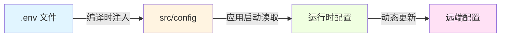
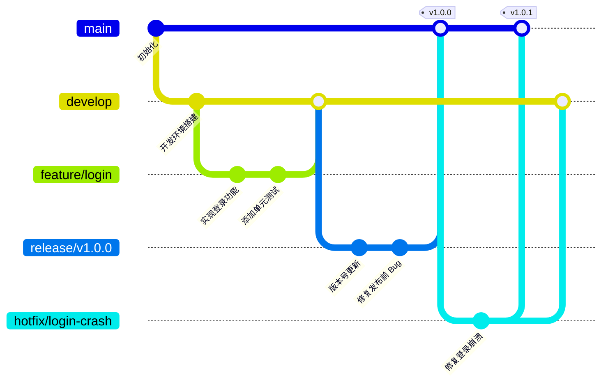

# 工程化与开发指南层

本文档定义 **iPet-uniapp** 项目的工程化规范和开发流程，为开发者提供从本地启动到生产发布的完整指南。

---

## 📋 目录

1. [快速启动](#快速启动)
2. [构建与发布](#构建与发布)
3. [配置策略](#配置策略)
4. [代码规范](#代码规范)

---

## 🚀 快速启动

### 1.1 环境要求

| 依赖 | 版本要求 | 说明 |
|------|---------|-----|
| **Node.js** | `>= 18.x` | 推荐使用最新 LTS 版本 |
| **npm** | `>= 9.x` | 或使用 pnpm/yarn |
| **HBuilderX** | `>= 3.8.x` | 用于小程序/App 开发 (可选) |

### 1.2 本地启动步骤

#### 1.2.1 克隆项目

```bash
git clone <repository-url>
cd iPet-uniapp
```

#### 1.2.2 安装依赖

```bash
npm install
```

> [!TIP]
> **加速依赖安装**: 如果网络较慢,可使用国内镜像源:
> ```bash
> npm config set registry https://registry.npmmirror.com
> ```

#### 1.2.3 启动开发服务器

根据目标平台选择对应命令:

| 平台 | 命令 | 说明 |
|------|------|-----|
| **H5** | `npm run dev:h5` | 浏览器预览,支持热更新 |
| **微信小程序** | `npm run dev:mp-weixin` | 生成 `dist/dev/mp-weixin` 目录 |
| **支付宝小程序** | `npm run dev:mp-alipay` | 生成 `dist/dev/mp-alipay` 目录 |
| **App** | `npm run dev:app` | 需配合 HBuilderX 运行 |

**示例 (微信小程序开发流程)**:

```bash
# 1. 启动编译
npm run dev:mp-weixin

# 2. 使用微信开发者工具打开 dist/dev/mp-weixin 目录
# 3. 修改代码后会自动重新编译
```

### 1.3 环境变量配置

项目使用 `.env` 文件管理环境变量,支持多环境配置:

| 文件 | 触发条件 | 用途 |
|------|---------|-----|
| `.env.development` | 开发模式 (`dev:*` 命令) | 开发环境配置 |
| `.env.production` | 生产模式 (`build:*` 命令) | 生产环境配置 |
| `.env.local` | 所有模式 (优先级最高) | **本地个人配置,不提交到 Git** |

**必需环境变量**:

```properties
# API 基础地址
VITE_API_BASE_URL=http://192.168.31.167:3000/api

# 是否启用 Mock 数据 (true/false)
VITE_USE_MOCK=false
```

> [!WARNING]
> **不要将敏感信息 (如密钥、Token) 直接写入 `.env` 文件并提交到远程仓库!** 敏感配置应使用 `.env.local` 或 CI/CD 平台的环境变量功能。

### 1.4 常见坑点与解决方案

#### 1.4.1 依赖安装失败

**问题**: `npm install` 报错或卡住不动

**解决方案**:

1. **清理缓存**:
   ```bash
   npm cache clean --force
   rm -rf node_modules package-lock.json
   npm install
   ```

2. **检查 Node 版本**:
   ```bash
   node -v  # 确保 >= 18.x
   ```

3. **使用镜像源**:
   ```bash
   npm install --registry=https://registry.npmmirror.com
   ```

#### 1.4.2 文章资源未生成

**问题**: 启动后提示"文章资源不存在"或显示为空

**原因**: 未执行文章预处理脚本

**解决方案**:

```bash
npm run articles:prepare
```

此命令会依次执行:
- `tokens:build` - 生成设计 Token
- `articles:validate` - 校验文章格式
- `articles:build` - 构建文章索引

> [!NOTE]
> 所有 `dev:*` 命令已自动包含 `articles:prepare`,无需手动执行。

#### 1.4.3 TypeScript 类型错误

**问题**: IDE 提示类型错误,但实际可运行

**解决方案**:

1. **重启 TypeScript 服务器** (VSCode):
   - 按 `Cmd+Shift+P` (Mac) 或 `Ctrl+Shift+P` (Windows)
   - 输入 "TypeScript: Restart TS Server"

2. **手动检查类型**:
   ```bash
   npm run type-check
   ```

3. **检查是否缺少类型定义**:
   - 查看 `tsconfig.json` 中的 `types` 字段
   - 确保安装了 `@dcloudio/types` 等相关包

#### 1.4.4 微信小程序开发者工具无法预览

**问题**: 编译成功但开发者工具报错或白屏

**检查清单**:

- ✅ 确认 `dist/dev/mp-weixin` 目录存在且包含 `app.json`
- ✅ 开发者工具项目路径指向 `dist/dev/mp-weixin` (不是项目根目录)
- ✅ 关闭"代码压缩"选项 (开发模式下)
- ✅ 清除开发者工具缓存: 工具栏 → 清缓存 → 全部清除

#### 1.4.5 SCSS 编译警告

**问题**: 控制台显示 `legacy-js-api` 警告

**说明**: 这是 Sass 新版本的弃用警告,已在 `vite.config.js` 中配置忽略:

```javascript
css: {
  preprocessorOptions: {
    scss: {
      silenceDeprecations: ['legacy-js-api', 'import'],
    },
  },
}
```

如需完全解决,需等待 uni-app 升级到 Sass 新 API。

---

## 🏗️ 构建与发布

### 2.1 构建命令

#### 2.1.1 完整构建流程

所有 `build:*` 命令均包含以下步骤:

1. **预处理** - 执行 `articles:prepare` (Token、文章校验与构建)
2. **图片优化** - 执行 `scripts/optimize-images.js` (压缩、WebP 转换)
3. **平台编译** - 使用 `uni build` 根据目标平台生成产物
4. **生成报告** - 执行 `scripts/generate-articles-report.js` (生成文章统计)

**常用构建命令**:

| 平台 | 命令 | 产物目录 |
|------|------|---------|
| **H5** | `npm run build:h5` | `dist/build/h5` |
| **微信小程序** | `npm run build:mp-weixin` | `dist/build/mp-weixin` |
| **支付宝小程序** | `npm run build:mp-alipay` | `dist/build/mp-alipay` |
| **App (Android)** | `npm run build:app-android` | `dist/build/app-android` |
| **App (iOS)** | `npm run build:app-ios` | `dist/build/app-ios` |

**示例 (构建微信小程序生产包)**:

```bash
npm run build:mp-weixin
```

构建完成后:
1. 在微信开发者工具中打开 `dist/build/mp-weixin`
2. 点击"上传"按钮提交代码
3. 在微信公众平台提交审核

#### 2.1.2 单独执行脚本

如需单独执行某个步骤:

```bash
# 仅构建文章索引
npm run articles:build

# 仅优化图片资源
node scripts/optimize-images.js

# 仅生成文章报告
node scripts/generate-articles-report.js
```

### 2.2 构建产物说明

#### 2.2.1 目录结构

```text
dist/
├── dev/              # 开发模式产物
│   ├── mp-weixin/    # 微信小程序开发版
│   └── h5/           # H5 开发版
└── build/            # 生产模式产物
    ├── mp-weixin/    # 微信小程序生产版
    ├── h5/           # H5 生产版
    └── app-*/        # 原生 App 产物
```

#### 2.2.2 关键产物文件

| 文件/目录 | 说明 |
|----------|-----|
| `app.json` / `app.js` | 微信小程序主配置与入口 |
| `index.html` | H5 入口页面 |
| `static/` | 静态资源 (图片、字体等) |
| `articles-report.json` | 文章统计报告 (仅生产模式) |

> [!IMPORTANT]
> **产物目录不应提交到 Git!** `.gitignore` 已配置忽略 `dist/` 和 `unpackage/`。

### 2.3 环境差异说明

#### 2.3.1 开发环境 vs 生产环境

| 特性 | 开发环境 (dev) | 生产环境 (build) |
|------|---------------|-----------------|
| **代码压缩** | ❌ | ✅ |
| **SourceMap** | ✅ | ❌ |
| **热更新** | ✅ | ❌ |
| **Console 日志** | 保留 | 移除 |
| **API 地址** | `.env.development` | `.env.production` |

#### 2.3.2 跨平台差异

**H5 平台特性**:
- 支持浏览器 DevTools 调试
- 可部署到任意 Web 服务器
- 需处理浏览器兼容性 (推荐 ES2020+)

**微信小程序特性**:
- 包大小限制: 主包 ≤ 2MB,总包 ≤ 20MB
- 需通过微信审核
- 部分 Web API 不可用 (如 `localStorage` → `wx.setStorageSync`)

**App 平台特性**:
- 需使用 HBuilderX 云打包或本地打包
- Android/iOS 平台特定配置在 `manifest.json` 中定义
- 支持原生插件集成

### 2.4 回滚方式

#### 2.4.1 微信小程序回滚

**方法 1: 微信公众平台回退**

1. 登录 [微信公众平台](https://mp.weixin.qq.com/)
2. 进入"开发管理" → "版本管理"
3. 点击"回退版本"按钮 (仅支持回退到上一版本)

**方法 2: 重新发布历史版本**

1. 切换到对应的 Git Tag/Commit:
   ```bash
   git checkout v1.2.0  # 替换为目标版本号
   ```

2. 重新构建并上传:
   ```bash
   npm run build:mp-weixin
   ```

3. 在开发者工具中上传并提交审核

#### 2.4.2 H5 回滚

**方法 1: 服务器替换文件**

将备份的 `dist/build/h5` 目录覆盖到服务器:

```bash
# 备份当前版本
mv /var/www/ipet /var/www/ipet.backup

# 恢复历史版本
cp -r /backup/ipet-v1.2.0 /var/www/ipet
```

**方法 2: CI/CD 重新部署**

如使用 GitHub Actions / Jenkins 等 CI/CD 工具:

1. 选择历史构建记录
2. 点击"重新部署"按钮
3. 或手动触发指定 Git Tag 的构建流程

> [!CAUTION]
> **回滚前务必检查数据库兼容性!** 如新版本包含数据库迁移 (Schema 变更),回滚代码后可能导致数据不一致。

---

## ⚙️ 配置策略

### 3.1 配置层次与职责边界

项目采用 **三层配置架构**,各层职责明确:



#### 3.1.1 `.env` 文件 (编译时环境变量)

**职责**: 定义与部署环境相关的配置,在 **编译时** 注入到代码中。

**典型用途**:
- API 后端地址
- 第三方服务密钥 (OAuth Client ID 等)
- 功能开关 (是否启用 Mock、调试模式等)

**访问方式**:

```typescript
// Vite 会在编译时替换 import.meta.env.VITE_* 变量
const apiBase = import.meta.env.VITE_API_BASE_URL
const useMock = import.meta.env.VITE_USE_MOCK === 'true'
```

**特性**:
- ✅ 支持多环境 (`.env.development` / `.env.production`)
- ✅ 编译时确定,运行时不可修改
- ❌ 不适合存储敏感信息 (会打包到前端代码中)

> [!WARNING]
> **前端环境变量对用户可见!** 任何写入 `.env` 并通过 `import.meta.env` 访问的值都会暴露在构建产物中。API 密钥等敏感信息应由后端管理,前端仅传递 Token。

#### 3.1.2 `src/config` (应用层配置)

**职责**: 定义与业务逻辑相关的常量配置,应用启动时读取。

**典型用途**:
- UI 样式常量 (颜色、字体、间距)
- 业务规则 (最大上传数量、数据保留天数)
- 静态映射表 (健康指标单位、宠物品种列表)

**目录结构**:

```text
src/config/
├── api.ts           # API 路径常量
├── articles.ts      # 文章配置 (分类、标签)
├── constants.ts     # 通用常量
├── health.ts        # 健康指标配置
├── index.ts         # 导出所有配置
└── metrics.ts       # 数据指标定义
```

**示例** ([health.ts](file:///Users/zhengjiyuan/Desktop/iPet/iPet-uniapp/src/config/health.ts)):

```typescript
export const HEALTH_METRIC_UNITS = {
  weight: 'kg',
  temperature: '°C',
  heartRate: 'bpm',
} as const

export const GUEST_DATA_RETENTION_DAYS = 7
```

**访问方式**:

```typescript
import { HEALTH_METRIC_UNITS } from '@/config/health'

const unit = HEALTH_METRIC_UNITS.weight  // 'kg'
```

**特性**:
- ✅ 类型安全 (TypeScript 支持)
- ✅ 可在运行时动态引用 (但值本身不可变)
- ✅ 支持代码提示和重构

#### 3.1.3 远端配置 (动态配置)

**职责**: 由后端或配置中心管理,支持在 **不重新发布** 的情况下动态更新。

**典型用途**:
- A/B 测试开关
- 功能灰度发布控制
- 紧急降级开关 (如暂时禁用某个耗时接口)
- 运营活动配置 (弹窗提示、Banner 轮播)

**实现方式**:

```typescript
// 示例: 从后端获取远端配置
const remoteConfig = await uni.request({
  url: `${import.meta.env.VITE_API_BASE_URL}/config`,
})

// 存储到 Pinia Store
const configStore = useConfigStore()
configStore.updateRemoteConfig(remoteConfig.data)
```

**特性**:
- ✅ 支持热更新 (无需重新编译/发布)
- ✅ 可配合灰度发布使用
- ❌ 需要网络请求,首次加载时可能不可用 (需设置默认值)

### 3.2 配置最佳实践

#### 3.2.1 如何选择配置层级?

| 场景 | 推荐方案 |
|------|---------|
| API 地址 (开发/生产不同) | `.env` 文件 |
| 第三方 SDK 密钥 | `.env` 文件 + 后端代理 |
| 健康指标单位、数据类型枚举 | `src/config` |
| 颜色、字体等设计 Token | `src/config` (由 `scripts/tokens/build.mjs` 生成) |
| 功能开关 (需灰度发布) | 远端配置 |
| 活动弹窗、Banner 配置 | 远端配置 |

#### 3.2.2 避免硬编码

❌ **反例** (硬编码):

```vue
<template>
  <view style="color: #FF6B6B">体重: {{ weight }}kg</view>
</template>
```

✅ **正例** (使用配置):

```vue
<template>
  <view class="metric-value">
    体重: {{ weight }}{{ HEALTH_METRIC_UNITS.weight }}
  </view>
</template>

<script setup lang="ts">
import { HEALTH_METRIC_UNITS } from '@/config/health'
</script>

<style lang="scss" scoped>
.metric-value {
  color: $color-danger;  // 使用 Sass Token
}
</style>
```

#### 3.2.3 敏感配置保护

**禁止将以下内容写入 `.env` 和提交到 Git**:
- 数据库密码
- API 私钥 (Private Key)
- 第三方服务的 Secret Key

**推荐方案**:
1. 使用 `.env.local` (已在 `.gitignore` 中排除)
2. 使用 CI/CD 平台的环境变量功能 (GitHub Secrets、Jenkins Credentials 等)
3. 前端仅传递 Token,敏感操作由后端完成

---

## 📏 代码规范

### 4.1 Lint & Format 工具链

#### 4.1.1 已配置工具

| 工具 | 配置文件 | 用途 |
|------|---------|-----|
| **TypeScript** | `tsconfig.json` | 类型检查、语法校验 |
| **Husky** | `.husky/` | Git Hooks 管理 |
| **lint-staged** | `package.json` | 提交前自动检查 |

#### 4.1.2 提交前自动检查

项目已配置 **Git Pre-commit Hook**,在执行 `git commit` 时自动运行:

```json
// package.json
{
  "lint-staged": {
    "*.{ts,tsx,vue}": [
      "vue-tsc --noEmit"
    ]
  }
}
```

**检查内容**:
- TypeScript 类型错误
- Vue 组件语法错误

**触发流程**:

```bash
git add .
git commit -m "feat: add new feature"
# → 自动执行 vue-tsc --noEmit
# → 如果有类型错误,提交会被阻止
```

> [!TIP]
> **暂时跳过检查** (不推荐):
> ```bash
> git commit --no-verify -m "feat: quick fix"
> ```

#### 4.1.3 手动运行检查

```bash
# 完整类型检查
npm run type-check

# 检查指定文件
npx vue-tsc --noEmit src/components/MyComponent.vue
```

### 4.2 Commit Message 规范

#### 4.2.1 格式要求

采用 **Conventional Commits** 规范:

```text
<type>: <subject>

[可选] <body>

[可选] <footer>
```

**示例**:

```text
feat: add guest login feature

- Add GuestLoginButton component
- Update auth store to handle guest users
- Add 7-day data retention policy
```

#### 4.2.2 Type 类型定义

| Type | 说明 | 示例 |
|------|-----|------|
| `feat` | 新增功能 | `feat: add trend analysis chart` |
| `fix` | 修复 Bug | `fix: resolve chart rendering issue` |
| `docs` | 文档变更 | `docs: update API documentation` |
| `style` | 代码格式调整 (不影响逻辑) | `style: format code with prettier` |
| `refactor` | 代码重构 | `refactor: simplify auth logic` |
| `perf` | 性能优化 | `perf: optimize image loading` |
| `test` | 测试相关 | `test: add unit tests for utils` |
| `chore` | 构建工具或依赖变动 | `chore: upgrade vite to 5.2.8` |

#### 4.2.3 Subject 编写规则

- ✅ 使用祈使句 (动词原形开头): `add` / `fix` / `update`
- ✅ 首字母小写
- ✅ 结尾不加句号
- ✅ 简洁明了,不超过 50 字符

❌ **反例**:

```text
Added new feature for users  (时态错误)
Fix Bug.                     (首字母大写、有句号)
修复了一个登录的问题          (使用中文)
```

✅ **正例**:

```text
feat: add user profile page
fix: resolve login timeout issue
refactor: simplify chart rendering logic
```

### 4.3 分支策略

#### 4.3.1 分支命名规范

| 分支类型 | 命名格式 | 示例 | 说明 |
|---------|---------|------|-----|
| **主分支** | `main` / `master` | `main` | 生产环境代码 |
| **开发分支** | `develop` | `develop` | 集成开发代码 |
| **功能分支** | `feature/<name>` | `feature/guest-login` | 新功能开发 |
| **修复分支** | `fix/<name>` | `fix/chart-crash` | Bug 修复 |
| **发布分支** | `release/<version>` | `release/v1.2.0` | 版本发布准备 |
| **热修复分支** | `hotfix/<name>` | `hotfix/critical-bug` | 紧急修复 |

#### 4.3.2 工作流程 (Git Flow)



**关键步骤**:

1. **功能开发**: 从 `develop` 创建 `feature/*` 分支
2. **合并到开发分支**: 功能完成后合并回 `develop`
3. **准备发布**: 创建 `release/*` 分支,进行最后测试
4. **发布**: 合并到 `main` 并打 Tag
5. **紧急修复**: 从 `main` 创建 `hotfix/*`,修复后合并回 `main` 和 `develop`

### 4.4 目录约定

#### 4.4.1 核心目录结构

详见 [架构与代码组织层.md](file:///Users/zhengjiyuan/Desktop/iPet/iPet-uniapp/docs/架构与代码组织层.md) 第 2 章。

**关键原则**:

```text
src/
├── components/       # 🔒 零外边距原则: 组件内部不包含 margin
│   ├── business/     # 业务组件 (按模块划分)
│   ├── profile/      # 个人中心组件
│   └── widgets/      # 独立小部件
├── composables/      # Vue 3 Composables (状态逻辑复用)
├── config/           # 应用配置 (常量、枚举)
├── services/         # API 服务层 (封装所有网络请求)
├── stores/           # Pinia 状态管理
├── types/            # TypeScript 类型定义
└── utils/            # 工具函数 (纯函数,无副作用)
```

#### 4.4.2 文件命名规范

| 类型 | 命名格式 | 示例 |
|------|---------|------|
| **Vue 组件** | PascalCase | `MetricChartArea.vue` |
| **Composables** | `use` + PascalCase | `useAuth.ts` |
| **工具函数** | camelCase | `formatDate.ts` |
| **类型定义** | PascalCase (接口/类型) | `User.ts` (导出 `User` 接口) |
| **配置文件** | camelCase | `health.ts` |
| **常量文件** | SCREAMING_SNAKE_CASE | `API_ROUTES` (变量名) |

**示例**:

```text
✅ 正确:
- MetricCard.vue
- useMetricData.ts
- formatHealthData.ts
- User.ts (导出 interface User)

❌ 错误:
- metric-card.vue    (组件应使用 PascalCase)
- metricData.ts      (Composable 应以 use 开头)
- FormatHealthData.ts (工具函数应使用 camelCase)
```

### 4.5 命名规范

#### 4.5.1 变量命名

| 类型 | 规范 | 示例 |
|------|-----|------|
| **普通变量** | camelCase | `userName`, `metricData` |
| **常量** | SCREAMING_SNAKE_CASE | `MAX_UPLOAD_SIZE`, `API_TIMEOUT` |
| **布尔值** | `is/has/should` 前缀 | `isLoading`, `hasError`, `shouldUpdate` |
| **私有属性** | `_` 前缀 (可选) | `_internalState` |

#### 4.5.2 函数命名

**动词 + 名词** 结构:

| 动词 | 含义 | 示例 |
|------|-----|------|
| `get` | 获取数据 (无副作用) | `getUserInfo()` |
| `fetch` | 从服务器获取数据 | `fetchMetrics()` |
| `set` | 设置值 | `setTheme()` |
| `update` | 更新数据 | `updateProfile()` |
| `handle` | 事件处理 | `handleClick()` |
| `validate` | 校验数据 | `validateForm()` |
| `format` | 格式化数据 | `formatDate()` |

**示例**:

```typescript
// ✅ 清晰表达意图
const getUserById = (id: string) => { ... }
const handleLoginClick = () => { ... }
const formatCurrency = (amount: number) => { ... }

// ❌ 命名不清晰
const user = (id: string) => { ... }      // 应为 getUser
const click = () => { ... }                 // 应为 handleClick
const money = (amount: number) => { ... }   // 应为 formatCurrency
```

#### 4.5.3 组件命名

**单文件组件 (SFC)** 采用 **多词组合** 避免与 HTML 元素冲突:

```text
✅ 正确:
- MetricCard.vue
- UserProfile.vue
- ArticleList.vue

❌ 错误 (单个单词):
- Card.vue     → MetricCard.vue
- Profile.vue  → UserProfile.vue
- List.vue     → ArticleList.vue
```

**业务组件分组**:

```text
components/business/health/
├── MetricCard.vue           # 健康指标卡片
├── MetricChartArea.vue      # 指标图表区域
└── MetricScheduleList.vue   # 指标日程列表
```

使用时带命名空间 (推荐):

```vue
<script setup lang="ts">
import MetricCard from '@/components/business/health/MetricCard.vue'
</script>

<template>
  <MetricCard :data="metricData" />
</template>
```

#### 4.5.4 CSS 类名规范

采用 **BEM (Block Element Modifier)** 方法论:

```scss
// Block (块)
.metric-card { }

// Element (元素)
.metric-card__title { }
.metric-card__value { }
.metric-card__unit { }

// Modifier (修饰符)
.metric-card--highlighted { }
.metric-card--disabled { }
```

**实际示例**:

```vue
<template>
  <view class="metric-card metric-card--highlighted">
    <text class="metric-card__title">体重</text>
    <text class="metric-card__value">5.2</text>
    <text class="metric-card__unit">kg</text>
  </view>
</template>

<style lang="scss" scoped>
.metric-card {
  padding: 32rpx;
  
  &--highlighted {
    background: $color-primary-light;
  }
  
  &__title {
    @include text-headline;
  }
  
  &__value {
    @include text-large-title;
  }
  
  &__unit {
    @include text-subheadline;
    color: $color-text-tertiary;
  }
}
</style>
```

---

## 🚨 错误处理规范

### 5.1 统一错误类型

项目使用 `AppError` 类和 `ErrorCode` 枚举统一管理所有错误：

**核心文件**:
- [`src/types/error.ts`](file:///Users/zhengjiyuan/Desktop/iPet/iPet-uniapp/src/types/error.ts) - 错误类型定义
- [`src/utils/common/errorHandler.ts`](file:///Users/zhengjiyuan/Desktop/iPet/iPet-uniapp/src/utils/common/errorHandler.ts) - 错误处理工具

**错误码分类**:

| 范围 | 分类 | 示例 |
|------|------|------|
| 10000-10003 | 通用错误 | `UNKNOWN`, `INVALID_PARAMS`, `RATE_LIMIT` |
| 20001-20006 | 认证错误 | `TOKEN_EXPIRED`, `LOGIN_FAILED` |
| 30001-30003 | 权限错误 | `FORBIDDEN`, `GUEST_RESTRICTED` |
| 40001-40004 | 资源错误 | `NOT_FOUND`, `DELETED`, `CONFLICT` |
| 50001-50003 | 业务错误 | `PET_LIMIT_EXCEEDED`, `SYNC_FAILED` |
| 60001-60004 | 客户端错误 | `NETWORK_ERROR`, `TIMEOUT`, `OFFLINE` |

### 5.2 使用方式

#### 5.2.1 使用 `withErrorHandler` 包装器

```typescript
import { withErrorHandler } from '@/utils/common/errorHandler'

// 简单用法：自动捕获并显示错误 Toast
const result = await withErrorHandler(() => api.createPet(data))

// 静默模式 + 降级值
const pets = await withErrorHandler(
  () => api.fetchPets(),
  { silent: true, fallback: [] }
)

// 自定义错误处理
const result = await withErrorHandler(
  () => api.submitData(),
  { 
    onError: (err) => {
      if (err.code === ErrorCode.GUEST_RESTRICTED) {
        navigateToUpgrade()
      }
    }
  }
)
```

#### 5.2.2 手动错误处理

```typescript
import { showError, isAuthError, AppError, ErrorCode } from '@/utils/common/errorHandler'

try {
  await api.updateProfile(data)
} catch (err) {
  // 判断错误类型
  if (isAuthError(err)) {
    // 跳转登录页
    uni.reLaunch({ url: '/pages/login/index' })
    return
  }
  
  // 显示错误 Toast
  showError(err)
}
```

#### 5.2.3 抛出业务错误

```typescript
import { AppError, ErrorCode } from '@/types/error'

function validatePetCount(pets: Pet[]) {
  if (pets.length >= 5) {
    throw new AppError(ErrorCode.PET_LIMIT_EXCEEDED)
    // Toast 会自动显示：'宠物数量已达上限'
  }
}
```

### 5.3 最佳实践

| ✅ 推荐 | ❌ 避免 |
|--------|--------|
| 使用 `withErrorHandler` 包装器 | 每处手动 try-catch |
| 使用 `ErrorCode` 枚举 | 硬编码错误消息 |
| 使用 `isAuthError()` 判断类型 | 直接比较 statusCode |
| 配置 `skipErrorHandle: true` 后自行处理 | 重复显示 Toast |

---

## 📚 扩展阅读

- [产品与业务层.md](file:///Users/zhengjiyuan/Desktop/iPet/iPet-uniapp/docs/产品与业务层.md) - 业务逻辑与规则
- [架构与代码组织层.md](file:///Users/zhengjiyuan/Desktop/iPet/iPet-uniapp/docs/架构与代码组织层.md) - 技术架构与模块划分
- [接口契约层.md](file:///Users/zhengjiyuan/Desktop/iPet/iPet-uniapp/docs/接口契约层.md) - API 规范与对接
- [数据层.md](file:///Users/zhengjiyuan/Desktop/iPet/iPet-uniapp/docs/数据层.md) - 数据模型与存储
- [设计规范.md](file:///Users/zhengjiyuan/Desktop/iPet/iPet-uniapp/docs/设计规范.md) - UI 设计规范
- [CONTRIBUTING.md](file:///Users/zhengjiyuan/Desktop/iPet/iPet-uniapp/CONTRIBUTING.md) - 贡献指南

---

**文档版本**: v1.1  
**最后更新**: 2025-12-19  
**维护者**: iPet 开发团队

