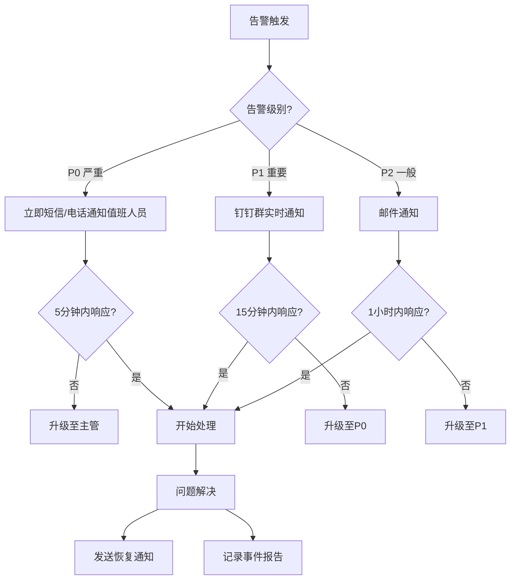

# 运维与可观测性层

> **目标**: 定义日志规范、监控指标、告警策略、排障手册，确保系统可观测性和运维效率。

---

## 1. 日志规范

### 1.1 日志分级

采用标准的日志级别分类，确保日志的可读性和可过滤性：

| 级别 | 用途 | 示例场景 |
|------|------|----------|
| **DEBUG** | 开发调试信息 | 函数调用栈、中间变量值、性能追踪 |
| **INFO** | 常规业务信息 | 用户登录、数据加载成功、缓存命中/未命中 |
| **WARN** | 警告但不影响核心功能 | Token 即将过期、缓存版本不匹配、降级策略触发 |
| **ERROR** | 错误需人工介入 | API 调用失败、数据校验错误、异常捕获 |
| **FATAL** | 严重错误导致服务不可用 | 认证完全失败、关键服务崩溃 |

**实现约定**:
```typescript
// ✅ 推荐：使用带上下文的结构化日志
console.log('[ModuleName] INFO:', { event: 'user_login', userId, timestamp })
console.warn('[ModuleName] WARN:', { event: 'cache_miss', key, reason })
console.error('[ModuleName] ERROR:', { event: 'api_failure', url, statusCode, error })

// ❌ 不推荐：无上下文的简单字符串
console.log('User logged in')
```

参考实现:
- [`src/services/healthCacheServiceV2.ts`](file:///Users/zhengjiyuan/Desktop/iPet/iPet-uniapp/src/services/healthCacheServiceV2.ts#L65-L152)
- [`src/utils/common/request.ts`](file:///Users/zhengjiyuan/Desktop/iPet/iPet-uniapp/src/utils/common/request.ts#L104-L118)

---

### 1.2 关键字段

所有日志应包含以下关键字段，便于追踪和排查：

#### 必需字段
```typescript
interface LogEntry {
  timestamp: string;        // ISO 8601 格式时间戳
  level: 'DEBUG' | 'INFO' | 'WARN' | 'ERROR' | 'FATAL';
  module: string;           // 模块名称，如 [HealthStore], [Request], [Cache]
  event: string;            // 事件类型，如 api_call, cache_hit, user_login
  message: string;          // 日志主体消息
}
```

#### 推荐字段
```typescript
interface EnhancedLogEntry extends LogEntry {
  traceId?: string;         // 请求追踪 ID（见 1.3 节）
  userId?: string;          // 用户标识（需脱敏）
  petId?: string;           // 宠物标识
  requestId?: string;       // API 请求 ID
  duration?: number;        // 操作耗时（ms）
  statusCode?: number;      // HTTP 状态码
  error?: {                 // 错误详情
    name: string;
    message: string;
    stack?: string;
  };
}
```

**示例**:
```typescript
console.log('[HealthStore] INFO:', {
  event: 'record_created',
  traceId: 'abc123',
  petId: 'pet_456',
  duration: 234,
  message: 'Health record created successfully'
});
```

---

### 1.3 TraceId 追踪

**目标**: 实现分布式请求链路追踪，关联前端→后端→缓存→数据库的完整调用链。

#### 生成规则
```typescript
// 为每个请求生成唯一 TraceId
const generateTraceId = (): string => {
  const timestamp = Date.now().toString(36);
  const randomStr = Math.random().toString(36).substr(2, 9);
  return `trace_${timestamp}_${randomStr}`;
};

// 在请求拦截器中注入
const request = async <T>(config: RequestConfig<T>): Promise<T> => {
  const traceId = generateTraceId();
  config.header = {
    ...config.header,
    'X-Trace-Id': traceId
  };
  
  console.log(`[Request] INFO:`, { 
    event: 'api_call', 
    traceId, 
    url: config.url, 
    method: config.method 
  });
  
  // ... 执行请求
};
```

#### 传递规则
- **前端 → 后端**: 通过 HTTP Header `X-Trace-Id` 传递
- **后端 → 日志系统**: 后端在所有日志中记录 `traceId`
- **本地操作**: 即使无网络请求，关键操作（如乐观更新）也应生成 `traceId`

参考实现:
- [`src/utils/common/request.ts`](file:///Users/zhengjiyuan/Desktop/iPet/iPet-uniapp/src/utils/common/request.ts#L345-L476)

---

### 1.4 数据脱敏

> [!CAUTION]
> 日志中**严禁**直接记录以下敏感信息：
> - 用户密码（明文/加密）
> - 完整手机号、邮箱
> - Token（AccessToken / RefreshToken）
> - 身份证、银行卡号

#### 脱敏规则

| 字段类型 | 脱敏方式 | 示例 |
|---------|---------|------|
| 邮箱 | 仅保留前 2 位 + 域名 | `us****@example.com` |
| 手机号 | 仅保留前 3 位和后 4 位 | `138****5678` |
| Token | 仅保留前 8 位 | `eyJhbGci****` |
| 身份证 | 仅保留前 6 位和后 4 位 | `110101********1234` |
| 用户 ID | 保留完整（已经是哈希值） | `user_abc123def456` |

**脱敏工具函数**:
```typescript
const maskEmail = (email: string): string => {
  const [name, domain] = email.split('@');
  return `${name.slice(0, 2)}****@${domain}`;
};

const maskPhone = (phone: string): string => {
  return phone.replace(/(\d{3})\d{4}(\d{4})/, '$1****$2');
};

const maskToken = (token: string): string => {
  return `${token.slice(0, 8)}****`;
};

// 使用示例
console.log('[Auth] INFO:', {
  event: 'login_success',
  email: maskEmail(user.email),
  token: maskToken(accessToken)
});
```

---

### 1.5 日志输出策略

#### 开发环境 (DEV)
- **级别**: 输出所有级别（DEBUG 及以上）
- **格式**: 彩色控制台输出，包含完整堆栈
- **目标**: 浏览器 Console / 微信开发者工具

#### 生产环境 (PROD)
- **级别**: 仅输出 INFO 及以上（过滤 DEBUG）
- **格式**: JSON 格式，便于日志采集
- **目标**: 远程日志服务（如阿里云 SLS、Sentry）
- **采样**: ERROR 日志 100% 上报，INFO 日志 10% 采样

**环境判断**:
```typescript
const shouldLog = (level: LogLevel): boolean => {
  if (import.meta.env.DEV) {
    return true; // 开发环境输出所有
  }
  return level !== 'DEBUG'; // 生产环境过滤 DEBUG
};
```

---

## 2. 监控指标

### 2.1 成功率指标

#### 2.1.1 API 请求成功率

**定义**: 
```
成功率 = (2xx 响应数 / 总请求数) × 100%
```

**采集点**:
- [`src/utils/common/request.ts`](file:///Users/zhengjiyuan/Desktop/iPet/iPet-uniapp/src/utils/common/request.ts#L388-L423)

**实现**:
```typescript
const metrics = {
  total: 0,
  success: 0,
  failure: 0
};

const trackApiCall = (statusCode: number) => {
  metrics.total++;
  if (statusCode >= 200 && statusCode < 300) {
    metrics.success++;
  } else {
    metrics.failure++;
  }
};

const getSuccessRate = () => {
  return metrics.total === 0 ? 0 : (metrics.success / metrics.total) * 100;
};
```

**监控维度**:
- 按模块: `auth`, `health`, `pet`, `upload`
- 按路径: `/auth/login`, `/pets`, `/health/records`
- 按时间: 1分钟、5分钟、1小时

**告警阈值**: 成功率 < 95% 触发告警

---

#### 2.1.2 缓存命中率

**定义**:
```
缓存命中率 = (缓存命中次数 / 总查询次数) × 100%
```

**采集点**:
- [`src/services/healthCacheServiceV2.ts`](file:///Users/zhengjiyuan/Desktop/iPet/iPet-uniapp/src/services/healthCacheServiceV2.ts#L86-L103)

**实现**:
```typescript
const cacheMetrics = {
  hit: 0,
  miss: 0
};

export const getCacheHitRate = () => {
  const total = cacheMetrics.hit + cacheMetrics.miss;
  return total === 0 ? 0 : (cacheMetrics.hit / total) * 100;
};
```

**监控维度**:
- 按缓存类型: `series`, `summary`, `pinnedMetrics`
- 按 TTL: 短期缓存（1分钟）、长期缓存（1小时）

**告警阈值**: 命中率 < 70% 触发告警

---

### 2.2 性能指标（耗时）

#### 2.2.1 API 请求耗时

**指标**:
- **P50**: 50% 请求的响应时间
- **P95**: 95% 请求的响应时间
- **P99**: 99% 请求的响应时间

**采集**:
```typescript
const requestDurations: number[] = [];

const trackRequestDuration = (duration: number) => {
  requestDurations.push(duration);
  
  // 计算百分位数
  const sorted = requestDurations.sort((a, b) => a - b);
  const p50 = sorted[Math.floor(sorted.length * 0.5)];
  const p95 = sorted[Math.floor(sorted.length * 0.95)];
  const p99 = sorted[Math.floor(sorted.length * 0.99)];
  
  console.log('[Metrics]', { p50, p95, p99 });
};

// 在请求拦截器中使用
const request = async <T>(config: RequestConfig<T>) => {
  const startTime = Date.now();
  try {
    const result = await uni.request({ ... });
    return result;
  } finally {
    const duration = Date.now() - startTime;
    trackRequestDuration(duration);
  }
};
```

**告警阈值**:
- P95 > 2000ms (2秒)
- P99 > 5000ms (5秒)

---

#### 2.2.2 页面加载耗时

**关键指标**:
- **FCP (First Contentful Paint)**: 首次内容绘制
- **LCP (Largest Contentful Paint)**: 最大内容绘制
- **TTI (Time to Interactive)**: 可交互时间

**采集**:
```typescript
const trackPageLoad = (pageName: string) => {
  const startTime = Date.now();
  
  onMounted(() => {
    const fcp = Date.now() - startTime;
    console.log(`[PageLoad] ${pageName}`, { fcp });
  });
};
```

参考实现:
- [`src/pages/summary/summary.vue`](file:///Users/zhengjiyuan/Desktop/iPet/iPet-uniapp/src/pages/summary/summary.vue#L292-L389)

**告警阈值**:
- FCP > 1000ms
- LCP > 2500ms

---

### 2.3 错误率指标

#### 2.3.1 API 错误率

**定义**:
```
错误率 = (4xx + 5xx 响应数 / 总请求数) × 100%
```

**监控维度**:
- **4xx 客户端错误**: 401 (未授权), 404 (未找到), 422 (参数错误)
- **5xx 服务端错误**: 500 (服务器错误), 502 (网关错误), 503 (服务不可用)

**实现**:
```typescript
const errorMetrics = {
  '4xx': 0,
  '5xx': 0,
  total: 0
};

const trackError = (statusCode: number) => {
  errorMetrics.total++;
  if (statusCode >= 400 && statusCode < 500) {
    errorMetrics['4xx']++;
  } else if (statusCode >= 500) {
    errorMetrics['5xx']++;
  }
};
```

**告警阈值**:
- 4xx 错误率 > 10%
- 5xx 错误率 > 1%

---

#### 2.3.2 JavaScript 异常率

**采集**:
```typescript
// 全局异常捕获
window.addEventListener('error', (event) => {
  console.error('[GlobalError]', {
    message: event.message,
    filename: event.filename,
    lineno: event.lineno,
    colno: event.colno,
    stack: event.error?.stack
  });
  
  // 上报到监控平台（如 Sentry）
  reportToMonitoring({
    type: 'js_error',
    message: event.message,
    stack: event.error?.stack
  });
});

// Promise 未处理的拒绝
window.addEventListener('unhandledrejection', (event) => {
  console.error('[UnhandledRejection]', event.reason);
  reportToMonitoring({
    type: 'unhandled_promise',
    reason: event.reason
  });
});
```

---

### 2.4 资源指标

#### 2.4.1 内存使用

**微信小程序限制**: 单个页面内存上限约 **64MB**

**监控方法**:
```typescript
// 微信小程序专用 API
const getMemoryInfo = () => {
  const memoryInfo = wx.getPerformance().getEntries({
    entryType: 'memory'
  });
  
  console.log('[Memory]', {
    jsHeapSizeLimit: memoryInfo.jsHeapSizeLimit,
    totalJSHeapSize: memoryInfo.totalJSHeapSize,
    usedJSHeapSize: memoryInfo.usedJSHeapSize
  });
};
```

**告警阈值**:
- 内存使用 > 50MB
- 内存增长率 > 10MB/min

---

#### 2.4.2 缓存容量

**监控**:
```typescript
const getCacheSize = (): number => {
  let totalSize = 0;
  const keys = uni.getStorageInfoSync().keys;
  
  keys.forEach(key => {
    const data = uni.getStorageSync(key);
    totalSize += JSON.stringify(data).length;
  });
  
  return totalSize; // 返回字节数
};

// 定期检查
setInterval(() => {
  const sizeKB = Math.round(getCacheSize() / 1024);
  console.log(`[Cache] Total size: ${sizeKB}KB`);
  
  if (sizeKB > 5000) { // 超过 5MB
    console.warn('[Cache] Size exceeds threshold, triggering LRU cleanup');
  }
}, 60000); // 每分钟检查一次
```

参考实现:
- [`src/services/healthCacheService.ts`](file:///Users/zhengjiyuan/Desktop/iPet/iPet-uniapp/src/services/healthCacheService.ts#L521-L539)

---

### 2.5 业务指标

#### 2.5.1 核心业务指标

| 指标名称 | 定义 | 采集点 |
|---------|------|--------|
| **DAU** | 日活跃用户数 | 用户登录事件 |
| **健康记录创建成功率** | 成功创建的记录 / 尝试创建的记录 | `healthStore.addRecord` |
| **数据同步成功率** | Token 刷新成功次数 / 刷新尝试次数 | `request.ts` Token 刷新逻辑 |
| **离线队列处理成功率** | 离线请求重试成功数 / 总离线请求数 | `request.ts` 离线队列 |

#### 2.5.2 用户体验指标

| 指标名称 | 定义 | 目标值 |
|---------|------|--------|
| **乐观更新成功率** | 乐观更新后未回滚的比例 | > 98% |
| **缓存首屏加载成功率** | 使用缓存快速渲染的比例 | > 90% |
| **趋势检测准确率** | 有效趋势 / 总趋势数 | > 85% |

参考实现:
- [`src/stores/healthStore.ts`](file:///Users/zhengjiyuan/Desktop/iPet/iPet-uniapp/src/stores/healthStore.ts#L607-L671) (乐观更新)
- [`src/pages/summary/summary.vue`](file:///Users/zhengjiyuan/Desktop/iPet/iPet-uniapp/src/pages/summary/summary.vue#L292-L316) (缓存首屏)

---

## 3. 告警策略

### 3.1 告警阈值

#### 3.1.1 关键业务告警

| 指标 | 阈值 | 级别 | 通知方式 |
|------|------|------|----------|
| API 成功率 | < 95% | **P0** | 短信 + 电话 + 钉钉群 |
| 5xx 错误率 | > 1% | **P0** | 短信 + 钉钉群 |
| 登录成功率 | < 90% | **P1** | 钉钉群 + 邮件 |
| Token 刷新失败率 | > 5% | **P1** | 钉钉群 |
| 健康记录创建失败率 | > 10% | **P2** | 邮件 |

#### 3.1.2 性能告警

| 指标 | 阈值 | 级别 | 通知方式 |
|------|------|------|----------|
| API P95 耗时 | > 2s | **P1** | 钉钉群 |
| API P99 耗时 | > 5s | **P2** | 邮件 |
| 页面 LCP | > 2.5s | **P2** | 邮件 |
| 内存使用 | > 50MB | **P2** | 邮件 |

#### 3.1.3 资源告警

| 指标 | 阈值 | 级别 | 通知方式 |
|------|------|------|----------|
| 缓存大小 | > 8MB | **P2** | 邮件 |
| 离线队列积压 | > 50 条 | **P1** | 钉钉群 |
| 日志上报失败率 | > 20% | **P2** | 邮件 |

---

### 3.2 告警升级路径



---

### 3.3 值班与责任人

#### 值班轮换表

| 时段 | 主值班 | 备值班 | 负责模块 |
|------|--------|--------|----------|
| 工作日 09:00-18:00 | 前端团队轮值 | 后端团队 | 全模块 |
| 工作日 18:00-09:00 | 运维团队 | 后端团队 | P0/P1 告警 |
| 周末/节假日 | 运维团队 | 全员待命 | P0 告警 |

#### 模块责任人

| 模块 | 责任人 | 职责范围 |
|------|--------|----------|
| **认证模块** (`/auth/*`) | 张三 | Token 刷新、登录/注册、权限验证 |
| **健康数据** (`/health/*`) | 李四 | 健康记录 CRUD、趋势检测、缓存策略 |
| **宠物管理** (`/pets/*`) | 王五 | 宠物信息、头像上传、家庭管理 |
| **文章内容** (`/articles/*`) | 赵六 | 文章加载、推荐算法、离线缓存 |
| **基础设施** | 运维团队 | CDN、数据库、日志系统、监控平台 |

---

## 4. 排障手册 (Runbook)

### 4.1 常见故障场景

#### 4.1.1 登录失败率异常升高

**现象**:
- 告警: `登录成功率 < 90%`
- 用户反馈: "无法登录" / "密码错误"

**定位步骤**:

1. **检查 API 状态**
   ```bash
   # 查看登录接口状态码分布
   curl -X POST https://api.ipet.com/auth/login \
     -H "Content-Type: application/json" \
     -d '{"email":"test@example.com","password":"TestPass123"}'
   ```
   - 预期: 返回 200 或 401（密码错误）
   - 异常: 返回 500/502/503

2. **检查日志**
   ```typescript
   // 前端日志关键字
   grep "login_failed" /var/log/ipet/frontend.log | tail -100
   
   // 关注字段
   - statusCode: 500 → 后端异常
   - statusCode: 401 → 密码错误（正常）
   - timeout → 网络/后端超时
   ```

3. **检查后端服务**
   ```bash
   # 检查服务健康状态
   curl https://api.ipet.com/health
   
   # 检查数据库连接
   psql -U ipet_user -d ipet_db -c "SELECT 1"
   ```

**处理动作**:

| 根因 | 动作 | 负责人 |
|------|------|--------|
| 后端服务宕机 | 重启服务 + 检查日志 | 后端/运维 |
| 数据库连接池耗尽 | 扩容连接池 + 优化慢查询 | DBA |
| 网络抖动 | 切换 CDN 节点 + 增加重试 | 运维 |
| 恶意攻击 | 启用限流 + IP 黑名单 | 安全团队 |

**回滚方案**:
- **临时方案**: 启用 Mock 模式，允许游客登录（本地数据）
  ```typescript
  // 紧急开关
  APP_CONFIG.USE_MOCK = true; // 仅用于紧急情况
  ```
- **长期方案**: 实现多区域容灾，自动切换备用 API

---

#### 4.1.2 健康记录无法创建

**现象**:
- 告警: `健康记录创建失败率 > 10%`
- 用户反馈: "添加记录后没有显示"

**定位步骤**:

1. **检查前端日志**
   ```typescript
   // 查找乐观更新失败的日志
   grep "addRecord" /var/log/ipet/frontend.log
   
   // 关注字段
   - optimisticRecord: 乐观更新是否生成
   - serverRecord: 服务器是否返回最终记录
   - error: 错误信息
   ```

2. **检查网络请求**
   ```bash
   # 查看 POST /health/records 的状态
   curl -X POST https://api.ipet.com/health/records \
     -H "Authorization: Bearer $TOKEN" \
     -d '{"petId":"123","type":"weight","value":5.5}'
   ```

3. **检查缓存失效**
   ```typescript
   // 验证缓存是否正常失效
   healthCacheServiceV2.invalidateMetric(petId, metricKey);
   ```

**处理动作**:

| 根因 | 动作 | 负责人 |
|------|------|--------|
| 乐观更新回滚 | 检查后端校验逻辑 + 修复参数 | 后端 |
| 缓存未失效 | 手动清除缓存 + 修复失效逻辑 | 前端 |
| 权限不足 | 检查 Token 有效性 + 权限配置 | 后端 |
| 幂等键冲突 | 清理重复数据 + 优化幂等逻辑 | 后端 |

**回滚方案**:
- **临时方案**: 禁用乐观更新，改为同步创建
  ```typescript
  // 紧急开关
  const DISABLE_OPTIMISTIC_UPDATE = true;
  if (!DISABLE_OPTIMISTIC_UPDATE) {
    applyOptimisticUpdate(record);
  }
  ```
- **长期方案**: 实现本地持久化队列，离线时自动入队

参考实现:
- [`src/stores/healthStore.ts`](file:///Users/zhengjiyuan/Desktop/iPet/iPet-uniapp/src/stores/healthStore.ts#L607-L671)

---

#### 4.1.3 Token 刷新失败导致批量登出

**现象**:
- 告警: `Token 刷新失败率 > 5%`
- 用户反馈: "突然提示需要重新登录"

**定位步骤**:

1. **检查 RefreshToken 有效性**
   ```bash
   # 手动测试刷新接口
   curl -X POST https://api.ipet.com/auth/refresh \
     -H "Content-Type: application/json" \
     -d '{"refreshToken":"$REFRESH_TOKEN"}'
   ```
   - 预期: 返回 200 + 新的 AccessToken
   - 异常: 返回 401/403

2. **检查前端刷新逻辑**
   ```typescript
   // 查看刷新队列
   console.log(failedRequestQueue.length); // 积压请求数
   console.log(refreshPromise !== null); // 是否正在刷新
   ```

3. **检查后端 Redis**
   ```bash
   # 检查 RefreshToken 是否在 Redis 中
   redis-cli GET "refresh_token:$USER_ID"
   ```

**处理动作**:

| 根因 | 动作 | 负责人 |
|------|------|--------|
| RefreshToken 过期 | 引导用户重新登录 + 延长有效期 | 后端 |
| Redis 缓存丢失 | 恢复缓存 + 检查 Redis 持久化 | 运维 |
| 网络超时 | 增加重试次数 + 延长超时时间 | 前端 |
| 并发刷新冲突 | 优化刷新队列锁机制 | 前端 |

**回滚方案**:
- **临时方案**: 放宽刷新失败容忍度，允许 3 次失败后再登出
  ```typescript
  let refreshFailureCount = 0;
  const MAX_REFRESH_FAILURES = 3;
  
  if (refreshFailureCount >= MAX_REFRESH_FAILURES) {
    forceLogout();
  } else {
    refreshFailureCount++;
  }
  ```
- **长期方案**: 实现静默刷新 (Silent Refresh)，提前 5 分钟刷新

参考实现:
- [`src/utils/common/request.ts`](file:///Users/zhengjiyuan/Desktop/iPet/iPet-uniapp/src/utils/common/request.ts#L170-L315)

---

#### 4.1.4 缓存雪崩导致 API 压力激增

**现象**:
- 告警: `API P95 耗时 > 2s` + `缓存命中率 < 70%`
- 后端监控: 数据库连接数激增

**定位步骤**:

1. **检查缓存状态**
   ```typescript
   // 查看缓存容量
   const sizeKB = Math.round(getCacheSize() / 1024);
   console.log(`[Cache] Size: ${sizeKB}KB`);
   
   // 查看缓存版本
   const version = uni.getStorageSync('CACHE_SCHEMA_VERSION');
   console.log(`[Cache] Version: ${version}`);
   ```

2. **检查 TTL 配置**
   ```typescript
   // 验证 TTL 是否过短
   const ttl = CACHE_CONFIG.defaultTTL; // 应为 3600000 (1小时)
   ```

3. **检查缓存失效日志**
   ```bash
   # 查找批量失效日志
   grep "Invalidated.*keys" /var/log/ipet/frontend.log
   ```

**处理动作**:

| 根因 | 动作 | 负责人 |
|------|------|--------|
| 缓存版本升级导致清空 | 提前预热缓存 + 分批升级 | 前端 |
| TTL 设置过短 | 调整 TTL + 实现渐进式失效 | 前端 |
| LRU 清理过于激进 | 提高缓存容量阈值 | 前端 |
| 缓存穿透攻击 | 增加布隆过滤器 + 限流 | 后端 |

**回滚方案**:
- **临时方案**: 禁用缓存自动失效，手动控制
  ```typescript
  // 紧急开关
  const DISABLE_AUTO_INVALIDATION = true;
  if (!DISABLE_AUTO_INVALIDATION) {
    healthCacheServiceV2.invalidateByPattern('*');
  }
  ```
- **长期方案**: 实现多级缓存（内存 + LocalStorage），减少穿透

参考实现:
- [`src/services/healthCacheService.ts`](file:///Users/zhengjiyuan/Desktop/iPet/iPet-uniapp/src/services/healthCacheService.ts#L521-L567)

---

#### 4.1.5 图片上传失败率高

**现象**:
- 告警: `上传成功率 < 90%`
- 用户反馈: "头像上传后不显示"

**定位步骤**:

1. **检查上传日志**
   ```typescript
   // 查找上传失败日志
   grep "upload_failed" /var/log/ipet/frontend.log
   
   // 关注字段
   - fileSize: 文件大小（是否超限）
   - compressQuality: 压缩质量
   - error: 错误信息
   ```

2. **检查 CDN 状态**
   ```bash
   # 测试 CDN 上传
   curl -X POST https://cdn.ipet.com/upload \
     -F "file=@test.jpg"
   ```

3. **检查图片缓存**
   ```typescript
   // 验证缓存映射
   const cachedUrl = await imageCache.resolve(remoteUrl);
   console.log('Cached URL:', cachedUrl);
   ```

**处理动作**:

| 根因 | 动作 | 负责人 |
|------|------|--------|
| 文件过大 | 提高压缩率 + 提示用户裁剪 | 前端 |
| CDN 限流 | 切换 CDN 节点 + 增加配额 | 运维 |
| 缓存未生成 | 修复 Base64 转换逻辑 | 前端 |
| 网络超时 | 增加断点续传 + 重试机制 | 前端 |

**回滚方案**:
- **临时方案**: 使用本地预览，延迟上传
  ```typescript
  // 先显示本地预览
  localPreviewPath.value = filePath;
  
  // 后台异步上传
  uploadImage(filePath).catch(err => {
    console.error('Background upload failed', err);
  });
  ```
- **长期方案**: 实现分片上传 + 断点续传

参考实现:
- [`src/components/forms/AvatarUploader.vue`](file:///Users/zhengjiyuan/Desktop/iPet/iPet-uniapp/src/components/forms/AvatarUploader.vue#L98-L131)

---

### 4.2 快速诊断工具

#### 4.2.1 日志查询快捷命令

```bash
# 查看最近 100 条 ERROR 日志
grep "ERROR" /var/log/ipet/frontend.log | tail -100

# 查看特定模块的日志
grep "\[HealthStore\]" /var/log/ipet/frontend.log

# 按 TraceId 追踪完整请求链
grep "trace_abc123" /var/log/ipet/*.log

# 统计 API 状态码分布
grep "statusCode" /var/log/ipet/frontend.log | awk '{print $NF}' | sort | uniq -c
```

#### 4.2.2 性能分析脚本

```typescript
// 一键导出性能指标
const exportPerformanceMetrics = () => {
  const metrics = {
    apiSuccessRate: getSuccessRate(),
    cacheHitRate: getCacheHitRate(),
    averageResponseTime: calculateAverageResponseTime(),
    errorRate: getErrorRate(),
    memoryUsage: getMemoryInfo(),
    cacheSize: getCacheSize()
  };
  
  console.log('Performance Metrics:', JSON.stringify(metrics, null, 2));
  
  // 复制到剪贴板（微信小程序不支持，仅 H5）
  // navigator.clipboard?.writeText(JSON.stringify(metrics, null, 2));
};

// 在控制台执行
exportPerformanceMetrics();
```

#### 4.2.3 缓存诊断工具

```typescript
// 诊断缓存状态
const diagnoseCacheHealth = () => {
  const keys = uni.getStorageInfoSync().keys;
  const cacheEntries = keys
    .filter(k => k.startsWith('cache:'))
    .map(k => {
      const data = uni.getStorageSync(k);
      return {
        key: k,
        size: JSON.stringify(data).length,
        ttl: data.expiresAt - Date.now(),
        isExpired: data.expiresAt < Date.now()
      };
    });
  
  console.table(cacheEntries);
  
  // 统计
  const totalSize = cacheEntries.reduce((sum, e) => sum + e.size, 0);
  const expiredCount = cacheEntries.filter(e => e.isExpired).length;
  
  console.log(`Total Entries: ${cacheEntries.length}`);
  console.log(`Total Size: ${Math.round(totalSize / 1024)}KB`);
  console.log(`Expired Entries: ${expiredCount}`);
};
```

---

### 4.3 应急预案

#### 4.3.1 服务降级策略

**降级优先级**（从低到高）:

1. **P3 - 非核心功能**:
   - 文章推荐算法（改为随机推荐）
   - 趋势检测（隐藏趋势模块）
   - 图表动画（使用静态图表）

2. **P2 - 辅助功能**:
   - 头像上传（使用默认头像）
   - 缓存预热（按需加载）
   - 日志上报（本地存储，稍后上报）

3. **P1 - 重要功能**:
   - 健康记录编辑（只允许新增）
   - 多宠物切换（锁定当前宠物）

4. **P0 - 核心功能**（不可降级）:
   - 用户登录
   - 健康记录查看
   - 数据同步

**降级开关**:
```typescript
const FEATURE_FLAGS = {
  enableTrendDetection: true,
  enableArticleRecommendation: true,
  enableAvatarUpload: true,
  enableChartAnimation: true
};

// 紧急降级
const emergencyDegradation = () => {
  FEATURE_FLAGS.enableTrendDetection = false;
  FEATURE_FLAGS.enableArticleRecommendation = false;
  FEATURE_FLAGS.enableChartAnimation = false;
  
  console.warn('[Emergency] Non-essential features degraded');
};
```

---

#### 4.3.2 数据回滚流程

**场景**: 错误的代码发布导致数据损坏

**步骤**:

1. **立即停止发布**
   ```bash
   # 回滚到上一个稳定版本
   git revert HEAD
   npm run build
   # 重新部署
   ```

2. **评估数据损坏范围**
   ```sql
   -- 查询异常数据
   SELECT * FROM health_records 
   WHERE created_at > '2023-12-18 00:00:00' 
   AND value < 0; -- 异常值
   ```

3. **从备份恢复**
   ```bash
   # 恢复数据库快照（最近一次备份）
   psql -U ipet_user -d ipet_db < backup_20231217.sql
   ```

4. **通知受影响用户**
   - 发送应用内通知
   - 提供数据恢复支持

5. **事后复盘**
   - 记录事故报告
   - 优化测试流程
   - 加强灰度发布

---

## 5. 最佳实践

### 5.1 日志最佳实践

1. **使用结构化日志**
   ```typescript
   // ✅ 推荐
   console.log('[Module]', { event, data, timestamp });
   
   // ❌ 不推荐
   console.log('Something happened: ' + JSON.stringify(data));
   ```

2. **避免日志泛滥**
   - 循环中不使用 `console.log`
   - 使用采样（如每 100 次记录一次）

3. **日志分级要准确**
   - DEBUG: 仅开发环境
   - INFO: 常规业务流程
   - WARN: 可恢复的异常
   - ERROR: 需人工介入

---

### 5.2 监控最佳实践

1. **监控指标要有基线**
   - 建立正常情况下的指标范围
   - 告警阈值基于历史数据动态调整

2. **避免告警疲劳**
   - 合并相似告警
   - 设置静默期（同一告警 5 分钟内不重复）

3. **定期Review监控配置**
   - 每月检查告警阈值是否合理
   - 清理无效的监控指标

---

### 5.3 故障处理最佳实践

1. **先止血，后复盘**
   - 优先恢复服务，不追究责任
   - 事后详细分析根因

2. **建立故障知识库**
   - 每次故障都记录 Runbook
   - 定期演练应急预案

3. **自动化运维**
   - 常见故障实现自动恢复
   - 减少人工介入

---

## 6. 工具与平台

### 6.1 推荐工具

| 类别 | 工具 | 用途 |
|------|------|------|
| **日志采集** | 阿里云 SLS | 前端日志聚合分析 |
| **错误追踪** | Sentry | JavaScript 异常监控 |
| **性能监控** | 微信小程序性能监控 | 页面加载、内存使用 |
| **API 监控** | Grafana + Prometheus | 接口耗时、成功率 |
| **告警通知** | 钉钉机器人 | 实时告警推送 |

### 6.2 集成示例

#### Sentry 集成
```typescript
import * as Sentry from '@sentry/browser';

Sentry.init({
  dsn: 'https://xxx@sentry.io/123',
  environment: import.meta.env.MODE,
  tracesSampleRate: 0.1, // 10% 采样
  beforeSend(event) {
    // 过滤敏感信息
    if (event.user) {
      delete event.user.email;
    }
    return event;
  }
});

// 手动上报
Sentry.captureException(new Error('Custom error'));
```

---

## 附录

### A. 相关文档

- [接口契约层.md](file:///Users/zhengjiyuan/Desktop/iPet/iPet-uniapp/docs/接口契约层.md) - API 错误码定义
- [数据层.md](file:///Users/zhengjiyuan/Desktop/iPet/iPet-uniapp/docs/数据层.md) - 数据一致性与幂等性
- [工程化与开发指南层.md](file:///Users/zhengjiyuan/Desktop/iPet/iPet-uniapp/docs/工程化与开发指南层.md) - 环境配置与部署流程

### B. 参考代码

- [`src/utils/common/request.ts`](file:///Users/zhengjiyuan/Desktop/iPet/iPet-uniapp/src/utils/common/request.ts) - 请求拦截器、Token 刷新、离线队列
- [`src/services/healthCacheServiceV2.ts`](file:///Users/zhengjiyuan/Desktop/iPet/iPet-uniapp/src/services/healthCacheServiceV2.ts) - 缓存监控与指标采集
- [`src/stores/healthStore.ts`](file:///Users/zhengjiyuan/Desktop/iPet/iPet-uniapp/src/stores/healthStore.ts) - 乐观更新与错误处理

---

**版本**: v1.0  
**最后更新**: 2023-12-18  
**维护者**: 前端团队 + 运维团队
