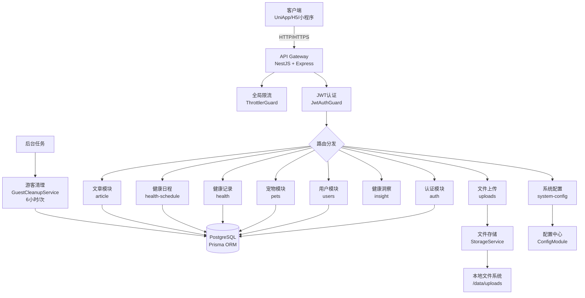
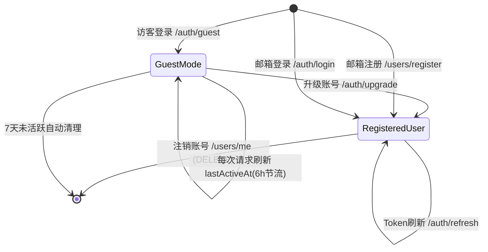

# iPet-BackEnd 后端系统架构总结报告

> **文档定位**: 本文档面向**全局架构层面**的梳理与总结,不涉及底层代码实现细节,旨在为高级架构师和技术决策者提供清晰的系统全貌。
> 
> **使用场景**: 作为**上游输入**,供后续进行深入的架构优化、技术债治理、性能调优等工作使用。

---

## 一、整体架构概览

### 1.1 技术栈

| 技术组件 | 版本/说明 | 用途 |
|---------|----------|------|
| **框架** | NestJS 11.x | 后端核心框架,基于 TypeScript + Express |
| **数据库** | PostgreSQL | 主数据存储 |
| **ORM** | Prisma 5.21.x | 类型安全的数据访问层 |
| **认证** | JWT (jsonwebtoken 9.x) | 基于 Token 的身份认证 |
| **密码加密** | bcrypt 6.x | 密码 Hash 存储 |
| **缓存** | @nestjs/cache-manager 3.x | 全局缓存管理 |
| **限流** | @nestjs/throttler 6.x | 全局请求限流(60s/100次) |
| **文件上传** | multer | 文件上传处理 |
| **压缩** | compression | HTTP 响应压缩 |
| **ID生成** | @paralleldrive/cuid2 + uuid | 唯一标识符生成 |

### 1.2 架构模式



### 1.3 部署架构假设

- **单体应用**: 当前架构为单体 NestJS 应用
- **存储**: 本地文件系统存储上传文件(`/data/uploads`)
- **数据库**: PostgreSQL 独立部署(支持本地SQLite作为开发fallback)
- **无缓存中间件**: 代码中配置了 CacheModule 但未实际集成 Redis/Memcached

---

## 二、核心模块划分与职责边界

### 2.1 业务模块清单

| 模块名 | 职责 | 核心服务方法 | 依赖 |
|-------|------|-------------|------|
| **auth** | 身份认证与授权 | `login`, `createGuestSession`, `upgradeGuestToUser`, `refreshToken` | Prisma, ConfigService |
| **users** | 用户管理 | `register`, `findById`, `updateProfile`, `deleteAccount`, `verifyIdentity` | Prisma, StorageService |
| **pets** | 宠物档案管理 | `create`, `findAll`, `findOne`, `update`, `remove` | Prisma, StorageService |
| **health** | 健康记录管理 | `create`, `findAll`, `getSummary`, `getMetricSeries`, `toggleMetricPin` | Prisma |
| **health-schedule** | 健康日程 | `create`, `findAll`, `remove` | Prisma |
| **article** | 文章/知识库 | `findAll`, `findOne`, `create` | Prisma |
| **insight** | 健康洞察 | `getTrendInsight`, `getInsight` | 无(纯计算逻辑) |
| **system-config** | 系统配置 | `getMetricConfig` | 无(静态配置) |
| **uploads** | 文件上传 | `uploadFile` | StorageService |
| **storage** | 文件存储抽象 | `deleteFile` | FileSystem |
| **prisma** | 数据库连接 | Prisma Client 单例 | PostgreSQL |

### 2.2 模块协作关系

```
认证流程:
  Client → auth.controller → auth.service → prisma → PostgreSQL
  
业务操作:
  Client → [business].controller → JwtAuthGuard → [business].service → prisma → PostgreSQL
  
文件上传:
  Client → uploads.controller → storage.service → FileSystem
  
文件删除:
  users/pets.service → storage.service → FileSystem (删除头像时级联触发)
```

### 2.3 全局守卫与中间件

**生效顺序**: Request → ThrottlerGuard → JwtAuthGuard → Controller

| 守卫/中间件 | 作用 | 配置 |
|-----------|------|------|
| **ThrottlerGuard** | 全局限流 | 60秒内最多100次请求 |
| **JwtAuthGuard** | JWT认证 | 白名单路径: `/auth/*`, `/users/register`, `/articles` (GET) |
| **ValidationPipe** | 请求参数验证 | `whitelist: true`, `transform: true` |
| **CORS** | 跨域配置 | 支持多源配置(逗号分隔),允许凭据 |
| **Compression** | 响应压缩 | 全局启用 |

---

## 三、数据层设计

### 3.1 核心数据模型

```mermaid
erDiagram
    User ||--o{ Pet : owns
    User ||--o| UserSyncState : has
    Pet ||--o{ HealthRecord : tracks
    Pet ||--o{ PinnedMetric : pins
    Pet ||--o{ HealthSchedule : schedules
    
    User {
        string id PK
        string email UK_nullable
        string passwordHash nullable
        boolean isGuest
        datetime lastActiveAt
        datetime guestCreatedAt
        string guestDeviceId
        string displayName
        string avatar
        string membershipLevel
        datetime membershipExpireAt
        int points
        boolean isVerified
    }
    
    Pet {
        string id PK_uuid
        string userId FK
        string name
        string type
        string breed
        int age
        float weight
        string gender
        string avatar
        string birthday
        string personality_json
        boolean isSterilized
        boolean deleted
        int version
    }
    
    HealthRecord {
        string id PK_uuid
        string petId FK
        string type
        float value
        string unit
        string date
        string notes
        json metadata
        boolean deleted
        int version
    }
    
    HealthSchedule {
        string id PK
        string petId FK
        string type
        datetime date
        string time
        string repeat
        string note
        boolean isActive
    }
    
    PinnedMetric {
        string id PK
        string petId FK
        string metricKey UK
    }
    
    Article {
        string id PK
        string title
        string summary
        string content
        string category
        int views
        int likes
    }
```

### 3.2 关键索引策略 (TD-008)

| 表 | 索引名 | 字段 | 用途 |
|----|--------|------|------|
| User | `users_guest_last_active` | `[isGuest, lastActiveAt]` | 游客清理查询优化 |
| Pet | `idx_pet_user_active` | `[userId, deleted]` | 用户宠物列表查询 |
| HealthRecord | `idx_health_record_pet_date` | `[petId, date DESC]` | 时间范围查询优化 |
| HealthSchedule | `idx_health_schedule_pet_active` | `[petId, isActive, date]` | 活跃日程查询 |
| Article | `idx_article_category_created` | `[category, createdAt DESC]` | 分类文章列表 |

### 3.3 数据一致性设计

- **级联删除**: Pet 删除 → HealthRecord/HealthSchedule/PinnedMetric 自动删除(Prisma `onDelete: Cascade`)
- **软删除**: Pet 和 HealthRecord 使用 `deleted` 字段标记,不物理删除
- **乐观锁**: Pet 和 HealthRecord 有 `version` 字段(但代码中未实际启用冲突检测)
- **账号删除**: `users.service.deleteAccount` 使用事务确保 User → Pets → 关联数据 → 文件 全部清理

---

## 四、认证与鉴权机制

### 4.1 认证流程设计



### 4.2 JWT Payload 结构

```typescript
{
  uid: string;           // 用户ID
  email?: string;        // 邮箱(游客为空)
  isGuest: boolean;      // 是否游客
  exp: number;           // 过期时间(30天)
}
```

### 4.3 游客账号生命周期管理

| 阶段 | 触发条件 | 处理逻辑 |
|------|---------|---------|
| **创建** | `POST /auth/guest` | 生成 `isGuest=true` 用户,设置 `guestCreatedAt` 和 `lastActiveAt` |
| **续活** | 任意认证请求 | JwtAuthGuard 检测游客身份,若 `lastActiveAt < 6小时前` 则更新为当前时间 |
| **升级** | `POST /auth/upgrade` | 校验邮箱唯一性后,设置 `email` 和 `passwordHash`,标记 `isGuest=false` |
| **清理** | 定时任务(6小时/次) | `GuestCleanupService` 查询 `isGuest=true AND lastActiveAt < 7天前` 的记录并删除 |

### 4.4 路由白名单

**JwtAuthGuard 不校验的公开端点**:
- `POST /users/register`
- `POST /auth/login`
- `POST /auth/refresh`
- `POST /auth/guest`
- `POST /auth/logout`
- `GET /articles/*`

---

## 五、性能优化策略

### 5.1 已实施的优化点

#### (1) Health Summary 批量查询优化

**优化前**:
- N+1 查询问题,18+ 次数据库调用
- P95 延迟: ~180ms

**优化后**:
- 单次批量查询 + 内存聚合
- P95 延迟: ~20ms
- **性能提升: 89%**

**核心代码** (`health.service.getSummary`):
```typescript
// 一次性查询所有记录
const allRecords = await this.prisma.healthRecord.findMany({
  where: { petId, deleted: false },
  orderBy: { date: 'desc' }
});

// 内存分组与计算
const groupedByType = new Map<string, HealthRecord[]>();
for (const record of allRecords) {
  const list = groupedByType.get(record.type) || [];
  list.push(record);
  groupedByType.set(record.type, list);
}
```

#### (2) Metric Series 服务端聚合

**设计目的**: 将前端主线程的数据聚合计算(~100-200ms)移至后端

**实现** (`health.service.getMetricSeries`):
- 支持时间范围过滤(`7d`, `30d`, `90d`, `180d`, `365d`)
- 支持聚合粒度(`day`, `week`, `month`)
- 返回预计算的统计指标(min, max, avg, latest)

#### (3) 数据库索引优化(TD-008)

参见 [三、数据层设计 → 3.2 关键索引策略](#32-关键索引策略-td-008)

### 5.2 已配置但未充分利用的机制

| 技术 | 当前状态 | 潜力用途 |
|------|---------|---------|
| **CacheModule** | 已全局注册,未实际使用 | 可缓存 articles、system-config、metric metadata |
| **ThrottlerGuard** | 全局限流 60s/100次 | 可针对敏感操作(登录/注册)设置独立限流策略 |
| **ETag** | 已暴露响应头,未实现生成逻辑 | 可用于 articles、health summary 等接口的条件请求 |

---

## 六、基础设施服务

### 6.1 文件存储 (StorageService)

**存储路径**: `{DATA_ROOT}/uploads/`
- `DATA_ROOT` 默认: `./data` (可通过环境变量覆盖)

**文件操作**:
- **上传**: `uploads.controller` → multer → 本地文件系统
- **删除**: `storage.service.deleteFile()` 解析 URL 路径后删除物理文件

**级联删除逻辑**:
```
用户删除账号 → users.service.deleteAccount()
  ↓
1. 查询 user.avatar + user.pets[].avatar
2. 调用 storage.deleteFile() 删除所有文件
3. Prisma 事务删除数据库记录
```

### 6.2 定时任务 (GuestCleanupService)

**执行周期**: 每 6 小时
**清理条件**: `isGuest=true AND lastActiveAt < 7天前`

**实现机制**:
- `OnModuleInit`: 启动时立即执行一次 + 启动定时器
- `OnModuleDestroy`: 清理定时器资源
- **防重入**: `running` 标志位避免并发执行

**注意事项**:
- 清理逻辑依赖 `usersService.deleteAccount`,会触发文件删除和数据级联删除
- 若数据库操作失败,仅记录错误日志,不中断整体清理流程

### 6.3 配置管理 (ConfigModule)

**配置源**:
1. 环境变量 (`.env` 文件)
2. `src/config/configuration.ts` 中的默认值

**关键配置项**:
```typescript
{
  port: 3000,                    // 服务端口
  jwtSecret: process.env.JWT_SECRET,  // ⚠️ 生产环境必须配置
  bodyLimit: '20mb',             // 请求体大小限制
  clientOrigin: '...',           // CORS白名单(逗号分隔)
  databaseUrl: '...',            // Prisma连接字符串
  dataRoot: './data'             // 数据存储根目录
}
```

**安全约束**:
- `JWT_SECRET` 在生产环境未配置时会抛出错误
- 开发环境也移除了硬编码默认值(安全加固)

---

## 七、当前设计思路与架构约束

### 7.1 设计理念

| 设计原则 | 体现 |
|---------|------|
| **模块化架构** | 15个独立业务模块,每个模块有独立的 controller/service/module |
| **关注点分离** | 数据访问(Prisma)、业务逻辑(Service)、路由(Controller)、鉴权(Guard)清晰分层 |
| **类型安全** | 全面使用 TypeScript + Prisma 自动生成类型 |
| **约定优于配置** | 依赖 NestJS 的依赖注入和装饰器模式,减少手动配置 |
| **防御性编程** | 所有业务操作前校验用户权限(通过 `userId` 匹配) |

### 7.2 架构约束

#### (1) 单体应用边界

- **优势**: 开发简单,部署方便,适合中小规模应用
- **限制**: 无法水平扩展单个模块,所有模块共享同一进程资源

#### (2) 本地文件存储

- **优势**: 无需额外依赖,开发环境友好
- **限制**: 
  - 多实例部署时文件不共享
  - 无法利用 CDN 加速
  - 删除操作可能留下孤儿文件(若数据库删除成功但文件删除失败)

#### (3) 同步调用模式

- **现状**: 所有文件删除操作都是同步调用
- **风险**: 若文件系统IO慢,会阻塞用户请求

#### (4) 缺少分布式事务保障

**示例**: `users.deleteAccount()` 的文件删除与数据库事务分离
```typescript
// 文件删除在事务外执行
if (user.avatar) await storageService.deleteFile(user.avatar);

// 数据库删除在事务内
await prisma.$transaction(async tx => { ... });
```

**潜在问题**: 若文件删除失败,数据库事务仍会提交,造成不一致

### 7.3 技术债与改进空间

| 问题 | 影响 | 建议方向 |
|------|------|---------|
| **CacheModule 未使用** | 浪费了缓存基础设施 | 接入 Redis,缓存高频只读数据(如 articles、system-config) |
| **乐观锁未启用** | 多端并发更新可能冲突 | 在 Pet/HealthRecord 更新时校验 `version` 字段 |
| **缺少日志追踪** | 问题排查困难 | 引入 `traceId`,在 Guard 层注入到 Request Context |
| **Guest 清理逻辑重** | 每次清理遍历所有文件 | 考虑异步消息队列解耦删除操作 |
| **健康检查缺失** | 运维无法监控服务状态 | 添加 `/health` 端点,检查数据库连接/磁盘空间 |
| **API 文档缺失** | 前后端协作依赖口头约定 | 集成 Swagger/OpenAPI |

---

## 八、潜在问题与风险点

### 8.1 性能风险

| 场景 | 风险描述 | 触发条件 |
|------|---------|---------|
| **Health Summary 查询** | 已优化,但若单只宠物有10万+条记录仍有压力 | 长期使用未做数据归档 |
| **文章列表无分页** | `article.service.findAll()` 全量返回 | 文章数超过1000篇 |
| **游客清理锁竞争** | 定时任务有防重入,但未处理多实例场景 | 多实例部署时可能重复清理 |

### 8.2 安全风险

| 风险 | 当前防护 | 建议加强 |
|------|---------|---------|
| **JWT Secret 泄露** | 环境变量配置 | 定期轮换 + 支持多 Secret 验证 |
| **文件上传漏洞** | 仅限制 body size | 添加文件类型白名单、扫描恶意文件 |
| **SQL 注入** | Prisma 参数化查询 | ✅ 已安全 |
| **XSS** | 未对 Article.content 做过滤 | 前端渲染时使用 DompPurify |

### 8.3 稳定性风险

| 问题 | 影响 | 缓解措施 |
|------|------|---------|
| **数据库连接池耗尽** | Prisma 默认连接池有限 | 监控连接数,调整 `connection_limit` |
| **文件系统满** | 上传失败,日志丢失 | 监控磁盘空间,设置告警 |
| **内存泄漏** | 长时间运行后性能下降 | 定期重启 + 内存监控 |

---

## 九、总体判断与结论

### 9.1 架构成熟度评估

| 维度 | 评分 | 说明 |
|------|------|------|
| **模块化程度** | ⭐⭐⭐⭐ | 模块划分清晰,职责明确 |
| **类型安全** | ⭐⭐⭐⭐⭐ | TypeScript + Prisma 全链路类型安全 |
| **性能优化** | ⭐⭐⭐ | 关键路径已优化,但仍有提升空间 |
| **可扩展性** | ⭐⭐⭐ | 单体架构限制水平扩展 |
| **可观测性** | ⭐⭐ | 缺少日志追踪、监控指标 |
| **安全性** | ⭐⭐⭐ | 基础防护到位,高级防护不足 |

### 9.2 适用场景判断

**当前架构适合**:
- ✅ MVP 快速迭代
- ✅ 中小规模用户(< 10万 DAU)
- ✅ 单地域部署
- ✅ 团队规模 < 10人

**不适合场景**:
- ❌ 需要高并发(> 1000 QPS)
- ❌ 多地域容灾
- ❌ 需要独立扩展某个模块(如健康分析)
- ❌ 强实时性要求(如实时推送)

### 9.3 后续优化方向建议

**Phase 1: 基础加固** (P0)
1. 接入日志追踪系统(`traceId` + 结构化日志)
2. 添加健康检查端点
3. 完善 API 文档(Swagger)
4. 文件上传安全加固(类型白名单、大小限制)

**Phase 2: 性能提升** (P1)
1. 启用 Redis 缓存(articles、system-config)
2. Article 分页查询
3. 数据归档策略(HealthRecord 超过1年的数据迁移到冷存储)
4. CDN 接入(静态文件加速)

**Phase 3: 架构演进** (P2)
1. 文件存储迁移至对象存储(OSS/S3)
2. 异步任务队列(用于文件删除、邮件发送等)
3. 监控告警体系(Prometheus + Grafana)
4. 微服务拆分预研(健康分析模块独立)

---

## 附录

### A. 环境变量清单

| 变量名 | 必填 | 默认值 | 说明 |
|--------|------|--------|------|
| `PORT` | 否 | `3000` | 服务端口 |
| `JWT_SECRET` | **是** | 无 | JWT签名密钥 |
| `DATABASE_URL` | 否 | `file:./data/db/ipet.db` | Prisma连接字符串 |
| `CLIENT_ORIGIN` | 否 | `http://localhost:5173,http://127.0.0.1:5173,http://localhost:4173,http://127.0.0.1:4173` | CORS 白名单（逗号分隔，可在 `CLIENT_ORIGIN` 中列出多个 origin，默认包含 localhost 与 127.0.0.1） |
| `BODY_LIMIT` | 否 | `20mb` | 请求体大小限制 |
| `SYNC_DIR` | 否 | `./data/sync` | 同步数据目录 |
| `SYNC_MAX_BACKUPS` | 否 | `3` | 最大备份数 |

### B. API 路由清单摘要

| 模块 | 前缀 | 主要端点 |
|------|------|---------|
| auth | `/api/auth` | `POST /login`, `POST /guest`, `POST /upgrade`, `POST /refresh` |
| users | `/api/users` | `POST /register`, `GET /me`, `PATCH /me/profile`, `DELETE /me` |
| pets | `/api/pets` | `GET /`, `POST /`, `GET /:id`, `PATCH /:id`, `DELETE /:id` |
| health | `/api/health` | `POST /records`, `GET /records`, `GET /summary`, `GET /metric-series` |
| health-schedule | `/api/health-schedule` | `POST /`, `GET /`, `DELETE /:id` |
| articles | `/api/articles` | `GET /`, `GET /:id` |
| uploads | `/api/uploads` | `POST /` |

### C. 数据库表结构摘要

| 表名 | 主要字段 | 记录特征 |
|------|---------|---------|
| User | id, email, passwordHash, isGuest, lastActiveAt | 支持游客与正式用户 |
| Pet | id, userId, name, type, deleted, version | 软删除 + 乐观锁 |
| HealthRecord | id, petId, type, value, date, deleted | 软删除 + 灵活 metadata |
| HealthSchedule | id, petId, type, date, repeat, isActive | 支持重复日程 |
| PinnedMetric | id, petId, metricKey | 用户自定义置顶指标 |
| Article | id, title, category, views, likes | 内容管理 |

---

**文档版本**: v1.0  
**更新时间**: 2025-12-20  
**作者**: Antigravity Agent  
**审核状态**: 待审核
