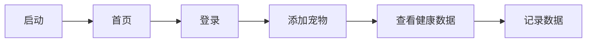
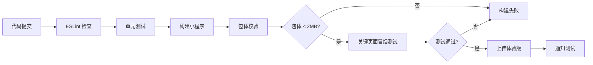

# H5 → 微信小程序迁移评估与重构文档

> **文档目标**：把"从 H5 为中心 → 微信小程序为中心"的迁移问题，拆成可收集资料、可量化风险、可执行重构任务

**项目名称**：iPet  
**评估日期**：2025-12-15  
**负责人**：  
**当前状态**：迁移中 / 待规划 / 已完成

---

## 📋 资料收集清单（评估前必读）

在填写本文档前，请先收集以下资料：

- [ ] `pages.json`、`manifest.json`、`App.vue`、`main.ts`
- [ ] 全局样式入口（`uni.scss`、`global.css`、主题文件）
- [ ] UI 库使用范围（哪些页面用了哪些组件）
- [ ] `package.json` + 体积分析（主包/分包/静态资源）
- [ ] 关键页面的性能数据（启动、首屏、长列表）
- [ ] 已知问题列表 + 复现路径

---

## 1️⃣ 迁移动机与目标边界

> **目标**：明确"为什么降级、降到什么程度"，避免无限重构

### 1.1 业务目标

**必须在小程序达成的关键路径**（请勾选并补充）：

- [ ] 用户登录（微信授权/手机号/账号密码）
- [ ] 首页展示
- [ ] 核心功能：\_\_\_\_\_\_\_\_\_\_\_\_\_\_\_\_\_\_\_\_
- [ ] 支付流程
- [ ] 分享功能（朋友/朋友圈/卡片）
- [ ] 消息推送（订阅消息/模板消息）
- [ ] 其他：\_\_\_\_\_\_\_\_\_\_\_\_\_\_\_\_\_\_\_\_

### 1.2 体验目标

| 指标         | H5 基线 | 小程序目标 | 备注                     |
| ------------ | ------- | ---------- | ------------------------ |
| 首屏耗时     | \_\_ms  | \_\_ms     | 包含接口 + 渲染完成      |
| 页面可用性   | \_\_    | \_\_       | 核心功能可用率           |
| 交互一致性   | -       | -          | 与 H5 对齐 / 以小程序为准 |
| 包体大小     | -       | \_\_MB     | 主包 + 分包总大小        |
| Crash/白屏率 | \_\_    | \_\_       | 启动失败率               |

### 1.3 功能边界决策

**H5 能做但小程序做不了（或成本极高）的功能**：

| 功能           | H5 支持 | 小程序支持 | 决策（砍/替代/延后） | 替代方案       |
| -------------- | ------- | ---------- | -------------------- | -------------- |
| 富文本编辑器   | ✅      | ❌         | 延后                 | 用 WebView 承载 |
| 复杂音视频处理 | ✅      | 部分       | 替代                 | 使用云处理     |
| \_\_\_\_\_\_   | \_\_    | \_\_       | \_\_                 | \_\_           |

### 1.4 成功指标（KPI）

| 指标         | 目标值  | 测量方式                   | 责任人 |
| ------------ | ------- | -------------------------- | ------ |
| 包体大小     | < 2MB   | 构建产物分析               | \_\_   |
| 首屏耗时     | < 2s    | 性能监控平台               | \_\_   |
| 白屏率       | < 1%    | 错误监控（Sentry/微信统计） | \_\_   |
| 核心转化率   | \_\_    | 埋点统计                   | \_\_   |
| 接口成功率   | > 99.5% | APM 监控                   | \_\_   |
| 用户留存率   | \_\_    | 数据分析                   | \_\_   |

### 1.5 不做什么（重要！避免范围蔓延）

> [!WARNING]
> 以下功能**本次迁移不做**，避免无限重构：

1. \_\_\_\_\_\_\_\_\_\_\_\_\_\_\_\_\_\_\_\_
2. \_\_\_\_\_\_\_\_\_\_\_\_\_\_\_\_\_\_\_\_
3. \_\_\_\_\_\_\_\_\_\_\_\_\_\_\_\_\_\_\_\_

---

## 2️⃣ 平台差异清单（能力对齐表）

> **目标**：明确 H5 vs 小程序的能力差异，找出风险点

### 2.1 能力矩阵表

**图例**：✅ 完全支持 | 🟡 部分支持 | ❌ 不支持 | 🔧 需要替代方案

| 能力分类       | 具体能力                  | H5  | 小程序 | 项目中使用位置                     | 风险等级 | 替代方案                 |
| -------------- | ------------------------- | --- | ------ | ---------------------------------- | -------- | ------------------------ |
| **路由与页面** | history 路由              | ✅  | ❌     | 全局路由管理                       | P1       | 改用小程序导航 API       |
|                | 页面栈管理                | ✅  | 🟡     | \_\_                               | \_\_     | \_\_                     |
|                | 重定向行为                | ✅  | 🟡     | \_\_                               | \_\_     | \_\_                     |
| **样式能力**   | `position: fixed`         | ✅  | 🟡     | 底部导航、悬浮按钮                 | P2       | 用 cover-view 或原生组件 |
|                | `vh` 单位                 | ✅  | 🟡     | \_\_                               | \_\_     | \_\_                     |
|                | `backdrop-filter`         | ✅  | ❌     | 模糊背景效果                       | P2       | 用图片或降级             |
|                | `gap` (flex/grid)         | ✅  | ❌     | 布局间距                           | P1       | 改用 margin              |
|                | `position: sticky`        | ✅  | 🟡     | \_\_                               | \_\_     | \_\_                     |
|                | 自定义字体/图标           | ✅  | 🟡     | iconfont                           | P0       | 转 base64 或本地文件     |
| **运行环境**   | DOM/Window API            | ✅  | ❌     | \_\_                               | \_\_     | \_\_                     |
|                | 事件模型                  | ✅  | 🟡     | \_\_                               | \_\_     | \_\_                     |
|                | 滚动容器                  | ✅  | 🟡     | 长列表                             | P1       | 用 scroll-view           |
|                | localStorage              | ✅  | 🟡     | 用户偏好存储                       | P1       | uni.storage              |
|                | clipboard                 | ✅  | 🟡     | 复制功能                           | P2       | uni.setClipboardData     |
|                | websocket                 | ✅  | ✅     | 实时通信                           | P1       | 需测试兼容性             |
| **文件与媒体** | 图片上传                  | ✅  | ✅     | \_\_                               | \_\_     | \_\_                     |
|                | 图片压缩                  | ✅  | ✅     | \_\_                               | \_\_     | \_\_                     |
|                | WebP 支持                 | ✅  | ✅     | \_\_                               | \_\_     | \_\_                     |
|                | 视频封面                  | ✅  | 🟡     | \_\_                               | \_\_     | \_\_                     |
|                | 音频播放                  | ✅  | ✅     | \_\_                               | \_\_     | \_\_                     |
| **地图/定位**  | 地图显示                  | ✅  | ✅     | \_\_                               | \_\_     | \_\_                     |
|                | 定位精度                  | ✅  | 🟡     | \_\_                               | \_\_     | 权限弹窗差异             |
|                | 权限模型                  | ✅  | 🟡     | \_\_                               | \_\_     | \_\_                     |
| **社交功能**   | 分享（朋友/朋友圈）       | 🟡  | ✅     | 文章分享                           | P1       | 已接入小程序分享         |
|                | 订阅消息                  | ❌  | ✅     | \_\_                               | \_\_     | \_\_                     |
|                | 微信支付                  | ✅  | ✅     | \_\_                               | \_\_     | \_\_                     |
| **WebView**    | 内嵌网页（关键功能承载）  | ✅  | 🟡     | \_\_                               | \_\_     | 谨慎使用，有性能问题     |

### 2.2 高风险能力汇总

> [!CAUTION]
> 以下能力在小程序中存在**严重限制**，需要重点关注：

1. **DOM/Window API**：涉及 \_\_ 个组件，需要完全重写
2. **CSS Gap 属性**：涉及 \_\_ 个页面，需要改用 margin
3. **自定义字体/Iconfont**：体积 \_\_KB，已导致启动失败
4. \_\_\_\_\_\_\_\_\_\_\_\_\_\_\_\_\_\_\_\_

---

## 3️⃣ 信息架构与页面分级

> **目标**：先保证核心链路活下来，再逐步完善

### 3.1 页面清单

| 页面路径 | 页面名称 | 类型 | 分包 | Tabbar | 入口页 | 落地页 |
| -------- | -------- | ---- | ---- | ------ | ------ | ------ |
| /pages/index/index | 首页 | 主包 | - | ✅ | ✅ | - |
| /pages/login/index | 登录 | 主包 | - | - | ✅ | ✅ |
| /pages/my/index | 我的 | 主包 | - | ✅ | - | - |
| /pages/articles/list | 文章列表 | 主包 | - | ✅ | - | - |
| /pages/articles/detail | 文章详情 | 主包 | - | - | - | - |
| /pages/pets/profile | 宠物档案 | 主包 | - | - | - | - |
| \_\_\_\_\_\_ | \_\_\_\_\_\_ | \_\_ | \_\_ | \_\_ | \_\_ | \_\_ |

### 3.2 核心链路定义

**从入口到目标完成的最短路径**（按小程序用户习惯）：



### 3.3 页面分级（P0/P1/P2）

| 优先级 | 页面                         | 理由                       | 依赖列表                                 |
| ------ | ---------------------------- | -------------------------- | ---------------------------------------- |
| **P0** | `/pages/index/index`         | 核心入口                   | 接口：`/api/health`、组件：`PetCard`     |
| **P0** | `/pages/login/index`         | 用户鉴权                   | 接口：`/api/auth/login`、微信登录 API    |
| **P0** | `/pages/pets/profile`        | 核心功能                   | 接口：`/api/pets`、组件：`PetForm`       |
| **P1** | `/pages/articles/list`       | 内容消费                   | 接口：`/api/articles`、本地缓存          |
| **P1** | `/pages/articles/detail`     | 内容详情                   | 组件：`up-markdown`、静态资源加载        |
| **P2** | `/pages/settings/index`      | 设置页                     | 本地存储、无关键依赖                     |
| **P2** | \_\_\_\_\_\_\_\_             | \_\_\_\_\_\_\_\_           | \_\_\_\_\_\_\_\_                         |

### 3.4 路由规范

| 规范项       | H5 方案             | 小程序方案                  | 迁移动作                 |
| ------------ | ------------------- | --------------------------- | ------------------------ |
| 页面参数传递 | query string        | query string / eventChannel | ✅ 保持一致              |
| 返回策略     | history.back()      | uni.navigateBack()          | 🔧 统一封装 router 工具  |
| 页面间通信   | Vuex / provide/inject | eventChannel / store        | 🔧 建议用 Pinia 统一管理 |
| 页面栈管理   | 无限制              | 最多 10 层                  | ⚠️ 需要优化跳转逻辑      |

---

## 4️⃣ UI 与样式体系

> **目标**：解决"H5 正常、小程序异常"的根因

### 4.1 全局样式入口分析

| 文件           | 加载方式       | 作用域  | 是否在小程序生效 | 问题                         |
| -------------- | -------------- | ------- | ---------------- | ---------------------------- |
| `App.vue`      | Vue 根组件     | 全局    | ✅               | -                            |
| `uni.scss`     | uni-app 配置   | 全局    | ✅               | 变量需要在组件中 `@import`   |
| `global.css`   | main.ts import | 全局    | 🟡               | 部分样式在小程序不生效       |
| `theme.scss`   | 按需引入       | 局部    | ✅               | -                            |
| uview-plus     | Vue.use        | 全局    | 🟡               | 部分组件在小程序有适配问题   |

### 4.2 布局策略问题清单

| 问题                | H5 表现 | 小程序表现 | 涉及页面/组件              | 解决方案                 | 优先级 |
| ------------------- | ------- | ---------- | -------------------------- | ------------------------ | ------ |
| `gap` 属性不生效    | ✅正常  | ❌失效     | 登录页、文章列表、卡片布局 | 改用 `margin`            | P0     |
| `100vh` 不准确      | ✅正常  | 🟡偏差     | 全屏页面                   | 用 `height: 100%` + flex | P1     |
| `position: fixed`   | ✅正常  | 🟡层级问题 | 底部悬浮按钮               | 用原生组件或调整层级     | P2     |
| `calc()` 计算错误   | ✅正常  | ❌失效     | \_\_                       | 预计算或用 rpx           | P1     |
| Flex 布局差异       | ✅正常  | 🟡细微差异 | \_\_                       | 测试验证                 | P2     |
| 背景色不生效 (#f2f1f5) | ✅正常  | ❌显示白色 | 多个页面                   | 显式设置页面根节点背景   | P0     |

### 4.3 主题系统策略

**当前状态**：
- ✅ 已移除暗黑模式
- ✅ 使用 TypeScript 主题系统（`src/styles/theme.ts`）
- 🟡 部分页面仍混用 Sass 变量

**统一策略**：

> [!IMPORTANT]
> **决策**：以 TypeScript 主题系统为准，逐步迁移所有 Sass 变量

| 令牌类型 | 定义位置          | 使用方式                      | 迁移状态 |
| -------- | ----------------- | ----------------------------- | -------- |
| 颜色     | `theme.ts`        | `theme.colors.primary`        | ✅ 完成  |
| 字号     | `theme.ts`        | `theme.typography.fontSize.*` | ✅ 完成  |
| 间距     | `theme.ts`        | `theme.spacing.*`             | 🟡 进行中 |
| 圆角     | `theme.ts`        | `theme.radius.*`              | 🟡 进行中 |
| 阴影     | ~~`uni.scss`~~    | ~~已废弃~~                    | ❌ 待迁移 |

### 4.4 图标体系

| 方案       | 实现方式          | 体积     | 小程序兼容性 | 当前使用情况         | 决策       |
| ---------- | ----------------- | -------- | ------------ | -------------------- | ---------- |
| Iconfont.js | 动态加载 JS       | ~100KB   | ❌ 导致崩溃  | Tabbar 图标（已移除） | ❌ 废弃    |
| 本地图片   | PNG/JPG           | 总计 \_\_KB | ✅ 完全支持  | Tabbar 图标（当前）   | ✅ 采用    |
| SVG 组件   | Vue 组件          | 按需     | ✅ 支持      | 部分图标             | 🟡 推荐    |
| Unicode    | 字体文件 + CSS    | ~50KB    | 🟡 需裁剪    | \_\_                 | 🟡 可选    |

**行动项**：
- [ ] P0：确保所有 Tabbar 图标使用本地图片（已完成）
- [ ] P1：将常用图标转为 SVG 组件，减少体积
- [ ] P2：评估是否需要字体图标方案

---

## 5️⃣ 组件与三方库审计

> **目标**：识别"H5 思维"的库，避免踩坑

### 5.1 依赖清单

| 依赖名          | 版本    | 用途           | 小程序适配成熟度 | 已知问题                     | 风险等级 | 替代方案        | 涉及页面/组件 |
| --------------- | ------- | -------------- | ---------------- | ---------------------------- | -------- | --------------- | ------------- |
| `uview-plus`    | ^3.2.0  | UI 组件库      | 🟡 中等          | 部分组件样式异常             | P1       | 用原生/自研组件 | 全局          |
| `@dcloudio/uni-ui` | ^1.5.0 | uni-app 官方组件 | ✅ 高            | -                            | -        | -               | -             |
| `dayjs`         | ^1.11.0 | 时间处理       | ✅ 高            | -                            | -        | -               | 多处          |
| `pinia`         | ^2.1.0  | 状态管理       | ✅ 高            | -                            | -        | -               | 全局          |
| `lodash-es`     | ^4.17.21 | 工具函数       | ✅ 高            | -                            | -        | -               | 多处          |
| ~~`marked`~~    | ~~^5.0.0~~ | ~~Markdown 解析~~ | ❌ 低            | 依赖 DOM                     | P0       | `up-markdown`   | 文章详情      |
| \_\_\_\_\_\_    | \_\_    | \_\_           | \_\_             | \_\_                         | \_\_     | \_\_            | \_\_          |

### 5.2 UI 库适配策略

**uview-plus 使用情况**：

| 组件            | 使用位置 | 小程序表现 | 决策                 |
| --------------- | -------- | ---------- | -------------------- |
| `u-navbar`      | 多页面   | 🟡 部分异常 | 减少使用，用原生导航 |
| `up-markdown`   | 文章详情 | ✅ 正常    | 保留                 |
| `u-form`        | 表单页面 | ✅ 正常    | 保留                 |
| `u-button`      | 全局     | 🟡 样式需调整 | 保留，统一样式覆盖   |
| \_\_\_\_\_\_    | \_\_     | \_\_       | \_\_                 |

> [!TIP]
> **建议**：尽量使用 `pages.json` 原生 navbar，减少对 `u-navbar` 的依赖

### 5.3 自研组件审计

| 组件名称          | 位置                        | 是否依赖 H5 API | 依赖内容                 | 风险等级 | 改造方案         |
| ----------------- | --------------------------- | --------------- | ------------------------ | -------- | ---------------- |
| `PetCard`         | `/components/PetCard.vue`   | ❌              | -                        | -        | -                |
| `MetricCard`      | `/components/MetricCard.vue`| ❌              | -                        | -        | -                |
| `SocialButton`    | `/pages/login/components/SocialButton.vue` | ❌              | -                        | -        | 已修复布局问题   |
| ~~`DynamicChart`~~| ~~`/components/DynamicChart.vue`~~ | ✅              | 依赖 `<component :is="">` | P0       | 已改为 v-if 条件渲染 |
| \_\_\_\_\_\_      | \_\_                        | \_\_            | \_\_                     | \_\_     | \_\_             |

---

## 6️⃣ 导航栏与页面配置

> **目标**：以 `pages.json` 为中心，减少自定义导航

### 6.1 导航策略决策

> [!IMPORTANT]
> **统一规则**：优先使用原生导航栏，仅在特殊需求时使用自定义导航

| 场景                 | 导航方案   | 理由                                   |
| -------------------- | ---------- | -------------------------------------- |
| 普通内容页           | 原生导航   | 稳定性高、返回按钮自动处理             |
| Tabbar 页面          | 原生导航   | 必须用原生                             |
| 需要自定义按钮的页面 | 原生导航   | 用 `navigationBarTextStyle` + 自定义按钮组件 |
| 沉浸式页面（如视频播放） | 自定义导航 | 需要控制透明度/覆盖                    |
| 特殊交互页面         | 自定义导航 | 需要动态显示/隐藏、渐变效果等          |

### 6.2 pages.json 配置核心

```json
{
  "pages": [
    {
      "path": "pages/index/index",
      "style": {
        "navigationBarTitleText": "首页",
        "navigationBarBackgroundColor": "#ffffff",
        "navigationBarTextStyle": "black",
        "enablePullDownRefresh": true,
        "backgroundColor": "#f2f1f5"
      }
    }
  ],
  "tabBar": {
    "color": "#666666",
    "selectedColor": "#5F52FF",
    "backgroundColor": "#ffffff",
    "borderStyle": "black",
    "list": [
      {
        "pagePath": "pages/index/index",
        "text": "首页",
        "iconPath": "static/images/tabbar/home.png",
        "selectedIconPath": "static/images/tabbar/home-active.png"
      }
    ]
  }
}
```

### 6.3 导航问题记录

| 问题                 | 页面           | 原因                                 | 解决方案                         | 状态 |
| -------------------- | -------------- | ------------------------------------ | -------------------------------- | ---- |
| 返回按钮缺失         | 多个页面       | 使用了 `u-navbar` 但未正确配置返回   | 改用原生导航或添加返回按钮处理   | ✅ 已修复 |
| 路由跳转后无法返回   | \_\_           | 页面栈超过 10 层                     | 优化跳转方式，用 `redirectTo` 替换 | 🟡 进行中 |
| 导航栏背景色不一致   | \_\_           | `pages.json` 未统一配置              | 统一设置 `navigationBarBackgroundColor` | 🟡 进行中 |

---

## 7️⃣ 性能与包体

> **目标**：满足小程序的硬指标

### 7.1 包体分析

| 分类         | 当前大小 | 目标大小 | 占比  | 优化方案                         |
| ------------ | -------- | -------- | ----- | -------------------------------- |
| **主包**     | \_\_MB   | < 2MB    | \_\_% | 移除 iconfont.js、压缩图片       |
| **分包**     | \_\_MB   | -        | \_\_% | \_\_                             |
| 静态资源     | \_\_MB   | -        | \_\_% | WebP 转换、图片压缩              |
| JS 代码      | \_\_MB   | -        | \_\_% | Tree-shaking、移除未使用依赖     |
| 字体/图标    | \_\_MB   | -        | \_\_% | 字体裁剪、改用 SVG               |
| Markdown 内容| \_\_MB   | -        | \_\_% | 分离为远程加载                   |

**优化清单（P0）**：
- [ ] 移除 iconfont.js 动态加载（已完成）
- [ ] 压缩所有文章配图至 < 20KB（已完成）
- [ ] 分离 Markdown 内容为远程加载
- [ ] 压缩主包 JS 代码
- [ ] \_\_\_\_\_\_\_\_\_\_\_\_\_\_\_\_\_\_\_\_

### 7.2 性能基线

| 指标           | H5 基线 | 小程序当前 | 小程序目标 | 测试环境        |
| -------------- | ------- | ---------- | ---------- | --------------- |
| 冷启动耗时     | \_\_ms  | \_\_ms     | < 2000ms   | iPhone 12, WiFi |
| 首屏接口耗时   | \_\_ms  | \_\_ms     | < 500ms    | 同上            |
| 首屏渲染完成   | \_\_ms  | \_\_ms     | < 1500ms   | 同上            |
| 长列表滚动 FPS | 60fps   | \_\_fps    | > 50fps    | 100 条数据      |
| setData 频率   | -       | \_\_次/s   | < 10 次/s  | 复杂页面        |

### 7.3 渲染性能优化

| 问题               | 涉及页面   | 原因                 | 优化方案                   | 优先级 |
| ------------------ | ---------- | -------------------- | -------------------------- | ------ |
| 长列表卡顿         | 文章列表   | 未使用虚拟列表       | 使用 `<recycle-list>` 或分页 | P1     |
| 频繁 setData       | \_\_       | 响应式数据过多       | 减少响应式数据、合并更新   | P1     |
| 复杂卡片渲染慢     | 健康数据卡片 | 组件层级深、计算多   | 组件拆分、缓存计算结果     | P2     |
| 图表性能差         | \_\_       | \_\_                 | 使用轻量级图表库           | P2     |

### 7.4 缓存策略

**本地基础内容 + 网络热点内容 双源策略**：

| 数据类型       | 来源   | 缓存策略           | 更新机制             | 实现状态 |
| -------------- | ------ | ------------------ | -------------------- | -------- |
| 基础文章内容   | 本地   | 内置在包内         | 版本更新时替换       | ✅ 已实现 |
| 热点文章       | 远程   | 本地缓存 7 天      | 启动时增量更新       | 🟡 规划中 |
| 用户数据       | 远程   | 本地缓存 + 实时同步 | 每次打开页面刷新     | ✅ 已实现 |
| 配置数据       | 远程   | 本地缓存 24 小时   | 启动时检查更新       | 🟡 规划中 |
| 图片资源       | CDN    | 微信缓存           | 自动                 | ✅ 已实现 |

---

## 8️⃣ 数据与接口契约

> **目标**：前后端协同点明确，避免接口问题

### 8.1 接口清单

| 接口路径            | 用途         | 鉴权 | 错误码 | 幂等 | 重试策略 | 涉及页面       | 状态   |
| ------------------- | ------------ | ---- | ------ | ---- | -------- | -------------- | ------ |
| `/api/health`       | 健康检查     | ❌   | 500    | ✅   | 3 次     | 启动时         | ⚠️ 有问题 |
| `/api/auth/login`   | 用户登录     | ❌   | 401    | ✅   | 0 次     | 登录页         | ✅ 正常 |
| `/api/pets`         | 宠物列表     | ✅   | 401, 500 | ✅   | 3 次     | 首页、宠物管理 | ✅ 正常 |
| `/api/articles`     | 文章列表     | ❌   | 500    | ✅   | 3 次     | 文章列表       | ✅ 正常 |
| \_\_\_\_\_\_\_\_    | \_\_         | \_\_ | \_\_   | \_\_ | \_\_     | \_\_           | \_\_   |

### 8.2 登录态管理

| 方案             | H5 实现          | 小程序实现                  | 迁移动作             |
| ---------------- | ---------------- | --------------------------- | -------------------- |
| Token 存储       | localStorage     | uni.storage                 | ✅ 已适配            |
| Token 刷新       | 过期前自动刷新   | 同 H5                       | ✅ 保持一致          |
| 小程序登录       | -                | `wx.login()` + code 换 session | 🟡 需要后端支持 |
| 登录态失效处理   | 跳转登录页       | 同 H5                       | ✅ 保持一致          |

### 8.3 内容分发策略

**数据源优先级**：

```
本地内置内容（静态基础） → 本地缓存（远程热点） → 网络请求（实时）
```

| 内容类型     | 数据源   | Schema 管控 | 版本管理 | 灰度/热修复 |
| ------------ | -------- | ----------- | -------- | ----------- |
| 基础文章     | 本地     | JSON Schema | 跟随版本 | ❌          |
| 热点文章     | 远程API  | JSON Schema | 版本号   | ✅ 支持     |
| 用户生成内容 | 远程API  | -           | -        | -           |
| 配置数据     | 远程API  | JSON Schema | 版本号   | ✅ 支持     |

### 8.4 埋点与监控

| 监控类型     | 工具/平台      | 监控指标                     | 告警阈值   |
| ------------ | -------------- | ---------------------------- | ---------- |
| 错误监控     | Sentry / 微信统计 | Crash、白屏、JS 错误         | > 1%       |
| 接口监控     | APM            | 成功率、耗时、超时           | < 99.5%    |
| 性能监控     | 微信小程序管理后台 | 启动耗时、首屏耗时、FPS      | 见 7.2 基线 |
| 业务埋点     | 自建 / 第三方   | 核心转化、用户行为           | -          |

---

## 9️⃣ 工程化与构建发布

> **目标**：从"能跑"到"可维护"

### 9.1 构建链路

| 环节         | 工具/配置              | 当前状态 | 优化方向                 |
| ------------ | ---------------------- | -------- | ------------------------ |
| 构建工具     | Vite                   | ✅ 已配置 | -                        |
| 条件编译     | `#ifdef MP-WEIXIN`     | ✅ 已使用 | 减少条件编译，用适配层   |
| 环境变量     | `.env.*`               | ✅ 已配置 | -                        |
| 平台分支     | 目录组织               | 🟡 混乱   | 建立统一适配层目录       |

### 9.2 代码规范

**平台适配层规范**：

```
src/
├── adapters/               # 平台适配层（集中管理）
│   ├── storage.ts          # 存储适配
│   ├── router.ts           # 路由适配
│   ├── clipboard.ts        # 剪贴板适配
│   └── ...
├── components/
├── pages/
└── ...
```

> [!IMPORTANT]
> **禁止事项**：
> 1. ❌ 在组件内部散落 `#ifdef` 条件编译
> 2. ❌ 直接调用 `wx.*` API（应通过适配层）
> 3. ❌ 混用 `uni.*` 和平台 API
> 4. ❌ 在样式中使用不兼容的 CSS（如 `gap`、`backdrop-filter`）

### 9.3 资源管线

| 资源类型 | 处理方式           | 工具/插件              | 优化目标        |
| -------- | ------------------ | ---------------------- | --------------- |
| 图片     | 压缩 + WebP 转换   | `imagemin` / 手动      | 单张 < 20KB     |
| 字体     | 裁剪子集           | `fontmin`              | 减少 50% 体积   |
| 分包资源 | 分包配置           | `pages.json`           | 主包 < 2MB      |
| CDN      | 静态资源外链       | 阿里云 OSS / 微信 CDN  | 减少包体        |

### 9.4 CI/CD 流程



**待完善**：
- [ ] 自动构建（GitHub Actions / Jenkins）
- [ ] 包体校验自动化
- [ ] 关键页面冒烟测试（Puppeteer / 微信开发者工具 CLI）
- [ ] 体验版自动上传

---

## 🔟 风险矩阵与重构路线图

> **目标**：把文档变成可执行计划

### 10.1 风险矩阵

**风险评分**：影响面（1-5）× 发生概率（1-5）× 修复成本（1-5）= 风险分数（1-125）

| 风险项                 | 影响面 | 发生概率 | 修复成本 | 风险分数 | 优先级 | 负责人 |
| ---------------------- | ------ | -------- | -------- | -------- | ------ | ------ |
| iconfont.js 导致崩溃   | 5      | 5        | 2        | 50       | **P0** | ✅ 已解决 |
| CSS Gap 导致布局错乱   | 4      | 5        | 3        | 60       | **P0** | 🟡 进行中 |
| 包体超过 2MB 限制      | 5      | 4        | 4        | 80       | **P0** | 🟡 进行中 |
| 页面背景色不一致       | 3      | 5        | 1        | 15       | **P1** | 🟡 进行中 |
| 自定义导航返回按钮缺失 | 4      | 4        | 2        | 32       | **P1** | ✅ 已解决 |
| 长列表性能差           | 3      | 3        | 4        | 36       | **P1** | ❌ 未开始 |
| 接口 /api/health 500   | 2      | 5        | 2        | 20       | **P1** | ⚠️ 待修复 |
| \_\_\_\_\_\_\_\_       | \_\_   | \_\_     | \_\_     | \_\_     | \_\_   | \_\_   |

### 10.2 迁移路线图

#### 阶段 1：稳定优先（P0）- 1-2 周

**目标**：小程序跑通主链路，允许功能降级

- [x] 移除 iconfont.js，改用本地图片
- [x] 修复登录页布局问题（gap → margin）
- [x] 修复自定义导航返回按钮缺失
- [ ] 优化包体至 < 2MB
- [ ] 修复所有 P0 页面的 CSS Gap 问题
- [ ] 确保核心接口（登录、宠物、健康）可用
- [ ] 基础错误监控接入

**可交付物**：
- 小程序可正常启动
- 核心链路可用（登录 → 添加宠物 → 查看数据）
- 无阻塞性 Bug

#### 阶段 2：体验一致（P1）- 2-3 周

**目标**：逐步对齐 H5 体验

- [ ] 统一所有页面背景色
- [ ] 优化长列表性能
- [ ] 文章内容双源策略实现（本地 + 远程）
- [ ] 完善错误处理和用户提示
- [ ] 性能监控接入
- [ ] 首屏优化至目标值

**可交付物**：
- 所有 P0 + P1 页面体验一致
- 性能指标达标
- 用户满意度调研通过

#### 阶段 3：重构优化（P2）- 持续

**目标**：清理平台分支、沉淀适配层与组件库

- [ ] 建立统一平台适配层
- [ ] 清理散落的 `#ifdef` 条件编译
- [ ] 组件库小程序适配优化
- [ ] CI/CD 流程完善
- [ ] 字体/图标体积优化
- [ ] 分包策略优化

**可交付物**：
- 代码可维护性提升
- 新需求开发效率提升
- 包体持续优化

### 10.3 任务看板（Backlog）

#### P0 任务池（阻塞性问题，必须立即解决）

| ID   | 任务                         | 负责人 | 预计工时 | 状态   | 验收标准                     |
| ---- | ---------------------------- | ------ | -------- | ------ | ---------------------------- |
| P0-1 | ~~移除 iconfont.js~~         | \_\_   | 2h       | ✅ 完成 | 小程序可正常启动             |
| P0-2 | ~~修复登录页按钮布局~~       | \_\_   | 1h       | ✅ 完成 | 按钮全宽显示                 |
| P0-3 | 优化主包体积至 < 2MB         | \_\_   | 8h       | 🟡 50% | 构建产物 < 2MB               |
| P0-4 | 修复所有 CSS Gap 布局问题    | \_\_   | 6h       | 🟡 30% | 所有页面布局正常             |
| P0-5 | ~~修复动态组件编译错误~~     | \_\_   | 4h       | ✅ 完成 | 编译通过                     |
| P0-6 | \_\_\_\_\_\_\_\_             | \_\_   | \_\_     | \_\_   | \_\_                         |

#### P1 任务池（重要但不阻塞，尽快解决）

| ID   | 任务                         | 负责人 | 预计工时 | 状态   | 验收标准                     |
| ---- | ---------------------------- | ------ | -------- | ------ | ---------------------------- |
| P1-1 | ~~修复导航栏返回按钮缺失~~   | \_\_   | 3h       | ✅ 完成 | 所有页面可正常返回           |
| P1-2 | 统一页面背景色为 #f2f1f5     | \_\_   | 2h       | 🟡 70% | 所有页面背景色一致           |
| P1-3 | 修复 /api/health 500 错误    | \_\_   | 4h       | ❌ 未开始 | 接口返回 200                 |
| P1-4 | 优化文章列表长列表性能       | \_\_   | 8h       | ❌ 未开始 | 滚动 FPS > 50                |
| P1-5 | 实现文章内容双源策略         | \_\_   | 16h      | 🟡 规划中 | 本地 + 远程内容正确加载      |
| P1-6 | \_\_\_\_\_\_\_\_             | \_\_   | \_\_     | \_\_   | \_\_                         |

#### P2 任务池（优化项，可延后）

| ID   | 任务                         | 负责人 | 预计工时 | 状态   | 验收标准                     |
| ---- | ---------------------------- | ------ | -------- | ------ | ---------------------------- |
| P2-1 | 建立平台适配层               | \_\_   | 16h      | ❌ 未开始 | 适配层模块完成               |
| P2-2 | 图标体积优化（SVG 化）       | \_\_   | 8h       | ❌ 未开始 | 图标总体积减少 50%           |
| P2-3 | CI/CD 流程搭建               | \_\_   | 20h      | ❌ 未开始 | 自动构建 + 冒烟测试          |
| P2-4 | 字体裁剪优化                 | \_\_   | 4h       | ❌ 未开始 | 字体体积减少 50%             |
| P2-5 | 分包策略优化                 | \_\_   | 8h       | ❌ 未开始 | 主包体积进一步减少           |
| P2-6 | \_\_\_\_\_\_\_\_             | \_\_   | \_\_     | \_\_   | \_\_                         |

---

## 📊 进度仪表板

### 总览

| 指标             | 当前值  | 目标值  | 达成率 |
| ---------------- | ------- | ------- | ------ |
| P0 任务完成率    | 40%     | 100%    | 🟡     |
| P1 任务完成率    | 20%     | 100%    | 🔴     |
| 包体大小         | \_\_MB  | < 2MB   | 🟡     |
| 首屏耗时         | \_\_ms  | < 2000ms| \_\_   |
| 白屏率           | \_\_    | < 1%    | \_\_   |
| 核心转化率       | \_\_    | \_\_    | \_\_   |

### 里程碑

- [x] **M1**：小程序可启动（2025-12-14 完成）
- [x] **M2**：核心页面可访问（2025-12-14 完成）
- [ ] **M3**：核心链路可用（预计 2025-12-20）
- [ ] **M4**：性能指标达标（预计 2025-12-27）
- [ ] **M5**：体验版发布（预计 2026-01-03）
- [ ] **M6**：正式版发布（预计 2026-01-10）

---

## 📝 变更日志

| 日期       | 变更内容                         | 责任人 |
| ---------- | -------------------------------- | ------ |
| 2025-12-15 | 创建迁移评估文档                 | \_\_   |
| 2025-12-14 | 移除 iconfont.js，修复启动崩溃   | \_\_   |
| 2025-12-14 | 修复登录页布局、导航栏返回按钮   | \_\_   |
| 2025-12-14 | 修复动态组件编译错误             | \_\_   |
| \_\_       | \_\_                             | \_\_   |

---

## 🔗 相关文档

- [项目 CHANGELOG](/Users/zhengjiyuan/Desktop/iPet/iPet-uniapp/CHANGELOG.md)
- [uni-app 官方文档 - 小程序平台差异](https://uniapp.dcloud.net.cn/matter.html)
- [微信小程序开发文档](https://developers.weixin.qq.com/miniprogram/dev/framework/)
- [uview-plus 组件库文档](https://uview-plus.jiangruyi.com/)

---

## 📞 联系方式

**技术负责人**：\_\_\_\_\_\_\_\_  
**产品负责人**：\_\_\_\_\_\_\_\_  
**项目仓库**：[baicai99/iPet](https://github.com/baicai99/iPet)

---

**最后更新**：2025-12-15 05:19  
**下次评审**：\_\_\_\_\_\_\_\_
