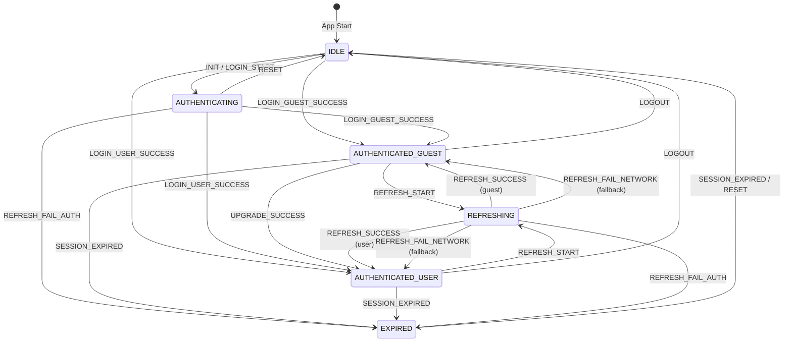

# Auth State Machine

Frontend authentication state machine with explicit states, transitions, and comprehensive logging.

## Overview

The auth module (`src/auth/`) provides a centralized state machine for managing authentication flows. It replaces implicit state management with explicit transitions and structured logging for debugging.

## State Diagram



## States

| State | Description | AuthMode |
|-------|-------------|----------|
| `IDLE` | No authentication, app just started or logged out | `none` |
| `AUTHENTICATING` | Login or refresh in progress | `none` |
| `AUTHENTICATED_GUEST` | Logged in as guest | `guest` |
| `AUTHENTICATED_USER` | Logged in as registered user | `user` |
| `REFRESHING` | Token refresh in progress | `guest`/`user` |
| `EXPIRED` | Session expired, needs re-login | `none` |
| `ERROR` | Auth error occurred | `none` |

## Key Events

| Event | Trigger | Description |
|-------|---------|-------------|
| `LOGIN_START` | User initiates login | Transition to authenticating |
| `LOGIN_GUEST_SUCCESS` | Guest API returns 2xx | Transition to guest mode |
| `LOGIN_USER_SUCCESS` | Login API returns 2xx | Transition to user mode |
| `REFRESH_START` | Token near expiry | Start refresh flow |
| `REFRESH_SUCCESS` | Refresh API returns 2xx | Update token, stay authenticated |
| `REFRESH_FAIL_NETWORK` | Network error | Keep old token, degraded mode |
| `REFRESH_FAIL_AUTH` | 401/404 from refresh | Force logout |
| `LOGOUT` | User clicks logout | Clear session |
| `UPGRADE_SUCCESS` | Guest upgrades to user | Transition to user mode |

## Transition Reasons

Each transition is logged with a `reason` field. Common reasons:

### Initialization
- `init_no_token` - App started with no stored token
- `init_has_token` - App started with stored token
- `init_token_expired` - Stored token is expired

### Login
- `guest_login_success` - Guest login completed
- `user_login_success` - User login completed

### Refresh
- `refresh_triggered` - Refresh started
- `refresh_success` - Refresh completed
- `refresh_fail_network_fallback` - Network error, using old token
- `refresh_fail_auth_401` - Auth failed with 401

### Session
- `user_logout` - User initiated logout
- `ghost_account_detected` - Profile sync returned 404

## Refresh Fallback Strategy

When token refresh fails:

| Error Type | Action | Result |
|------------|--------|--------|
| Auth error (401/404) | Clear session | → `EXPIRED` → Login page |
| Network error | Keep old token | → `AUTHENTICATED_*` (degraded) |

**Degraded Mode**: When `isDegraded` is `true`, the app is using a potentially stale token. The state machine logs a warning and continues operating.

## Usage

### Check Auth State
```typescript
import { useAuthStateMachine } from '@/auth'

const authMachine = useAuthStateMachine()

// Reactive state
console.log(authMachine.state.value)       // 'AUTHENTICATED_USER'
console.log(authMachine.authMode.value)    // 'user'
console.log(authMachine.isAuthenticated.value)  // true
console.log(authMachine.isDegraded.value)  // false
```

### Dispatch Events
```typescript
authMachine.dispatch('LOGOUT', 'user_logout')
authMachine.dispatch('REFRESH_SUCCESS', 'refresh_success', {
    requestId: 'abc123',
    tokenUpdate: { accessToken: '...', expiresAt: 1234567890, isGuest: false }
})
```

### Debug Logs
```typescript
import { AuthLogger } from '@/auth'

// Get all transition history
console.log(AuthLogger.getHistory())

// Export as JSON
console.log(AuthLogger.exportLogs())
```

## Log Format

Console logs follow this format:
```
[AuthStateMachine] 🔐 2024-12-24T11:22:33.456Z IDLE -> AUTHENTICATED_GUEST (LOGIN_GUEST_SUCCESS: guest_login_success)
[AuthStateMachine] ⚠️ 2024-12-24T11:23:00.789Z [req-123] REFRESHING -> AUTHENTICATED_GUEST (REFRESH_FAIL_NETWORK: refresh_fail_network_fallback)
```

Icons:
- 🔐 Normal transition
- ⚠️ Warning (network fallback)
- ❌ Error (auth failure)

## Files

| File | Purpose |
|------|---------|
| `src/auth/AuthState.ts` | Type definitions for states, events, reasons |
| `src/auth/AuthLogger.ts` | Structured logging with history |
| `src/auth/AuthStateMachine.ts` | Core state machine singleton |
| `src/auth/index.ts` | Public API exports |
| `src/initAuth.ts` | App initialization with state machine |
