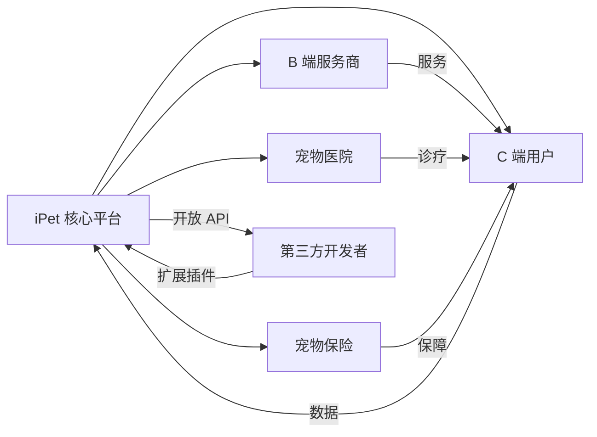
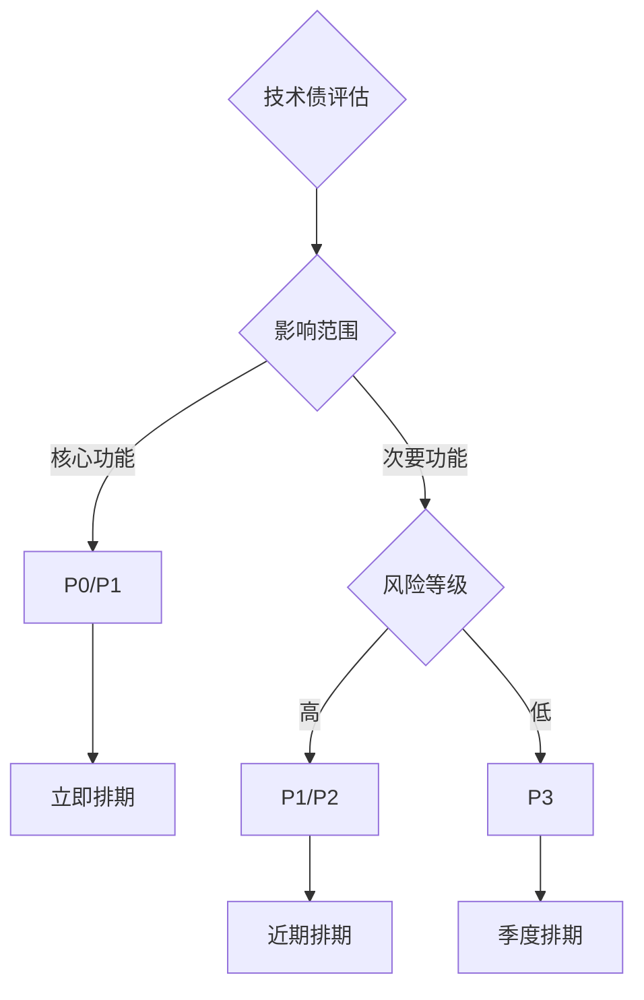
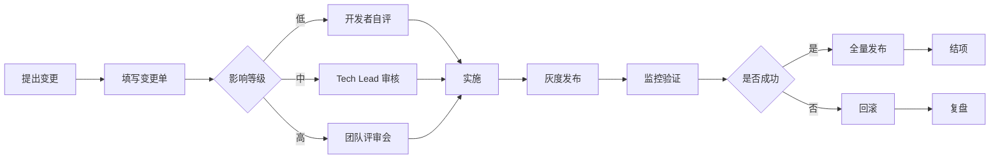

# 产品迭代与技术债管理层

> **文档版本**: v1.0  
> **更新时间**: 2025-12-18  
> **负责人**: 产品&技术团队  
> **文档目标**: 规范产品迭代节奏、技术债治理流程和变更评审机制，确保产品持续健康发展

---

## 一、Roadmap：产品路线图与里程碑

### 1.1 短期规划（1-3个月）

#### 🎯 核心目标
- **用户体验优化**: 提升核心功能的流畅度和易用性
- **数据准确性**: 完善健康数据录入和统计准确性
- **性能优化**: 解决已知性能瓶颈

#### 📋 关键里程碑

| 里程碑 | 目标时间 | 关键产出 | 负责人 | 状态 |
|--------|---------|---------|--------|------|
| **M1: 登录体验升级** | Week 1-2 | <ul><li>现代化登录/注册UI</li><li>游客模式支持</li><li>社交登录集成</li></ul> | 前端团队 | ✅ 已完成 |
| **M2: 图表渲染优化** | Week 3-4 | <ul><li>修复图表滚动消失问题</li><li>优化图表初始化逻辑</li><li>提升图表渲染性能</li></ul> | 前端团队 | ✅ 已完成 |
| **M3: 空状态优化** | Week 5-6 | <ul><li>统一空状态展示组件</li><li>优化加载态与错误态</li><li>改善用户引导</li></ul> | 前端&设计 | ✅ 已完成 |
| **M4: 文档体系建设** | Week 7-12 | <ul><li>完善技术文档</li><li>建立规范体系</li><li>沉淀最佳实践</li></ul> | 全体团队 | 🔄 进行中 |

#### 🚀 短期迭代重点

**功能增强**
- [ ] 健康记录批量导入/导出
- [ ] 宠物成长里程碑记录
- [ ] 智能健康提醒（疫苗、体检、驱虫）
- [ ] 多宠物管理优化

**体验优化**
- [ ] 首屏加载性能优化（目标 < 2s）
- [ ] 图片加载优化与缓存策略
- [ ] 离线数据同步机制
- [ ] 错误提示优化

**技术债偿还**
- [ ] qiun-data-charts Vue3 兼容性改造
- [ ] 统一状态管理规范
- [ ] API 错误处理标准化
- [ ] 单元测试覆盖率提升至 30%

---

### 1.2 中期规划（3-6个月）

#### 🎯 核心目标
- **功能完整性**: 构建完整的宠物健康管理闭环
- **社区生态**: 建立用户社区和内容生态
- **数据智能**: 引入 AI 辅助分析和决策

#### 📋 关键里程碑

| 里程碑 | 目标时间 | 关键产出 | 依赖条件 |
|--------|---------|---------|---------|
| **P1: 智能分析引擎** | Q1 2026 | <ul><li>健康趋势预测</li><li>异常指标预警</li><li>个性化建议</li></ul> | 数据积累 ≥ 1000 条记录 |
| **P2: 社区内容平台** | Q1-Q2 2026 | <ul><li>宠物日记</li><li>知识问答</li><li>经验分享</li></ul> | 用户基数 ≥ 500 |
| **P3: 三方服务集成** | Q2 2026 | <ul><li>宠物医院预约</li><li>美容洗澡预约</li><li>宠物用品商城</li></ul> | 商业合作洽谈 |
| **P4: 多端协同** | Q2 2026 | <ul><li>Web 管理端</li><li>iPad 适配</li><li>数据实时同步</li></ul> | 基础架构升级 |

#### 🔧 技术架构升级

**后端服务化**
- [ ] 核心业务拆分为微服务
- [ ] 引入消息队列（RabbitMQ/Kafka）
- [ ] 搭建数据仓库（离线分析）
- [ ] 建立 API Gateway

**前端工程化**
- [ ] 组件库标准化（发布私有 npm 包）
- [ ] 自动化测试覆盖率 > 60%
- [ ] 性能监控平台接入
- [ ] CI/CD 流程完善

**数据能力**
- [ ] 用户行为埋点体系
- [ ] 实时数据看板
- [ ] A/B 测试平台
- [ ] 推荐算法引擎

---

### 1.3 长期规划（6-12个月）

#### 🎯 核心目标
- **生态平台化**: 从工具到平台，构建宠物健康管理生态
- **商业化探索**: 构建可持续的商业模式
- **技术领先性**: 在宠物健康领域建立技术壁垒

#### 🌟 战略方向

**1. 平台生态建设**


**2. 核心能力矩阵**

| 能力层 | 关键特性 | 技术方案 |
|--------|---------|---------|
| **AI 智能层** | <ul><li>疾病风险预测</li><li>智能问诊</li><li>图像识别（皮肤病、粪便分析）</li></ul> | TensorFlow Lite / 云端模型服务 |
| **IoT 接入层** | <ul><li>智能设备数据接入</li><li>实时健康监测</li><li>自动记录</li></ul> | MQTT / WebSocket / 蓝牙协议 |
| **数据服务层** | <ul><li>健康数据 API</li><li>第三方数据互通</li><li>数据安全与隐私</li></ul> | GraphQL / OAuth2.0 / 数据加密 |
| **内容生态层** | <ul><li>PGC 专业内容</li><li>UGC 用户内容</li><li>知识图谱</li></ul> | CMS / 推荐算法 / NLP |

**3. 商业化路径**

- **Phase 1 (6-9月)**: 基础能力建设
  - [ ] 会员体系（高级功能、数据存储）
  - [ ] 增值服务（定制报告、专家咨询）
  - [ ] 广告位探索（非侵入式）

- **Phase 2 (9-12月)**: 生态变现
  - [ ] 佣金分成（服务预约、商品销售）
  - [ ] 企业服务（宠物医院 SaaS）
  - [ ] 数据服务（匿名化洞察报告）

**4. 技术前瞻性布局**

- **边缘计算**: 本地模型推理，降低延迟
- **联邦学习**: 保护隐私的 AI 训练
- **区块链**: 健康数据溯源与确权
- **VR/AR**: 沉浸式宠物互动体验

---

## 二、技术债清单

> **管理原则**: 
> - 技术债不可避免，但必须可控
> - 每个迭代必须分配 20% 时间偿还技术债
> - 优先偿还影响面大、风险高的技术债

### 2.1 技术债分级标准

| 等级 | 影响范围 | 风险等级 | 处理时限 | 示例 |
|------|---------|---------|---------|------|
| **P0 - 紧急** | 核心功能阻塞 | 🔴 高 | 立即修复 | 登录失败、数据丢失 |
| **P1 - 重要** | 影响用户体验 | 🟠 中高 | 1-2 周 | 性能问题、兼容性问题 |
| **P2 - 正常** | 局部功能受限 | 🟡 中 | 1 个月 | 代码重复、文档缺失 |
| **P3 - 较低** | 不影响使用 | 🟢 低 | 下个季度 | 代码优化、技术升级 |

---

### 2.2 当前技术债清单

#### 🔴 P0 - 紧急技术债

目前无 P0 级技术债。

---

#### 🟠 P1 - 重要技术债

| ID | 技术债项 | 影响面 | 优先级 | 改造方案 | 预估工时 | 负责人 | 状态 |
|----|---------|--------|--------|---------|---------|--------|------|
| **TD-001** | **qiun-data-charts Vue3 兼容性** | 所有图表功能 | P1 | <ul><li>fork 并修改源码</li><li>替换为 uCharts 官方版本</li><li>或自研图表组件</li></ul> | 3-5 天 | 前端 | ✅ 已改造 |
| **TD-002** | **缺乏统一错误处理机制** | 所有 API 调用 | P1 | <ul><li>封装统一 HTTP 拦截器</li><li>标准化错误码</li><li>统一 Toast 提示</li></ul> | 2 天 | 前端 | 📋 待处理 |
| **TD-003** | **缺少单元测试** | 代码质量保障 | P1 | <ul><li>引入 Vitest</li><li>核心工具函数测试</li><li>API 层测试</li></ul> | 5 天 | 全栈 | 📋 待处理 |
| **TD-004** | **图片资源未压缩优化** | 加载性能、流量消耗 | P1 | <ul><li>使用 WebP 格式</li><li>接入 CDN 图片处理</li><li>图片懒加载</li></ul> | 2 天 | 前端 | 📋 待处理 |

---

#### 🟡 P2 - 正常技术债

| ID | 技术债项 | 影响面 | 优先级 | 改造方案 | 预估工时 | 负责人 | 状态 |
|----|---------|--------|--------|---------|---------|--------|------|
| **TD-005** | **API 接口文档不完整** | 协作效率 | P2 | <ul><li>补充 Swagger/Apifox 文档</li><li>完善错误码说明</li><li>添加请求示例</li></ul> | 3 天 | 后端 | 📋 待处理 |
| **TD-006** | **代码重复率高** | 维护成本 | P2 | <ul><li>提取公共组件</li><li>封装工具函数</li><li>建立组件库</li></ul> | 4 天 | 前端 | 🔄 进行中 |
| **TD-007** | **缺少性能监控** | 问题发现滞后 | P2 | <ul><li>接入 Sentry</li><li>自定义性能埋点</li><li>建立监控看板</li></ul> | 3 天 | 前端 | 📋 待处理 |
| **TD-008** | **数据库索引未优化** | 查询性能 | P2 | <ul><li>分析慢查询</li><li>添加必要索引</li><li>优化复杂查询</li></ul> | 2 天 | 后端 | 📋 待处理 |

---

#### 🟢 P3 - 较低技术债

| ID | 技术债项 | 影响面 | 优先级 | 改造方案 | 预估工时 | 负责人 | 状态 |
|----|---------|--------|--------|---------|---------|--------|------|
| **TD-009** | **依赖包版本过时** | 安全风险 | P3 | <ul><li>升级主要依赖</li><li>测试兼容性</li><li>建立依赖扫描</li></ul> | 3 天 | 全栈 | 📋 待处理 |
| **TD-010** | **缺少代码规范检查** | 代码一致性 | P3 | <ul><li>配置 ESLint + Prettier</li><li>添加 Git Hooks</li><li>制定编码规范</li></ul> | 1 天 | 前端 | 📋 待处理 |
| **TD-011** | **CSS 样式冗余** | 包体积 | P3 | <ul><li>清理无用样式</li><li>CSS Modules 改造</li><li>原子化 CSS</li></ul> | 4 天 | 前端 | 📋 待处理 |
| **TD-012** | **缺少 TypeScript 严格模式** | 类型安全 | P3 | <ul><li>启用 strict 模式</li><li>修复类型错误</li><li>完善类型定义</li></ul> | 5 天 | 前端 | 📋 待处理 |

---

### 2.3 技术债改造拆分计划

#### 示例：TD-002 统一错误处理机制改造

**Phase 1: 调研与设计（0.5 天）**
- [ ] 梳理现有错误处理方式
- [ ] 设计统一错误码体系
- [ ] 设计拦截器架构

**Phase 2: 基础设施搭建（1 天）**
- [ ] 实现 HTTP 请求拦截器
- [ ] 实现响应拦截器
- [ ] 封装错误处理工具函数
- [ ] 定义错误枚举类型

**Phase 3: 渐进式迁移（0.5 天）**
- [ ] 迁移 API 层代码
- [ ] 更新组件调用方式
- [ ] 移除旧的 try-catch 冗余代码

**Phase 4: 验证与文档（1 天）**
- [ ] 异常场景测试
- [ ] 编写使用文档
- [ ] 团队培训与 Review

**总计**: 2 天，可拆分为 4 个独立 PR

---

### 2.4 技术债偿还规则

**每周迭代分配**
```
总开发时间 = 100%
├─ 新功能开发: 60%
├─ Bug 修复: 20%
└─ 技术债偿还: 20%
```

**优先级决策矩阵**



**偿还验收标准**
- ✅ 代码 Review 通过
- ✅ 自动化测试覆盖
- ✅ 文档更新完成
- ✅ 无新增 Bug
- ✅ 性能指标不退化

---

## 三、变更评审模板

> **适用范围**: 所有涉及核心功能、数据模型、架构调整的变更必须经过评审

### 3.1 变更评审流程



---

### 3.2 变更评审模板

#### 📋 基本信息

| 字段 | 内容 |
|------|------|
| **变更标题** | [简短描述，不超过 20 字] |
| **变更类型** | [ ] 功能新增 [ ] 功能优化 [ ] Bug 修复 [ ] 性能优化 [ ] 架构调整 [ ] 技术债偿还 |
| **影响等级** | [ ] 低（局部调整） [ ] 中（模块级调整） [ ] 高（架构级调整） |
| **紧急程度** | [ ] 低 [ ] 中 [ ] 高 [ ] 紧急 |
| **发起人** | [姓名] |
| **评审日期** | YYYY-MM-DD |
| **目标上线时间** | YYYY-MM-DD |

---

#### 📝 一、改动点详述

**1.1 背景与目标**
<!-- 为什么要做这个变更？解决什么问题？达成什么目标？ -->

**示例**:
```
背景: 用户反馈图表在滚动时会消失，严重影响数据查看体验
目标: 解决图表渲染问题，确保图表在任何滚动场景下都能正常显示
```

**1.2 具体改动内容**
<!-- 详细描述代码、配置、数据库等改动 -->

**示例**:
```
1. 修改文件: /components/MetricChartArea.vue
   - 移除 v-show 条件渲染逻辑
   - 改为始终挂载图表组件
   - 依赖 qiun-data-charts 内部优化避免重复渲染

2. 修改文件: /components/BaseCanvasChart.vue
   - 新增 dimension 缓存机制
   - 避免不必要的图表重绘
```

**1.3 涉及文件清单**
<!-- 列出所有修改的文件，标注新增/修改/删除 -->

| 文件路径 | 变更类型 | 改动行数 | 风险评估 |
|---------|---------|---------|---------|
| `/components/MetricChartArea.vue` | 修改 | ~20 行 | 低 |
| `/components/BaseCanvasChart.vue` | 修改 | ~15 行 | 低 |
| `/pages/detail/detail.vue` | 修改 | ~5 行 | 低 |

---

#### 🎯 二、影响面分析

**2.1 功能影响范围**
<!-- 哪些功能会受到影响？ -->

- ✅ **直接影响**: 所有使用 MetricChartArea 的页面（详情页、摘要页）
- ⚠️ **间接影响**: 图表性能、内存占用
- ❌ **不影响**: 其他业务功能

**2.2 数据影响**
<!-- 是否涉及数据迁移、数据格式变更、数据删除？ -->

- [ ] 需要数据迁移
- [ ] 数据格式变更
- [ ] 可能影响历史数据
- [x] 无数据影响

**2.3 用户体验影响**
<!-- 对用户的可见影响是什么？ -->

- **正面影响**: 图表显示稳定，用户体验提升
- **负面影响**: 无
- **兼容性影响**: 无

**2.4 性能影响**
<!-- 对系统性能的影响评估 -->

| 指标 | 变更前 | 变更后 | 变化 |
|------|--------|--------|------|
| 首屏加载时间 | 2.5s | 2.5s | 无变化 |
| 内存占用 | ~50MB | ~52MB | +4% (可接受) |
| 页面滚动 FPS | 45-60 | 55-60 | 改善 |

**2.5 依赖影响**
<!-- 是否影响其他系统、服务、第三方依赖？ -->

- **上游依赖**: qiun-data-charts (无版本变更)
- **下游依赖**: 无
- **三方服务**: 无

---

#### ⚠️ 三、风险评估

**3.1 技术风险**

| 风险项 | 风险等级 | 描述 | 缓解措施 |
|--------|---------|------|---------|
| 图表组件内部错误 | 🟡 中 | qiun-data-charts 可能有未知 bug | 充分测试；准备降级方案 |
| 内存泄漏 | 🟢 低 | 始终挂载可能导致内存占用 | 监控内存使用；设置合理上限 |
| 性能退化 | 🟢 低 | 图表组件一直存在可能影响性能 | 性能测试；设置懒加载策略 |

**3.2 业务风险**

| 风险项 | 风险等级 | 描述 | 缓解措施 |
|--------|---------|------|---------|
| 用户体验下降 | 🟢 低 | 如果改造失败，图表可能完全不显示 | 灰度发布；快速回滚 |
| 数据展示错误 | 🟢 低 | 图表数据计算错误 | 单元测试；人工验证 |

**3.3 合规风险**

- [ ] 涉及用户隐私数据
- [ ] 涉及敏感信息
- [ ] 需要安全审计
- [x] 无合规风险

**3.4 最坏情况**
<!-- 如果一切都出错，最坏会怎样？ -->

```
最坏场景: 图表完全无法显示，所有数据可视化功能失效
影响范围: 所有用户的图表查看功能
恢复时间: 5-10 分钟（回滚）
```

---

#### 🔄 四、回滚方案

**4.1 回滚触发条件**
<!-- 什么情况下需要回滚？ -->

- [ ] 错误率 > 5%
- [ ] 性能下降 > 20%
- [ ] 用户投诉 > 10 条/小时
- [x] 图表完全不显示
- [x] 严重内存泄漏

**4.2 回滚步骤**
<!-- 详细的回滚操作步骤 -->

```bash
# Step 1: 切换到上一个稳定版本
git checkout <previous-stable-commit>

# Step 2: 重新构建
npm run build

# Step 3: 发布到小程序
npm run deploy

# Step 4: 验证回滚成功
- 打开任意图表页面
- 检查图表是否正常显示
- 检查滚动是否流畅
```

**4.3 回滚预计时间**
- **准备时间**: 2 分钟
- **执行时间**: 3 分钟
- **验证时间**: 5 分钟
- **总计**: ~10 分钟

**4.4 回滚后数据处理**
<!-- 回滚后是否需要数据处理？ -->

- [x] 无需数据处理
- [ ] 需要数据回滚
- [ ] 需要数据清理

---

#### ✅ 五、验收标准

**5.1 功能验收**

| 验收项 | 验收标准 | 验收方法 | 负责人 |
|--------|---------|---------|--------|
| 图表正常显示 | 所有图表场景均正常渲染 | 手工测试所有图表页面 | QA |
| 滚动流畅性 | 滚动时图表不消失，FPS > 50 | 性能测试工具测量 | 前端 |
| 数据准确性 | 图表数据与原始数据一致 | 对比检查 | 开发 |
| 兼容性 | 微信小程序、iOS、Android 均正常 | 多端测试 | QA |

**5.2 性能验收**

| 指标 | 目标值 | 测试方法 |
|------|--------|---------|
| 首屏加载时间 | < 3s | Performance API |
| 内存占用 | < 100MB | 微信开发者工具 |
| 滚动 FPS | > 50 | Performance Monitor |
| 图表渲染时间 | < 500ms | 埋点统计 |

**5.3 质量验收**

- [ ] 代码 Review 通过
- [ ] 单元测试覆盖率 > 80%
- [ ] 无 ESLint 错误
- [ ] 无 TypeScript 类型错误
- [ ] 文档更新完成

**5.4 灰度验收**

| 阶段 | 灰度比例 | 验证指标 | 持续时间 |
|------|---------|---------|---------|
| 内测 | 开发团队 | 功能正常 | 1 天 |
| 小流量 | 5% 用户 | 错误率 < 1% | 2 天 |
| 中流量 | 30% 用户 | 性能无退化 | 3 天 |
| 全量 | 100% 用户 | 稳定运行 24h | - |

---

#### 📊 六、监控指标

**6.1 核心监控指标**

| 指标 | 告警阈值 | 监控方式 | 处理人 |
|------|---------|---------|--------|
| 图表渲染错误率 | > 1% | Sentry 错误上报 | 前端 oncall |
| 图表加载时间 P95 | > 1s | 性能埋点 | 前端 |
| 内存占用 | > 150MB | 性能监控 | 前端 |
| 页面崩溃率 | > 0.1% | 微信小程序后台 | 前端 oncall |

**6.2 业务监控指标**

| 指标 | 正常范围 | 监控方式 |
|------|---------|---------|
| 图表页面 PV | 与历史持平 ±10% | 数据埋点 |
| 图表页面停留时长 | > 30s | 数据埋点 |
| 用户反馈负面率 | < 5% | 客服系统 |

---

#### 📆 七、上线计划

**7.1 时间安排**

| 阶段 | 时间 | 负责人 | 交付物 |
|------|------|--------|--------|
| 开发 | D-5 ~ D-3 | 前端 | 功能代码 |
| 联调测试 | D-2 | QA | 测试报告 |
| 代码 Review | D-2 | Tech Lead | Review 意见 |
| 预发布验证 | D-1 | QA | 验证结果 |
| 灰度发布 | D-Day | 运维 | 灰度配置 |
| 全量发布 | D+2 | 运维 | 发布完成 |

**7.2 人员安排**

| 角色 | 姓名 | 职责 |
|------|------|------|
| 开发负责人 | [姓名] | 代码实现、技术方案 |
| 测试负责人 | [姓名] | 测试用例、验收 |
| 运维负责人 | [姓名] | 发布、监控 |
| 值班负责人 | [姓名] | 应急响应 |

---

#### 📝 八、备注与补充

**8.1 相关文档**
- [技术设计文档](链接)
- [测试用例](链接)
- [性能测试报告](链接)

**8.2 依赖事项**
- [ ] 依赖 A 已完成
- [ ] 依赖 B 已完成

**8.3 后续优化计划**
- 考虑引入虚拟滚动优化性能
- 考虑图表懒加载策略
- 考虑更换更轻量的图表库

---

#### ✍️ 评审记录

| 评审人 | 角色 | 评审意见 | 是否通过 | 日期 |
|--------|------|---------|---------|------|
| [姓名] | Tech Lead | 方案可行，建议增加性能监控 | ✅ 通过 | 2025-12-18 |
| [姓名] | QA | 测试用例完善，可以上线 | ✅ 通过 | 2025-12-18 |
| [姓名] | 产品 | 符合产品预期 | ✅ 通过 | 2025-12-18 |

**最终决议**: ✅ 批准上线

---

## 四、附录

### 4.1 变更影响等级定义

| 等级 | 定义 | 示例 | 审批流程 |
|------|------|------|---------|
| **低** | 局部优化，不影响其他模块 | UI 调整、文案修改 | 开发者自评 + Code Review |
| **中** | 模块级变更，可能影响相关功能 | 新增功能、性能优化 | Tech Lead 审核 |
| **高** | 架构级变更，影响多个模块 | 数据库 schema 变更、架构重构 | 团队评审会 |

### 4.2 技术债记录模板

```markdown
## 技术债: [简短标题]

**编号**: TD-XXX  
**发现日期**: YYYY-MM-DD  
**优先级**: P0/P1/P2/P3  
**负责人**: [姓名]

### 问题描述
[详细描述技术债的现状和问题]

### 影响分析
- **影响范围**: [描述影响的功能和模块]
- **风险等级**: 高/中/低
- **量化影响**: [性能数据、错误率等]

### 改造方案
1. 方案 A: [描述] (推荐度: ⭐⭐⭐⭐⭐)
2. 方案 B: [描述] (推荐度: ⭐⭐⭐)

### 实施计划
- [ ] Phase 1: [描述] (预估 X 天)
- [ ] Phase 2: [描述] (预估 X 天)
- [ ] Phase 3: [描述] (预估 X 天)

### 验收标准
- [ ] [标准 1]
- [ ] [标准 2]
```

### 4.3 最佳实践

**技术债管理原则**
1. **及时记录**: 发现技术债立即记录，不要拖延
2. **定期评审**: 每月评审一次技术债清单，更新优先级
3. **强制偿还**: 每个迭代必须分配时间偿还技术债
4. **量化影响**: 用数据说话，量化技术债的影响
5. **根因分析**: 偿还技术债后要分析根本原因，避免重复

**变更评审原则**
1. **风险优先**: 高风险变更必须经过充分评审
2. **可回滚**: 所有变更必须有明确的回滚方案
3. **灰度发布**: 重要变更必须灰度发布，逐步放量
4. **监控先行**: 上线前必须准备好监控和告警
5. **文档同步**: 变更完成后及时更新文档

**Roadmap 规划原则**
1. **目标导向**: 每个里程碑都有明确的目标和产出
2. **小步快跑**: 避免大而全的规划，快速迭代验证
3. **灵活调整**: 根据用户反馈和市场变化及时调整
4. **技术前瞻**: 预留技术储备时间，不要只关注业务功能
5. **平衡发展**: 新功能开发、技术债偿还、性能优化要平衡

---

## 五、版本历史

| 版本 | 日期 | 修改内容 | 修改人 |
|------|------|---------|--------|
| v1.0 | 2025-12-18 | 初始版本，建立 Roadmap、技术债管理和变更评审体系 | 技术团队 |

---

**文档维护**: 本文档由产品和技术团队共同维护，每月更新 Roadmap 和技术债清单。

**反馈渠道**: 如有任何疑问或建议，请联系 Tech Lead 或在团队会议上提出。
