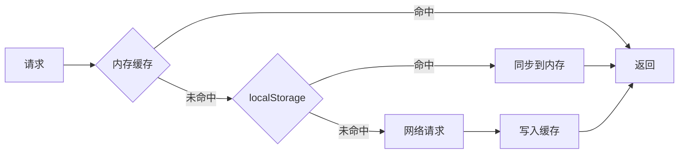

# 性能与稳定性层

## 概述

本文档定义 iPet 项目的性能优化策略、稳定性保障措施和容灾方案。

**适用范围**：UniApp（微信小程序、H5、APP）

**版本**：v1.0.0

**最后更新**：2025-12-18

---

## 1. 性能预算

### 1.1 首屏时长

| 环境 | 白屏时间 | 首屏可交互时间 | 目标 |
|------|---------|---------------|------|
| **微信小程序** | ≤ 1.5s | ≤ 2.5s | 使用分包加载、骨架屏优化 |
| **H5** | ≤ 2.0s | ≤ 3.0s | 使用懒加载、CDN 加速 |
| **APP** | ≤ 1.0s | ≤ 2.0s | 预编译、本地化资源 |

**测量方式**：
- 微信小程序：使用 Performance API（`wx.getPerformance()`）
- H5：使用 Navigation Timing API（`performance.timing`）
- APP：使用 UniApp 生命周期钩子（`App.onLaunch` → `Page.onReady`）

### 1.2 包体大小

| 环境 | 主包大小 | 总包大小 | 当前值 | 优化策略 |
|------|---------|---------|--------|---------|
| **微信小程序** | ≤ 2MB | ≤ 20MB | 主包 1.8MB | 使用分包、图片压缩 |
| **H5** | - | ≤ 5MB（未压缩） | 3.2MB | 代码分割、Tree Shaking |
| **APP** | - | ≤ 50MB | 未发布 | 按需引入依赖 |

**监控方式**：
- CI/CD 流程中自动检测包体大小
- 超过阈值时自动告警

### 1.3 接口耗时

| 接口类型 | P50 | P95 | P99 | 超时时间 |
|---------|-----|-----|-----|---------|
| **查询类（GET）** | ≤ 200ms | ≤ 500ms | ≤ 1s | 5s |
| **写入类（POST/PUT）** | ≤ 300ms | ≤ 800ms | ≤ 1.5s | 10s |
| **上传类（图片）** | ≤ 1s | ≤ 3s | ≤ 5s | 30s |

**降级策略**：
- 超时后使用缓存数据（GET 请求）
- 写入失败时加入离线队列

### 1.4 列表流畅度

| 场景 | FPS | 目标 | 优化策略 |
|------|-----|------|---------|
| **长列表滚动** | ≥ 50 FPS | 60 FPS | 虚拟列表、分页加载 |
| **图表渲染** | ≥ 30 FPS | 60 FPS | Canvas 渲染、降级策略 |
| **页面过渡** | ≥ 55 FPS | 60 FPS | 使用 GPU 加速、减少重排 |

---

## 2. 性能优化点位

### 2.1 缓存策略

#### 2.1.1 双层缓存架构

**实现位置**：[CacheManager.ts](file:///Users/zhengjiyuan/Desktop/iPet/iPet-uniapp/src/utils/cache/CacheManager.ts)



**特性**：
- **L1 缓存（内存）**：Map 实现，快速访问
- **L2 缓存（持久化）**：localStorage，应用重启后仍可用
- **版本控制**：基于 `package.json` 版本号，升级时自动清理旧缓存
- **TTL 过期**：默认 5 分钟，支持自定义

**使用示例**：
```typescript
import { CacheManager } from '@/utils/cache/CacheManager'

// 写入缓存
CacheManager.set('user_profile', userData, { ttl: 10 * 60 * 1000 }) // 10分钟

// 读取缓存
const cached = CacheManager.get('user_profile')
if (cached) {
  console.log('Cache hit:', cached.value)
}
```

#### 2.1.2 健康数据缓存（LRU + SWR）

**实现位置**：[healthCacheService.ts](file:///Users/zhengjiyuan/Desktop/iPet/iPet-uniapp/src/services/healthCacheService.ts)

**特性**：
- **LRU 容量控制**：最大 5MB，超过 90% 自动清理最久未访问项
- **SWR（Stale-While-Revalidate）**：优先返回缓存，后台刷新
- **依赖图失效**：修改指标后自动失效相关缓存（Summary、Trend、Series）
- **请求去重**：同一 key 的并发请求复用同一 Promise

**缓存键规则**：
- `Summary_Snapshot`：概览快照（高优先级，不会被 LRU 清理）
- `Trend_Cache_7Days` / `Trend_Cache_30Days`：趋势缓存
- `Series_{metricKey}_{range}`：时间序列数据

**使用示例**：
```typescript
import { healthCacheService } from '@/services/healthCacheService'

// SWR 模式：优先返回缓存，后台刷新
const data = await healthCacheService.getWithSWR({
  key: 'Summary_Snapshot',
  fetcher: () => fetchSummaryFromAPI(),
  staleTime: 5 * 60 * 1000, // 5分钟内不刷新
  onRevalidate: (fresh) => console.log('后台刷新完成', fresh)
})
```

#### 2.1.3 图片缓存（Base64 + LRU）

**实现位置**：[imageCacheStore.ts](file:///Users/zhengjiyuan/Desktop/iPet/iPet-uniapp/src/stores/imageCacheStore.ts)

**策略**：
- **H5 端**：小于 500KB 的图片转为 Base64 存储，刷新后仍可用
- **APP 端**：存储临时文件路径（`uni.downloadFile`）
- **容量限制**：最多缓存 30 张图片，超出时删除最早的

**使用示例**：
```vue
<script setup>
import { useImageCacheStore } from '@/stores/imageCacheStore'

const imageCache = useImageCacheStore()

// 获取缓存图片（fallback 到原 URL）
const avatarSrc = imageCache.resolve(user.avatar)
</script>

<template>
  <image :src="avatarSrc" mode="aspectFill" lazy-load />
</template>
```

### 2.2 分页策略

**实现位置**：[history.vue](file:///Users/zhengjiyuan/Desktop/iPet/iPet-uniapp/src/pages/metrics/history.vue#L53)

```typescript
const pageSize = 20 // 每页 20 条
const page = ref(1)
const hasMore = ref(true)

onReachBottom(() => {
  if (hasMore.value && !loading.value) {
    page.value++
    fetchData() // 追加数据
  }
})

// 判断是否还有更多数据
if (res.length < pageSize) {
  hasMore.value = false
}
```

**规范**：
- **首页大小**：20 条（平衡用户体验和加载速度）
- **触发时机**：`onReachBottom` 距离底部 50px 时触发
- **加载状态**：显示 `u-loading-icon`，防止重复请求
- **无数据提示**：显示"没有更多了"

### 2.3 懒加载

#### 2.3.1 图片懒加载

**实现方式**：使用 `lazy-load="true"` 属性

```vue
<image :src="cover" mode="aspectFill" lazy-load="true" />
```

**适用场景**：
- 列表页图片（文章卡片、宠物头像）
- 长页面中的非首屏图片

#### 2.3.2 组件懒加载

**实现位置**：[useCropperLoader.ts](file:///Users/zhengjiyuan/Desktop/iPet/iPet-uniapp/src/composables/useCropperLoader.ts)

```typescript
// 动态加载 u-cropper 组件
const loadCropper = async () => {
  const { default: UCropper } = await import('u-cropper')
  return UCropper
}
```

**适用场景**：
- 低频使用的组件（裁剪器、富文本编辑器）
- 体积较大的第三方库

### 2.4 降级策略

#### 2.4.1 图表降级

**场景**：低端设备渲染图表卡顿

**策略**：
1. 检测设备性能（通过 `uni.getSystemInfoSync()` 获取内存、CPU）
2. 低端设备使用简化图表（减少数据点、关闭动画）
3. 极低端设备使用静态图片或表格

**示例**：
```typescript
const isLowEndDevice = () => {
  const info = uni.getSystemInfoSync()
  // 内存 < 2GB 或 Android 6 以下
  return info.system.includes('Android') && parseInt(info.system) < 7
}

if (isLowEndDevice()) {
  chartOptions.animation = false // 关闭动画
  chartOptions.dataZoom = [] // 移除数据缩放
}
```

#### 2.4.2 接口降级

**场景**：后端服务异常或超时

**策略**：
1. 优先使用本地缓存
2. 显示简化数据（只展示关键指标）
3. 显示友好提示（"数据加载失败，显示历史数据"）

---

## 3. 容灾与限流

### 3.1 降级开关

**实现位置**：环境配置（`APP_CONFIG.USE_MOCK`）

**场景**：
- **Mock 模式**：开发/测试环境，不依赖后端
- **降级模式**：后端服务不可用时，全部使用缓存数据

**配置示例**：
```typescript
// src/utils/config.ts
export const APP_CONFIG = {
  USE_MOCK: process.env.NODE_ENV === 'development',
  FALLBACK_TO_CACHE: true // 容灾模式
}
```

### 3.2 熔断机制

**实现位置**：[request.ts](file:///Users/zhengjiyuan/Desktop/iPet/iPet-uniapp/src/utils/common/request.ts#L404)

**策略**：
- **401 熔断**：Token 过期时，暂停所有请求，统一刷新 Token 后重试
- **避免雪崩**：使用 `refreshPromise` 单例，防止并发刷新

**实现代码**：
```typescript
let refreshPromise: Promise<TokenRefreshResult | null> | null = null

const triggerTokenRefresh = () => {
  if (!refreshPromise) {
    refreshPromise = refreshAuthToken()
      .then(result => {
        applyRefreshedToken(result)
        processQueue(null, result) // 重试队列中的请求
        return result
      })
      .catch(error => {
        processQueue(error, null) // 清空队列
        forceLogout() // 强制登出
        return null
      })
      .finally(() => {
        refreshPromise = null
      })
  }
  return refreshPromise
}
```

### 3.3 限流策略

#### 3.3.1 请求去重

**实现位置**：[request.ts](file:///Users/zhengjiyuan/Desktop/iPet/iPet-uniapp/src/utils/common/request.ts#L377)

**策略**：
- GET 请求：根据 `url + params` 生成 dedupKey，复用 Promise
- 避免短时间内重复请求

**实现代码**：
```typescript
const inflightRequests = new Map<string, Promise<any>>()

const dedupKey = isGet ? `${config.url}?${JSON.stringify(config.data || {})}` : null

if (dedupKey && inflightRequests.has(dedupKey)) {
  return inflightRequests.get(dedupKey) as Promise<T>
}
```

#### 3.3.2 请求取消

**实现位置**：[request.ts](file:///Users/zhengjiyuan/Desktop/iPet/iPet-uniapp/src/utils/common/request.ts#L146)

**策略**：
- 使用 `abortKey` 取消重复请求（例如搜索框输入时）

**使用示例**：
```typescript
// 搜索场景：取消上一次请求
request({
  url: '/search',
  method: 'GET',
  data: { keyword },
  abortKey: 'search_request' // 相同 key 的请求会被取消
})
```

### 3.4 重试与退避

#### 3.4.1 离线队列

**实现位置**：[request.ts](file:///Users/zhengjiyuan/Desktop/iPet/iPet-uniapp/src/utils/common/request.ts#L97)

**策略**：
- 非 GET 请求失败时，加入离线队列
- 网络恢复后自动重试

**实现代码**：
```typescript
// 监听网络状态
uni.onNetworkStatusChange((res) => {
  if (res.isConnected) {
    processOfflineQueue() // 重试队列中的请求
  }
})

// 请求失败处理
if (err?.errMsg?.includes('request:fail')) {
  const method = (config.method || 'GET').toUpperCase()
  if (method !== 'GET') {
    addToOfflineQueue(config) // 加入队列
    uni.showToast({ title: '网络不可用，已保存到离线队列' })
  }
}
```

#### 3.4.2 Token 刷新重试

**实现位置**：[request.ts](file:///Users/zhengjiyuan/Desktop/iPet/iPet-uniapp/src/utils/common/request.ts#L217)

**策略**：
- 401 错误时，将请求加入 `failedRequestQueue`
- Token 刷新成功后，自动重试队列中的请求
- 刷新失败后，清空队列并强制登出

---

## 4. 压测与容量规划

### 4.1 客户端性能指标

> **注意**：iPet 是客户端应用（小程序/H5/APP），不涉及服务端 QPS 和扩容。以下指标针对客户端性能监控。

| 指标 | 目标值 | 监控方式 |
|------|--------|---------|
| **页面切换耗时** | ≤ 300ms | Performance API |
| **内存占用** | ≤ 200MB（小程序）<br>≤ 500MB（APP） | `uni.getPerformance()` |
| **缓存占用** | ≤ 10MB（localStorage）<br>≤ 5MB（健康数据缓存） | LRU 自动清理 |
| **崩溃率** | ≤ 0.1% | 监控平台（如微信小程序后台） |

### 4.2 压力测试场景

#### 4.2.1 大数据量测试

**场景**：用户有 10 只宠物，每只宠物有 1000+ 条健康记录

**测试步骤**：
1. 使用 Mock 数据生成大量记录
2. 测试列表页加载速度（首屏 + 滚动）
3. 测试图表渲染性能（多指标同时渲染）

**预期结果**：
- 首屏加载 ≤ 2s
- 滚动 FPS ≥ 50
- 图表渲染 ≤ 1.5s

#### 4.2.2 弱网测试

**场景**：2G/3G 网络，RTT 500ms+

**测试步骤**：
1. 使用 Chrome DevTools 模拟慢速网络
2. 测试页面加载、数据提交

**预期结果**：
- 显示骨架屏或 Loading 状态
- 请求失败后使用缓存数据
- 写入请求加入离线队列

#### 4.2.3 离线测试

**场景**：完全断网

**测试步骤**：
1. 关闭网络
2. 测试页面浏览、数据录入

**预期结果**：
- 历史数据可正常浏览（使用缓存）
- 新增/修改数据加入离线队列
- 网络恢复后自动同步

### 4.3 性能监控

#### 4.3.1 关键指标

**实时监控**：
- 页面加载耗时（FCP、LCP）
- API 请求耗时分布（P50、P95、P99）
- 错误率（网络错误、JS 错误）

**工具**：
- 微信小程序后台性能分析
- H5：集成第三方 APM（如阿里云 ARMS）
- APP：UniApp Performance API

#### 4.3.2 告警阈值

| 指标 | 告警阈值 | 处理方式 |
|------|---------|---------|
| **P95 接口耗时** | \u003e 1s | 检查后端性能 / 启用降级 |
| **首屏时长** | \u003e 3s | 优化资源加载 / 启用骨架屏 |
| **崩溃率** | \u003e 0.5% | 紧急修复并发布热更新 |
| **缓存占用** | \u003e 10MB | 触发 LRU 清理 |

---

## 5. 最佳实践

### 5.1 性能优化 Checklist

- [ ] 使用图片懒加载（`lazy-load="true"`）
- [ ] 长列表使用分页加载（`onReachBottom`）
- [ ] 接口数据使用缓存（`CacheManager` 或 `healthCacheService`）
- [ ] 低频组件使用懒加载（`useCropperLoader`）
- [ ] 图表使用 Canvas 渲染（`qiun-data-charts`）
- [ ] 避免频繁的 `setData`（合并更新）
- [ ] 图片压缩至合理尺寸（头像 ≤ 200KB，封面 ≤ 500KB）
- [ ] 使用骨架屏优化加载体验

### 5.2 稳定性保障 Checklist

- [ ] 接口请求启用超时（默认 5s/10s）
- [ ] 网络错误时使用缓存数据
- [ ] 写入请求失败时加入离线队列
- [ ] Token 刷新失败时强制登出
- [ ] 关键操作显示 Loading 状态
- [ ] 异常捕获并上报（`try-catch` + 监控平台）

---

## 6. 相关文档

- [架构与代码组织层](file:///Users/zhengjiyuan/Desktop/iPet/iPet-uniapp/docs/架构与代码组织层.md)
- [接口契约层](file:///Users/zhengjiyuan/Desktop/iPet/iPet-uniapp/docs/接口契约层.md)
- [运维与可观测性层](file:///Users/zhengjiyuan/Desktop/iPet/iPet-uniapp/docs/运维与可观测性层.md)
