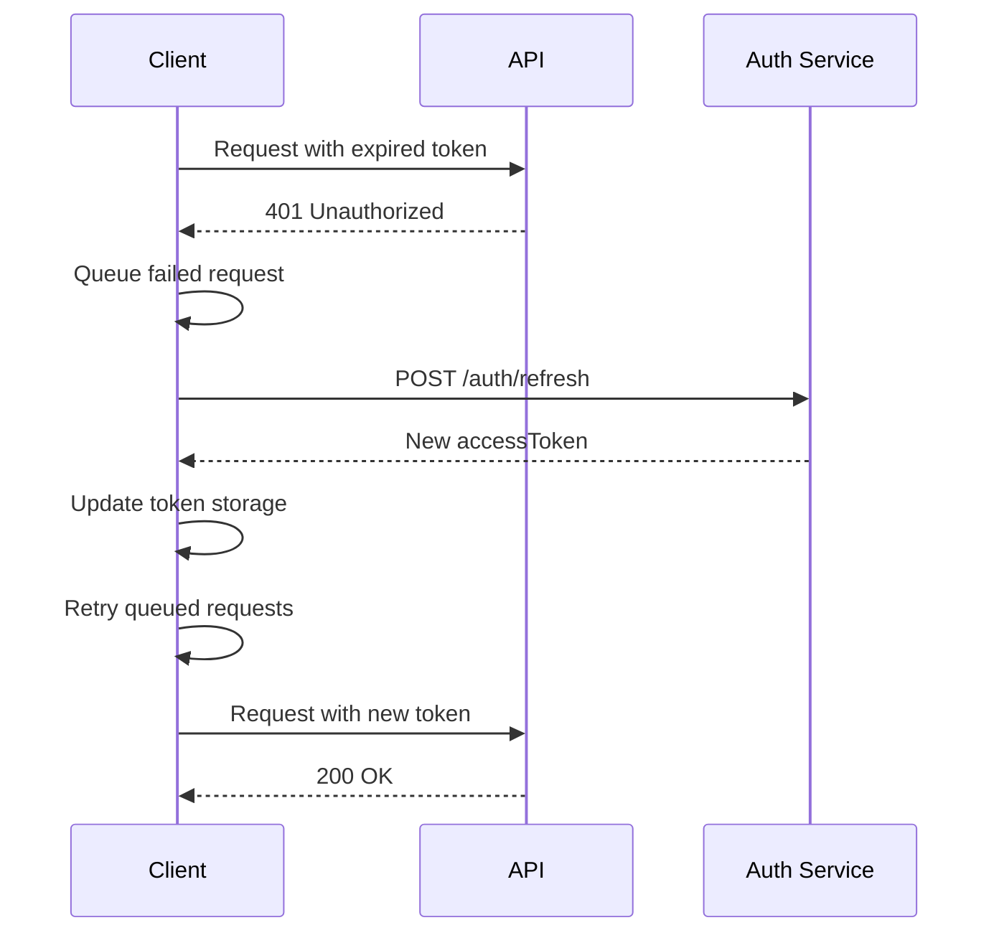
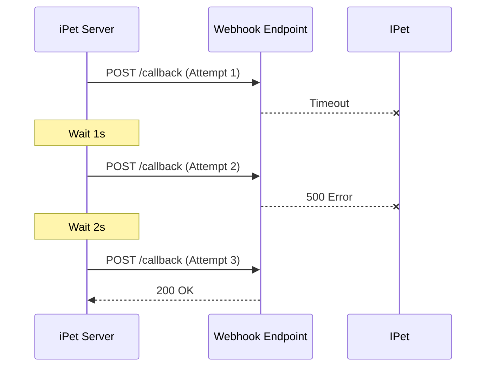

# 接口契约层

> **文档版本**: v1.0.0  
> **最后更新**: 2025-12-18  
> **维护者**: iPet 后端团队

## 概述

本文档定义了 iPet 前后端协作的核心契约，包括 API 规范、鉴权机制、版本管理、以及第三方对接规范。所有接口必须严格遵守本文档定义的契约，以确保系统的一致性、可维护性和可扩展性。

---

## 一、API 文档规范

### 1.1 基础配置

#### Base URL
```
开发环境: http://192.168.31.167:3000/api
生产环境: https://api.zhengjiyuan.top/api
Mock 模式: 本地 Mock Server
```

**配置方式**:
- 通过环境变量 `VITE_API_BASE_URL` 配置
- 所有 API 路径均为相对路径，自动拼接 Base URL
- 参考实现: [`src/utils/config.ts`](file:///Users/zhengjiyuan/Desktop/iPet/iPet-uniapp/src/utils/config.ts)

#### 超时设置
```
默认超时: 10000ms (10s)
可通过 RequestConfig.timeout 覆盖
```

### 1.2 请求格式

#### Headers
```typescript
{
  "Content-Type": "application/json",
  "Authorization": "Bearer <accessToken>",  // 需要鉴权的接口
  "X-Request-ID": "<uuid>",                 // 可选，用于请求追踪
  "X-Client-Version": "<version>",          // 可选，客户端版本
  "X-Platform": "miniprogram|h5|app"        // 可选，平台标识
}
```

#### Body (JSON)
```json
{
  "data": {
    // 业务数据
  },
  "metadata": {
    // 元数据（可选）
    "timestamp": 1702888888000,
    "clientId": "device-uuid"
  }
}
```

**约定**:
- `GET` 请求：参数通过 query string 传递
- `POST/PUT/PATCH/DELETE` 请求：参数通过 JSON body 传递
- 文件上传：使用 `multipart/form-data`

### 1.3 响应格式

#### 统一响应结构
```typescript
interface ApiResponse<T> {
  code: number;        // 业务状态码
  message: string;     // 响应消息
  data: T;            // 业务数据
  timestamp: number;   // 服务器时间戳
  requestId?: string;  // 请求追踪 ID
}
```

#### 成功响应示例
```json
{
  "code": 200,
  "message": "Success",
  "data": {
    "id": 123,
    "name": "Tom"
  },
  "timestamp": 1702888888000,
  "requestId": "req-uuid-12345"
}
```

#### 错误响应示例
```json
{
  "code": 40001,
  "message": "Invalid email format",
  "data": null,
  "timestamp": 1702888888000,
  "requestId": "req-uuid-12345",
  "errors": [
    {
      "field": "email",
      "message": "Email must be a valid email address"
    }
  ]
}
```

### 1.4 错误码规范

#### HTTP 状态码
```
200 OK - 请求成功
201 Created - 创建成功
204 No Content - 删除成功
304 Not Modified - 资源未修改
400 Bad Request - 请求参数错误
401 Unauthorized - 未授权，需要登录
403 Forbidden - 权限不足
404 Not Found - 资源不存在
409 Conflict - 资源冲突（如重复提交）
422 Unprocessable Entity - 业务逻辑错误
429 Too Many Requests - 请求频率限制
500 Internal Server Error - 服务器错误
502 Bad Gateway - 网关错误
503 Service Unavailable - 服务不可用
```

#### 业务错误码 (code)
```typescript
// 通用错误 (1xxxx)
10000 - 成功
10001 - 未知错误
10002 - 参数错误
10003 - 请求频率限制

// 认证错误 (2xxxx)
20001 - Token 无效
20002 - Token 过期
20003 - Refresh Token 失效
20004 - 登录失败（邮箱或密码错误）
20005 - 用户不存在
20006 - 账号已被禁用

// 权限错误 (3xxxx)
30001 - 无权限访问
30002 - 资源不属于当前用户
30003 - 游客模式限制（需升级账号）

// 资源错误 (4xxxx)
40001 - 资源不存在
40002 - 资源已删除
40003 - 资源已过期
40004 - 资源冲突（如重复创建）

// 业务错误 (5xxxx)
50001 - 宠物数量达到上限
50002 - 健康记录不存在
50003 - 数据同步失败
```

**错误处理策略**:
- HTTP 401 自动触发 Token 刷新
- HTTP 5xx 显示通用错误提示
- 业务错误码优先显示 `message` 字段
- 参考实现: [`src/utils/common/request.ts`](file:///Users/zhengjiyuan/Desktop/iPet/iPet-uniapp/src/utils/common/request.ts#L317-L343)

### 1.5 分页规范

#### 请求参数
```typescript
interface PaginationParams {
  page: number;      // 页码，从 1 开始
  pageSize: number;  // 每页条数，默认 20，最大 100
  sortBy?: string;   // 排序字段
  order?: 'asc' | 'desc';  // 排序方向
}
```

#### 响应格式
```typescript
interface PaginatedResponse<T> {
  items: T[];           // 当前页数据
  pagination: {
    page: number;       // 当前页码
    pageSize: number;   // 每页条数
    total: number;      // 总条数
    totalPages: number; // 总页数
    hasNext: boolean;   // 是否有下一页
    hasPrev: boolean;   // 是否有上一页
  };
}
```

#### 示例
```json
{
  "code": 200,
  "message": "Success",
  "data": {
    "items": [
      { "id": 1, "name": "Tom" },
      { "id": 2, "name": "Jerry" }
    ],
    "pagination": {
      "page": 1,
      "pageSize": 20,
      "total": 45,
      "totalPages": 3,
      "hasNext": true,
      "hasPrev": false
    }
  }
}
```

### 1.6 时间格式约定

> [!IMPORTANT]
> 所有时间字段必须严格遵守以下规范

#### 传输格式
```
ISO 8601 格式 (UTC)
示例: "2025-12-18T06:52:28.000Z"
```

#### 前端处理
```typescript
// 接收：自动解析为 Date 对象
const date = new Date(apiResponse.createdAt);

// 发送：转换为 ISO 8601 字符串
const payload = {
  recordDate: new Date().toISOString()
};
```

#### 时区处理
- 后端存储：统一使用 UTC 时间
- 前端显示：根据用户时区自动转换
- 日期选择器：发送当天 00:00:00 UTC

### 1.7 空值约定

#### NULL vs undefined
```typescript
// 后端返回
{
  "name": "Tom",      // 有值
  "avatar": null,     // 明确表示无头像
  // "email" 不存在    // 字段不存在
}
```

#### 前端处理规则
```typescript
// ✅ 推荐：使用可选链和空值合并
const avatar = user.avatar ?? '/default-avatar.png';
const email = user.email ?? '';

// ❌ 避免：直接访问可能不存在的字段
const email = user.email.toLowerCase(); // 可能报错
```

#### 数组空值
```typescript
// ✅ 返回空数组，不返回 null
{
  "pets": []
}

// ❌ 避免
{
  "pets": null
}
```

---

## 二、鉴权与签名

### 2.1 认证流程

#### JWT Token 机制
```typescript
interface AuthTokens {
  accessToken: string;   // 访问令牌，1小时有效
  refreshToken: string;  // 刷新令牌，30天有效
  expiresIn: number;     // accessToken 有效期（秒）
}
```

#### 认证方式
**1. 邮箱密码登录**
```http
POST /auth/login
Content-Type: application/json

{
  "email": "user@example.com",
  "password": "hashed_password"
}

Response:
{
  "accessToken": "eyJhbGc...",
  "refreshToken": "eyJhbGc...",
  "expiresIn": 3600,
  "user": {
    "id": 123,
    "email": "user@example.com"
  }
}
```

**2. 游客登录**
```http
POST /auth/guest

Response:
{
  "accessToken": "eyJhbGc...",
  "refreshToken": "eyJhbGc...",
  "expiresIn": 3600,
  "profile": {
    "id": "guest-uuid",
    "isGuest": true
  }
}
```

**3. 游客账号升级**
```http
POST /auth/upgrade
Authorization: Bearer <guestAccessToken>

{
  "email": "user@example.com",
  "password": "new_password"
}
```

参考实现: [`src/services/authService.ts`](file:///Users/zhengjiyuan/Desktop/iPet/iPet-uniapp/src/services/authService.ts)

### 2.2 Token 刷新机制

#### 自动刷新流程


#### 刷新接口
```http
POST /auth/refresh
Content-Type: application/json

{
  "refreshToken": "eyJhbGc..."
}

Response:
{
  "accessToken": "new_eyJhbGc...",
  "refreshToken": "new_eyJhbGc...",  // 可选，支持 Refresh Token Rotation
  "expiresIn": 3600
}
```

#### Token 存储策略
```typescript
// 存储位置
localStorage: {
  ACCESS_TOKEN: string;
  REFRESH_TOKEN: string;
  TOKEN_EXPIRES_AT: number;  // 过期时间戳
  IS_PERSISTENT: boolean;    // 是否持久化（记住我）
}

// 过期检查
const isTokenExpired = () => {
  const expiresAt = getTokenExpiresAt();
  return Date.now() >= expiresAt;
};
```

参考实现: 
- [`src/utils/business/authStorage.ts`](file:///Users/zhengjiyuan/Desktop/iPet/iPet-uniapp/src/utils/business/authStorage.ts)
- [`src/utils/common/request.ts`](file:///Users/zhengjiyuan/Desktop/iPet/iPet-uniapp/src/utils/common/request.ts#L170-L215)

### 2.3 权限校验

#### 角色权限模型
```typescript
enum UserRole {
  GUEST = 'guest',       // 游客：仅本地数据，无云同步
  USER = 'user',         // 普通用户：完整功能
  PREMIUM = 'premium',   // 付费用户：高级功能
  ADMIN = 'admin'        // 管理员：后台管理
}

interface Permission {
  resource: string;      // 资源类型: pet, health_record, article
  action: string;        // 操作: read, write, delete
  scope: 'own' | 'all';  // 作用域: 仅自己的 / 所有
}
```

#### 权限检查流程
```typescript
// 前端权限检查
const canEditPet = (pet: Pet, user: User): boolean => {
  if (user.role === 'admin') return true;
  if (user.role === 'guest') return false;
  return pet.userId === user.id;
};

// 后端权限验证
@Auth({ resource: 'pet', action: 'write', scope: 'own' })
async updatePet(@Param('id') id: number, @Body() data: UpdatePetDto) {
  // 自动验证当前用户是否有权限修改该宠物
}
```

#### 游客限制
> [!WARNING]
> 游客账号仅支持本地存储，以下操作将被拦截：

```typescript
const GUEST_RESTRICTIONS = [
  'POST /sync/upload',      // 数据上传
  'GET /sync/download',     // 数据下载
  'POST /pets/share',       // 宠物分享
  'POST /export/cloud'      // 云端导出
];
```

### 2.4 回放攻击保护

#### 时间戳验证
```typescript
// 请求携带时间戳
const headers = {
  'X-Timestamp': Date.now().toString()
};

// 后端验证（5分钟内有效）
const isValid = Math.abs(serverTime - requestTime) < 5 * 60 * 1000;
```

#### 请求 ID 去重
```typescript
// 幂等性保证
const headers = {
  'X-Idempotency-Key': uuid()  // POST/PUT/DELETE 必须携带
};

// 后端缓存（Redis）
if (await redis.exists(`idempotency:${key}`)) {
  return cachedResponse;  // 返回缓存的响应
}
await redis.setex(`idempotency:${key}`, 3600, response);
```

---

## 三、版本与兼容

### 3.1 API 版本管理

#### 版本策略
```
路径版本控制: /api/v1/pets, /api/v2/pets
```

#### 版本生命周期
```typescript
enum ApiVersionStatus {
  STABLE = 'stable',       // 稳定版，推荐使用
  DEPRECATED = 'deprecated', // 已废弃，计划下线
  BETA = 'beta'            // 测试版，不保证稳定
}

// 示例
{
  "v1": {
    "status": "deprecated",
    "sunset": "2026-06-01",  // 下线日期
    "replacement": "v2"
  },
  "v2": {
    "status": "stable"
  }
}
```

#### 版本协商
```http
// 请求头指定版本
GET /api/v2/pets
Accept: application/json; version=2

// 响应头返回版本
X-API-Version: 2
X-API-Deprecated: false
```

### 3.2 字段废弃策略

#### 字段标记
```typescript
interface User {
  id: number;
  email: string;
  
  /** @deprecated 使用 fullName 替代，将于 2026-06-01 移除 */
  name?: string;
  
  fullName: string;  // 新字段
}
```

#### 响应示例
```json
{
  "id": 123,
  "email": "user@example.com",
  "name": "Tom",  // 兼容旧客户端
  "fullName": "Tom Cat",
  "_warnings": [
    {
      "field": "name",
      "message": "Field 'name' is deprecated, use 'fullName' instead",
      "sunset": "2026-06-01"
    }
  ]
}
```

### 3.3 灰度发布

#### 流量控制
```typescript
// 请求头
X-Feature-Flag: new-health-record-v2

// 后端配置
{
  "new-health-record-v2": {
    "enabled": true,
    "rollout": 20,  // 20% 流量
    "whitelist": ["user-123", "user-456"]
  }
}
```

#### 客户端检测
```typescript
const isFeatureEnabled = async (featureName: string): Promise<boolean> => {
  const response = await request({
    url: '/config/features',
    method: 'GET'
  });
  return response.data[featureName]?.enabled ?? false;
};
```

---

## 四、Webhook / 第三方对接

### 4.1 Webhook 规范

#### 配置管理
```typescript
interface WebhookConfig {
  url: string;           // 回调地址
  events: string[];      // 订阅事件: pet.created, health.updated
  secret: string;        // 签名密钥
  retryPolicy: {
    maxRetries: number;  // 最大重试次数
    backoff: 'linear' | 'exponential';  // 退避策略
  };
}
```

#### 事件通知
```http
POST https://your-webhook-url.com/callback
Content-Type: application/json
X-Webhook-Event: pet.created
X-Webhook-Signature: sha256=<signature>
X-Webhook-Delivery: <deliveryId>

{
  "event": "pet.created",
  "timestamp": 1702888888000,
  "data": {
    "petId": 123,
    "userId": 456,
    "name": "Tom"
  }
}
```

### 4.2 签名验证

#### 签名生成 (后端)
```typescript
import crypto from 'crypto';

const generateSignature = (payload: string, secret: string): string => {
  return crypto
    .createHmac('sha256', secret)
    .update(payload)
    .digest('hex');
};

// 请求头
headers['X-Webhook-Signature'] = `sha256=${generateSignature(
  JSON.stringify(payload),
  webhookConfig.secret
)}`;
```

#### 签名校验 (接收方)
```typescript
const verifySignature = (
  payload: string,
  signature: string,
  secret: string
): boolean => {
  const expectedSignature = `sha256=${generateSignature(payload, secret)}`;
  return crypto.timingSafeEqual(
    Buffer.from(signature),
    Buffer.from(expectedSignature)
  );
};
```

### 4.3 超时与重试

#### 超时设置
```
连接超时: 5s
读取超时: 10s
总超时: 30s
```

#### 重试策略
```typescript
interface RetryConfig {
  maxRetries: 3;
  backoff: 'exponential';  // 1s, 2s, 4s
  retryableStatus: [408, 429, 500, 502, 503, 504];
}

// 重试间隔计算
const getRetryDelay = (attempt: number): number => {
  return Math.min(1000 * Math.pow(2, attempt), 30000);  // 最大 30s
};
```

#### Webhook 重试


### 4.4 验收用例

#### 测试场景
```gherkin
Feature: Webhook 集成测试

  Scenario: 成功接收 Webhook 通知
    Given 已配置 Webhook URL 和 Secret
    When 触发 "pet.created" 事件
    Then 应收到 POST 请求
    And 请求头包含正确的签名
    And 响应状态码为 200

  Scenario: 签名校验失败
    Given Webhook 配置了错误的 Secret
    When 触发事件
    Then 签名校验失败
    And 不处理该事件

  Scenario: 重试机制
    Given Webhook 第一次返回 500 错误
    When 触发重试
    Then 应在 1s 后重试
    And 最多重试 3 次
```

#### Mock Server 示例
```typescript
// 测试用 Webhook 接收服务器
app.post('/test-webhook', (req, res) => {
  const signature = req.headers['x-webhook-signature'];
  const payload = JSON.stringify(req.body);
  
  // 验证签名
  if (!verifySignature(payload, signature, TEST_SECRET)) {
    return res.status(401).json({ error: 'Invalid signature' });
  }
  
  // 记录事件
  console.log('Received webhook:', req.body);
  res.status(200).json({ received: true });
});
```

---

## 五、离线与网络容错

### 5.1 离线队列

#### 队列机制
```typescript
interface OfflineRequest {
  id: string;
  config: RequestConfig;
  timestamp: number;
  retries: number;
}

// 存储
localStorage.setItem('offline_request_queue', JSON.stringify(queue));

// 网络恢复时自动重发
uni.onNetworkStatusChange((res) => {
  if (res.isConnected) {
    processOfflineQueue();
  }
});
```

参考实现: [`src/utils/common/request.ts`](file:///Users/zhengjiyuan/Desktop/iPet/iPet-uniapp/src/utils/common/request.ts#L79-L120)

### 5.2 请求去重

#### GET 请求去重
```typescript
// 同一个 GET 请求并发时，复用同一个 Promise
const dedupKey = `${method}:${url}:${JSON.stringify(params)}`;
if (inflightRequests.has(dedupKey)) {
  return inflightRequests.get(dedupKey);
}
```

#### POST 幂等性
```typescript
// 使用 Idempotency Key 防止重复提交
const headers = {
  'X-Idempotency-Key': `${userId}:${action}:${timestamp}`
};
```

---

## 六、附录

### 6.1 常用接口清单

| 模块 | 接口路径 | 方法 | 说明 |
|------|---------|------|------|
| **认证** | `/auth/login` | POST | 邮箱密码登录 |
| | `/auth/register` | POST | 用户注册 |
| | `/auth/guest` | POST | 游客登录 |
| | `/auth/refresh` | POST | 刷新 Token |
| | `/auth/logout` | POST | 退出登录 |
| **宠物** | `/pets` | GET | 获取宠物列表 |
| | `/pets` | POST | 创建宠物 |
| | `/pets/:id` | GET | 获取宠物详情 |
| | `/pets/:id` | PUT | 更新宠物信息 |
| | `/pets/:id` | DELETE | 删除宠物 |
| **健康记录** | `/health-records` | GET | 获取健康记录 |
| | `/health-records` | POST | 创建健康记录 |
| | `/health-records/:id` | DELETE | 删除健康记录 |
| **数据同步** | `/sync/upload` | POST | 上传本地数据 |
| | `/sync/download` | GET | 下载云端数据 |

### 6.2 环境变量配置

```env
# .env.development
VITE_API_BASE_URL=http://192.168.31.167:3000/api
VITE_USE_MOCK=false

# .env.production
VITE_API_BASE_URL=https://api.ipet.com/api
VITE_USE_MOCK=false
```

### 6.3 Mock 模式

> [!NOTE]
> Mock 模式用于开发和测试，无需真实后端服务

```typescript
// 启用 Mock
VITE_USE_MOCK=true

// Mock Handler 示例
export const handleMockRequest = async <T>(config: RequestConfig): Promise<T> => {
  const mockData = getMockData(config.url, config.method);
  return mockData as T;
};
```

参考实现:
- [`mock/handlers/authHandlers.ts`](file:///Users/zhengjiyuan/Desktop/iPet/iPet-uniapp/mock/handlers/authHandlers.ts)
- [`src/utils/common/request.ts`](file:///Users/zhengjiyuan/Desktop/iPet/iPet-uniapp/src/utils/common/request.ts#L346-L358)

---

## 七、变更记录

| 版本 | 日期 | 变更内容 | 负责人 |
|------|------|---------|--------|
| v1.0.0 | 2025-12-18 | 初始版本，定义核心 API 契约 | iPet Team |

---

## 八、参考文档

- [产品与业务层](file:///Users/zhengjiyuan/Desktop/iPet/iPet-uniapp/docs/产品与业务层.md)
- [数据层](file:///Users/zhengjiyuan/Desktop/iPet/iPet-uniapp/docs/数据层.md)
- [架构与代码组织层](file:///Users/zhengjiyuan/Desktop/iPet/iPet-uniapp/docs/架构与代码组织层.md)
- [JWT Best Practices](https://datatracker.ietf.org/doc/html/rfc8725)
- [REST API Design Guidelines](https://github.com/microsoft/api-guidelines)
