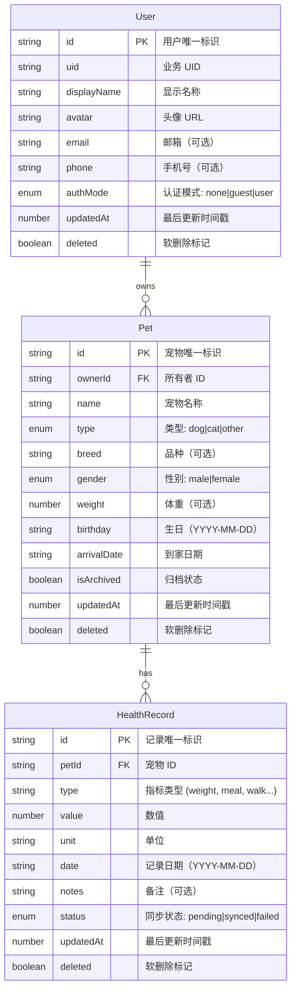
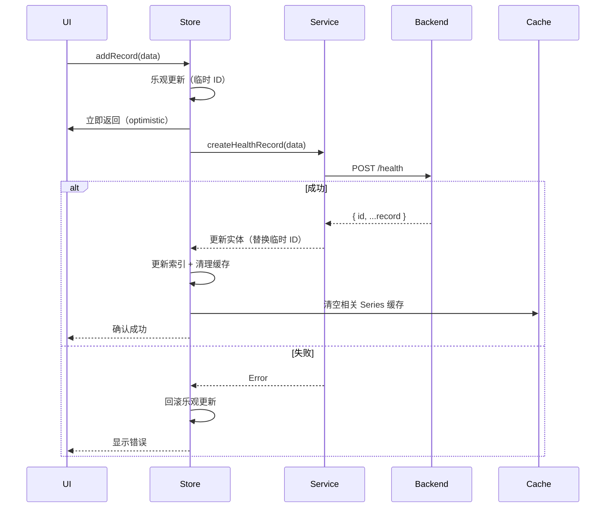

# 数据层

> **文档版本**: v1.0  
> **最后更新**: 2025-12-18  
> **责任范围**: 数据模型、生命周期、一致性策略、统计聚合

---

## 1. 数据模型（Data Models）

### 1.1 核心实体 ER 图



---

### 1.2 Schema 定义与约束

#### 1.2.1 User Schema

```typescript
interface AccountInfo {
    id: string;              // 主键，全局唯一
    uid: string;             // 业务 UID，用于展示
    displayName: string;     // 显示名称，必填
    avatar: string;          // 头像 URL
    email?: string | null;   // 邮箱，可选，需唯一索引
    phone?: string | null;   // 手机号，可选，需唯一索引
    gender?: 'male' | 'female' | null;
    theme?: 'light' | 'dark' | null;
    isVip?: boolean | null;
    updatedAt: number;       // 时间戳（毫秒）
    deleted?: boolean;       // 软删除标记，默认 false
}
```

**约束与索引**:
- **主键**: `id` (UUID)
- **唯一索引**: `email`, `phone` (when not null)
- **复合索引**: `(deleted, updatedAt)` 用于增量同步查询
- **字段验证**:
  - `displayName`: 长度 1-50 字符
  - `email`: 符合邮箱格式
  - `phone`: 符合手机号格式

---

#### 1.2.2 Pet Schema

```typescript
interface Pet {
    id: string;              // 主键，全局唯一
    ownerId?: string | null; // 外键，关联 User.id
    name: string;            // 宠物名称，必填
    type: 'dog' | 'cat' | 'other'; // 类型枚举
    breed?: string | null;   // 品种
    gender?: 'male' | 'female' | null;
    weight?: number | null;  // 体重（kg）
    birthday?: string | null; // 生日（YYYY-MM-DD）
    birthTimestamp?: number | null;
    arrivalDate?: string | null; // 到家日期
    arrivalTimestamp?: number | null;
    chipId?: string | null;  // 芯片号
    isArchived?: boolean | null; // 归档标记
    isSterilized?: boolean | null; // 绝育标记
    updatedAt: number;       // 时间戳（毫秒）
    deleted?: boolean;       // 软删除标记
}
```

**约束与索引**:
- **主键**: `id` (UUID)
- **外键**: `ownerId` → `User.id` (ON DELETE SET NULL)
- **复合索引**: 
  - `(ownerId, deleted, isArchived)` 用于查询用户的活跃宠物
  - `(updatedAt, deleted)` 用于增量同步
- **字段验证**:
  - `name`: 长度 1-50 字符
  - `weight`: 0.1-200 kg
  - `chipId`: 唯一索引（when not null）

---

#### 1.2.3 HealthRecord Schema

```typescript
interface HealthRecord {
    id: string;              // 主键，全局唯一
    petId: string;           // 外键，关联 Pet.id，必填
    type: string;            // 指标类型（weight, meal, walk...）
    value: number;           // 数值
    unit: string;            // 单位（kg, g, ml, steps...）
    date: string;            // 记录日期（YYYY-MM-DD）
    notes?: string | null;   // 备注
    source?: string | null;  // 数据来源（manual, device, sync）
    status?: 'pending' | 'synced' | 'failed' | null;
    label?: string | null;   // 显示标签
    emoji?: string | null;   // 图标
    gridValue?: number | null; // Grid 展示值
    metadata?: Record<string, any>; // 扩展元数据
    updatedAt: number;       // 时间戳（毫秒）
    deleted?: boolean;       // 软删除标记
}
```

**约束与索引**:
- **主键**: `id` (UUID)
- **外键**: `petId` → `Pet.id` (ON DELETE CASCADE)
- **复合索引**:
  - `(petId, type, date DESC)` 用于按宠物和类型查询历史
  - `(petId, date DESC)` 用于时间序列查询
  - `(type, date DESC)` 用于趋势分析
  - `(updatedAt, deleted)` 用于增量同步
- **字段验证**:
  - `type`: 必须在预定义的 `metricKey` 列表中
  - `value`: 根据 `type` 动态验证范围
  - `date`: 格式 YYYY-MM-DD，不能早于宠物出生日期

---

### 1.3 指标领域模型

#### 1.3.1 指标分类与聚合策略

```typescript
type MetricDomain = 
  | 'snapshot'     // 快照型：体重、体温、心率
  | 'cumulative'   // 累积型：步数、饮水、热量
  | 'continuous'   // 连续型：监测指标
  | 'enum';        // 离散型：排泄、情绪

type AggregationMethod = 'sum' | 'avg' | 'latest' | 'max' | 'min';

// 指标配置示例
const metricConfig = {
  weight: {
    domain: 'snapshot',
    aggregation: 'latest',
    missingPolicy: 'null',  // 数据缺失时图表断开
    unit: 'kg'
  },
  meal: {
    domain: 'cumulative',
    aggregation: 'sum',
    missingPolicy: 'zero',  // 数据缺失时填充 0
    unit: 'g'
  }
};
```

#### 1.3.2 时间范围类型

```typescript
// 自然周期（按日历边界对齐）
type NaturalPeriod = 'day' | 'week' | 'month' | 'six_month' | 'year';

// 滚动窗口（从今天往前推 N 天）
type RollingWindow = 'last7d' | 'last30d' | 'last40w' | 'last12m';

// 聚合粒度
type MetricBucket = 'day' | 'calendarWeek' | 'calendarMonth';
```

---

## 2. 数据生命周期（Data Lifecycle）

### 2.1 创建流程（Create）



**关键点**:
- **乐观更新**: 先更新本地状态，提升 UI 响应速度
- **幂等键**: 使用客户端生成的 `clientId` + `timestamp` 作为幂等键，防止重复提交
- **回滚机制**: 失败时自动回滚本地状态

---

### 2.2 更新流程（Update）

**更新策略**:
1. **增量更新**: 只发送变更字段 (`Partial<T>`)
2. **版本控制**: 使用 `updatedAt` 时间戳检测冲突
3. **冲突解决**: "最后写入胜利"（LWW）策略，服务端比较 `updatedAt`

```typescript
// 示例：更新宠物信息
async updatePet(id: string, data: Partial<Pet>) {
  // 1. 乐观更新本地
  const oldData = entities.value[id];
  entities.value[id] = { ...oldData, ...data, updatedAt: Date.now() };
  
  try {
    // 2. 发送增量更新
    const updated = await petService.updatePet(id, data);
    
    // 3. 以服务端返回为准
    entities.value[id] = updated;
  } catch (error) {
    // 4. 回滚乐观更新
    entities.value[id] = oldData;
    throw error;
  }
}
```

---

### 2.3 删除流程（Delete）

**软删除 vs 硬删除**:

| 操作 | 方式 | 适用场景 | 数据保留 |
|------|------|----------|----------|
| 归档宠物 | 软删除 | `isArchived = true` | 永久保留 |
| 删除宠物 | 软删除 | `deleted = true` | 保留 30 天 |
| 删除记录 | 软删除 | `deleted = true` | 保留 30 天 |
| 完全删除 | 硬删除 | 用户主动永久删除 | 立即清除 |

**实现示例**:
```typescript
// 软删除：标记 deleted = true
async deleteRecord(id: string) {
  await healthService.updateHealthRecord(id, { deleted: true });
  removeFromIndex(id);      // 移除索引
  emitRecordChange(id);     // 通知依赖
}

// 硬删除：真正删除数据
async deletePetFully(id: string) {
  await petService.deletePet(id);  // 后端执行 DELETE
  delete entities.value[id];       // 清除本地实体
  ids.value = ids.value.filter(x => x !== id); // 清除索引
}
```

---

### 2.4 归档策略（Archive）

**归档触发条件**:
- 宠物离世或送养 → `isArchived = true`
- 超过 180 天未记录数据的宠物 → 自动建议归档
- 用户主动归档

**归档效果**:
- 不在活跃列表显示
- 数据完整保留，可随时恢复
- 不参与统计聚合（除非明确查询归档数据）

---

### 2.5 过期策略（Expiration）

#### 2.5.1 游客数据过期

```typescript
// 游客模式数据保留策略
const GUEST_DATA_RETENTION = {
  // 本地缓存保留 7 天
  localCache: 7 * 24 * 60 * 60 * 1000,
  
  // 服务端临时存储 30 天
  serverTemp: 30 * 24 * 60 * 60 * 1000,
  
  // 提示用户转正的时机
  upgradePrompt: 3 * 24 * 60 * 60 * 1000  // 3 天后提示
};

// 游客转正用户后数据迁移
async upgradeGuestToUser(email: string, password: string) {
  const guestToken = token.value;
  
  // 1. 注册新用户
  const { token: newToken, user } = await authService.register(email, password);
  
  // 2. 迁移游客数据到新用户
  await syncService.migrateGuestData(guestToken, newToken);
  
  // 3. 更新本地状态
  setToken(newToken, null);
  authMode.value = 'user';
  accountInfo.value = user;
}
```

#### 2.5.2 缓存过期策略

| 缓存类型 | TTL | 清理策略 |
|---------|-----|----------|
| Series 缓存 | 10 分钟 | 被动清理（读取时检查） |
| 图片缓存 | 7 天 | LRU + 定期清理 |
| 趋势缓存 | 实时 | 数据变更时立即清除 |
| 摘要缓存 | 1 小时 | 被动清理 |

```typescript
// Series 缓存过期检查
const SERIES_CACHE_TTL_MS = 10 * 60 * 1000; // 10 分钟

function isSeriesCacheExpired(cached: CachedSeries): boolean {
  return Date.now() - cached.updatedAt > SERIES_CACHE_TTL_MS;
}

// 使用示例
if (cached && !isSeriesCacheExpired(cached)) {
  return cached.data; // 返回缓存
}
// 缓存过期，重新获取
```

---

## 3. 一致性与幂等（Consistency & Idempotency）

### 3.1 幂等键设计

**目标**: 防止重复提交、网络重试导致的重复记录

#### 3.1.1 客户端幂等键生成

```typescript
// 幂等键生成策略
function generateIdempotencyKey(operation: string, data: any): string {
  // 方案1: 基于业务语义
  if (operation === 'addHealthRecord') {
    return `${data.petId}-${data.type}-${data.date}-${data.value}`;
  }
  
  // 方案2: 基于客户端 UUID + 时间戳
  const clientId = getDeviceId(); // 设备唯一标识
  const timestamp = Date.now();
  return `${clientId}-${operation}-${timestamp}`;
}

// 使用示例
const idempotencyKey = generateIdempotencyKey('addHealthRecord', recordData);
await healthService.createHealthRecord({
  ...recordData,
  metadata: { idempotencyKey }
});
```

#### 3.1.2 服务端幂等处理

```typescript
// 后端伪代码
async function createHealthRecord(data: HealthRecord) {
  const { idempotencyKey } = data.metadata || {};
  
  if (idempotencyKey) {
    // 检查是否已存在
    const existing = await db.findByIdempotencyKey(idempotencyKey);
    if (existing) {
      return existing; // 返回已有记录，不创建新记录
    }
  }
  
  // 创建新记录，并存储幂等键
  return await db.create(data);
}
```

---

### 3.2 重试机制

**重试策略**: 指数退避 + 最大重试次数

```typescript
async function retryableRequest<T>(
  fn: () => Promise<T>,
  options = { maxRetries: 3, baseDelay: 1000 }
): Promise<T> {
  let attempt = 0;
  
  while (attempt < options.maxRetries) {
    try {
      return await fn();
    } catch (error) {
      attempt++;
      
      // 非重试错误直接抛出
      if (!isRetryableError(error) || attempt >= options.maxRetries) {
        throw error;
      }
      
      // 指数退避
      const delay = options.baseDelay * Math.pow(2, attempt - 1);
      await sleep(delay);
    }
  }
  
  throw new Error('Max retries exceeded');
}

// 可重试的错误类型
function isRetryableError(error: any): boolean {
  const retryableStatusCodes = [408, 429, 500, 502, 503, 504];
  return retryableStatusCodes.includes(error.statusCode);
}
```

---

### 3.3 去重策略

#### 3.3.1 客户端去重

```typescript
// Store 层去重：基于业务语义
function isDuplicate(newRecord: HealthRecord): boolean {
  const existing = metricIndex.value[newRecord.type] || [];
  
  return existing.some(id => {
    const record = entities.value[id];
    return (
      record.petId === newRecord.petId &&
      record.type === newRecord.type &&
      record.date === newRecord.date &&
      Math.abs(record.value - newRecord.value) < 0.01 // 浮点误差容忍
    );
  });
}

// 添加记录前检查
async addRecord(record: Partial<HealthRecord>) {
  if (isDuplicate(record as HealthRecord)) {
    console.warn('Duplicate record detected, skipping');
    return;
  }
  // ... 继续创建
}
```

#### 3.3.2 服务端去重

- **唯一索引**: 对于唯一性约束强的数据（如 `chipId`、`email`），使用数据库唯一索引
- **业务去重**: 对于复合唯一性（如同一天同一宠物的体重记录），在业务层检查

---

### 3.4 冲突解决（多端同步）

**冲突场景**:
- 用户在设备 A 修改了宠物名称
- 同时在设备 B 也修改了宠物名称
- 两次修改同时到达服务端

**解决策略**: **Last-Write-Wins (LWW)**

```typescript
// 服务端冲突解决逻辑
async function updatePet(id: string, incoming: Partial<Pet>) {
  const current = await db.findById(id);
  
  // 比较 updatedAt 时间戳
  if (incoming.updatedAt && incoming.updatedAt <= current.updatedAt) {
    // 来自过去的更新，拒绝
    throw new ConflictError('Stale update, please refresh');
  }
  
  // 接受更新
  return await db.update(id, {
    ...incoming,
    updatedAt: Date.now() // 服务端时间为准
  });
}
```

**客户端处理**:
```typescript
// 更新失败时，拉取最新数据并重新合并
try {
  await petStore.updatePet(id, changes);
} catch (error) {
  if (error.code === 'CONFLICT') {
    // 拉取最新数据
    await petStore.fetchPets();
    
    // 提示用户重新编辑
    uni.showModal({
      title: '数据已更新',
      content: '其他设备修改了该宠物，请重新编辑'
    });
  }
}
```

---

## 4. 统计与聚合（Statistics & Aggregation）

### 4.1 指标口径定义

#### 4.1.1 核心指标及其计算方式

| 指标名称 | 口径定义 | 计算方式 | 采样窗口 |
|---------|---------|---------|---------|
| **体重趋势** | 最近 7 天的体重记录 | 每天取最后一条记录 | 滚动 7 天 |
| **饮食总量** | 每日进食总克数 | 当天所有 meal 记录求和 | 自然日 |
| **步数统计** | 每日步数 | 当天所有 walk 记录求和 | 自然日 |
| **用户统计** | 记录总天数 | 去重后的 date 字段计数 | 全生命周期 |
| **平均体重** | 最近 30 天平均体重 | 每天最后一条记录的平均值 | 滚动 30 天 |

---

#### 4.1.2 指标详细定义

**示例：体重趋势**

```typescript
// 口径名称：体重趋势（7 天滚动窗口）
// 指标键：weight_trend_7d
// 计算方式：每天取最后一条体重记录，绘制折线图
// 采样窗口：从今天往前推 7 天（含今天）
// 缺失值处理：null（图表断开）

async function getWeightTrend7d(petId: string) {
  const range = 'last7d';
  const bucket = 'day';
  
  return await healthService.getMetricSeries(petId, 'weight', range, bucket);
  // 返回: { points: [{ ts, value }], stats: { min, max, avg } }
}
```

---

### 4.2 计算方式

#### 4.2.1 客户端聚合（已优化）

**优化前**: 在主线程遍历所有记录进行聚合 → 100-200ms 延迟  
**优化后**: 使用预建索引 + 服务端聚合

```typescript
// ❌ 旧方式：O(N) 扫描
const weightRecords = healthRecords.value.filter(r => r.type === 'weight');

// ✅ 新方式：O(1) 索引查询
const weightRecordIds = metricIndex.value['weight'] || [];
const weightRecords = weightRecordIds.map(id => entities.value[id]);
```

#### 4.2.2 服务端聚合（推荐）

```typescript
// API: GET /health/series
// 参数: { petId, metricKey, range, bucket }
// 返回: 预聚合的时间序列数据

interface MetricSeriesResponse {
  metric: string;
  bucket: 'day' | 'calendarWeek' | 'calendarMonth';
  range: string;
  points: Array<{ ts: number; value: number | null }>;
  stats: {
    min: number;
    max: number;
    avg: number;
    latest?: number;
    count: number;
  };
}
```

**优势**:
- 减少客户端计算负担
- 统一口径，避免多端计算差异
- 支持复杂聚合（分位数、标准差等）

---

### 4.3 采样窗口

#### 4.3.1 时间窗口类型

```typescript
// 自然周期（按日历边界）
const naturalPeriods = {
  day: '当天 00:00 ~ 23:59:59',
  week: '周一 00:00 ~ 周日 23:59:59 (ISO 8601)',
  month: '月初 00:00 ~ 月末 23:59:59',
  six_month: '当月及前 5 个自然月',
  year: '当月及前 11 个自然月'
};

// 滚动窗口（从今天往前推）
const rollingWindows = {
  last7d: '含今天的过去 7 天',
  last30d: '含今天的过去 30 天',
  last40w: '含本周的过去 40 周',
  last12m: '含本月的过去 12 个月'
};
```

#### 4.3.2 窗口选择建议

| 场景 | 推荐窗口 | 理由 |
|------|---------|------|
| 体重趋势 | `last7d` | 短期变化敏感 |
| 饮食统计 | `week` | 按自然周统计更符合习惯 |
| 长期趋势 | `last40w` | 平滑波动，看长期趋势 |
| 年度报告 | `year` | 自然年度对齐 |

---

### 4.4 口径变更流程

**场景**: 需要修改指标计算方式，如"体重趋势改为取每天平均值而非最后一条"

#### 4.4.1 变更流程


#### 4.4.2 版本控制

```typescript
// 在 shared/types/health.ts 中定义
export const HEALTH_CACHE_SCHEMA_VERSION = 3;

// 缓存条目包含版本号
interface CacheEntry<T> {
  data: T;
  updatedAt: number;
  schemaVersion: number;  // 版本不匹配时自动清空
}

// 读取缓存时校验版本
function validateCacheVersion(entry: CacheEntry<any>): boolean {
  return entry.schemaVersion === HEALTH_CACHE_SCHEMA_VERSION;
}
```

#### 4.4.3 变更公告模板

```markdown
## 指标口径变更公告

**变更日期**: 2025-12-18  
**影响指标**: 体重趋势 (weight_trend_7d)  
**变更内容**: 每天取平均值 → 每天取最后一条记录  
**变更原因**: 用户反馈平均值不能反映当前状态  
**影响范围**: 
- 前端 Summary 页面体重卡片
- 后端 /health/series API
**迁移计划**: 
1. 2025-12-18 更新后端逻辑
2. 2025-12-19 更新前端代码，清空缓存
3. 2025-12-20 上线验证
```

---

## 5. 性能优化策略

### 5.1 索引优化

```typescript
// metricIndex: 指标键 -> 记录 ID 列表
const metricIndex = ref<Record<string, string[]>>({
  weight: ['rec1', 'rec2', 'rec3'],
  meal: ['rec4', 'rec5'],
  // ...
});

// 构建索引（初始化时）
function buildMetricIndex() {
  const index: Record<string, string[]> = {};
  ids.value.forEach(id => {
    const record = entities.value[id];
    if (!index[record.type]) index[record.type] = [];
    index[record.type].push(id);
  });
  metricIndex.value = index;
}

// 增量更新索引（添加记录时）
function updateMetricIndex(record: HealthRecord) {
  if (!metricIndex.value[record.type]) {
    metricIndex.value[record.type] = [];
  }
  metricIndex.value[record.type].push(record.id);
}
```

---

### 5.2 缓存分层

```typescript
// 三层缓存架构
const cacheLayers = {
  // L1: 内存缓存（响应式数据）
  memory: {
    entities: shallowRef<Record<string, HealthRecord>>({}),
    metricIndex: shallowRef<Record<string, string[]>>({})
  },
  
  // L2: 本地持久化缓存（Pinia persist）
  persistent: {
    ids: ['rec1', 'rec2'],
    entities: { rec1: {...}, rec2: {...} },
    lastUpdated: 1734480000000
  },
  
  // L3: 服务端缓存（Redis / CDN）
  server: {
    seriesCache: { key: 'weight-last7d', ttl: 600 }
  }
};
```

---

### 5.3 数据持久化配置

```typescript
// Pinia 持久化策略（各 Store 配置）
const persistConfigs = {
  userStore: {
    paths: ['authMode', 'token', 'tokenExpiresAt', 'accountInfo']
  },
  petStore: {
    persist: true  // 全量持久化
  },
  healthEntityStore: {
    pick: ['ids', 'entities', 'lastUpdated']  // 选择性持久化
  },
  healthStore: {
    pick: ['ids', 'entities', 'lastUpdated', 'metricIndex']
  },
  preferenceStore: {
    paths: ['theme', 'language', 'chartRange']
  },
  imageCacheStore: {
    pick: ['imageMap', 'indexByDate', 'lruQueue']
  }
};
```

---

## 6. 数据安全与隐私

### 6.1 数据加密

- **传输加密**: 所有 API 请求使用 HTTPS
- **存储加密**: 敏感字段（如 `email`, `phone`）在数据库层加密
- **Token 安全**: JWT Token 存储在安全存储（Keychain/EncryptedSharedPreferences）

---

### 6.2 数据权限

```typescript
// 权限检查示例
function canAccessPet(userId: string, petId: string): boolean {
  const pet = petStore.pets.find(p => p.id === petId);
  return pet?.ownerId === userId;
}

function canAccessHealthRecord(userId: string, recordId: string): boolean {
  const record = healthEntityStore.entities[recordId];
  const pet = petStore.pets.find(p => p.id === record.petId);
  return pet?.ownerId === userId;
}
```

---

### 6.3 数据导出与删除

**用户权利**:
- **导出数据**: 支持导出 JSON / CSV 格式的完整数据
- **删除数据**: 支持永久删除账户及所有关联数据（符合 GDPR）

```typescript
// 导出数据示例
async function exportUserData(userId: string) {
  const user = await userService.getProfile(userId);
  const pets = await petService.getPets();
  const records = await healthService.getHealthRecords();
  
  return {
    user,
    pets,
    healthRecords: records,
    exportedAt: new Date().toISOString()
  };
}
```

---

## 7. 附录

### 7.1 数据字典

**完整字段说明请参考**:
- [`shared/types/user.ts`](file:///Users/zhengjiyuan/Desktop/iPet/shared/types/user.ts)
- [`shared/types/pet.ts`](file:///Users/zhengjiyuan/Desktop/iPet/shared/types/pet.ts)
- [`shared/types/health.ts`](file:///Users/zhengjiyuan/Desktop/iPet/shared/types/health.ts)

### 7.2 相关文档

- [产品与业务层](file:///Users/zhengjiyuan/Desktop/iPet/iPet-uniapp/docs/产品与业务层.md)
- [架构与代码组织层](file:///Users/zhengjiyuan/Desktop/iPet/iPet-uniapp/docs/架构与代码组织层.md)

### 7.3 更新日志

| 日期 | 版本 | 变更内容 |
|------|------|---------|
| 2025-12-18 | v1.0 | 初始版本，包含数据模型、生命周期、一致性策略、统计聚合 |

---

**维护责任人**: 开发团队  
**审核周期**: 每季度一次  
**问题反馈**: 请提交到项目 Issue Tracker
